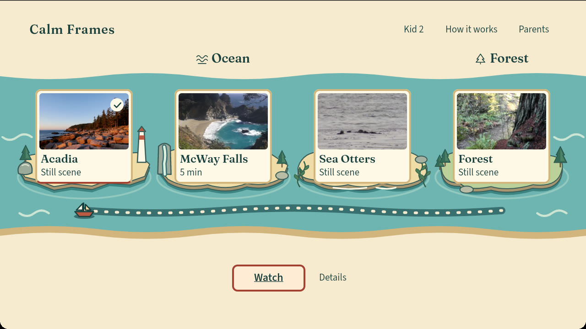
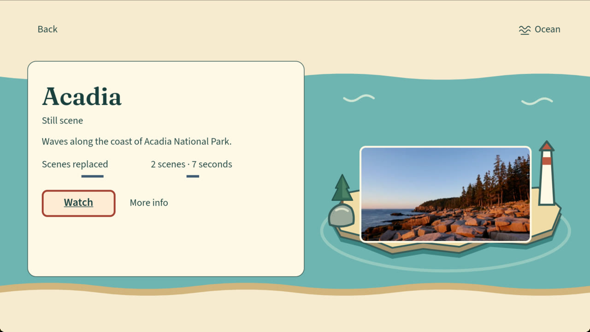
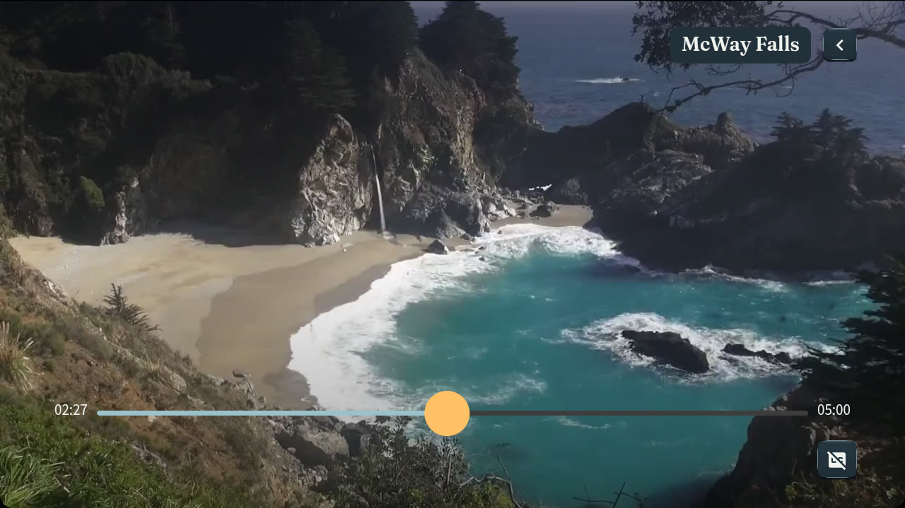

# Calm Frames 🌊

**A standalone Fire TV prototype designed with people with photosensitive epilepsy in mind.**

[](app/)
[](.nvmrc)
[](.python-version)
[](LICENSE)

Calm Frames combines prepared nature content with offline flash analysis, signed media maps and guarded playback. Its coastal, remote-first interface makes browsing and playback deliberate. These mechanisms do not establish medical safety, prevent seizures or guarantee individual comfort. Calm Frames is not a medical device.

**Playback scope:** this app plays its own prepared catalog. It is not integrated with Prime Video, Netflix, live TV or third-party playback. A reusable hook is available separately; it is not evidence that another app uses it.

Choose Acadia, McWay Falls, Sea Otters or Forest, inspect the title, and decide when to watch. McWay Falls offers five continuous minutes of a fixed coastal view at natural speed, then holds the final frame until you leave. The other titles open as still scenes, with short moving previews available separately.

**Current development:** the [native handoff `37d10c2`](START_HERE_CODEX.md) supplies installed-source `fbe53bf` evidence and the accepted disclaimer. Newer D1/D2/D3 and coastal background fixes still need native confirmation. Continuation through `5bd9f6c4cdc6b8ea4b9427270810cd5de2c78b53` adds robust caregiver review handling and an [actual file-to-review browser walkthrough](docs/cloud-deliverables-2026-10-25/README.md). Native app source and dependencies are unchanged from `67e10f0`; Audit still fails with four advisories. The [20-item checklist](docs/cloud-integration-2026-10-23/CHECKPOINT.md) remains 6 complete, 12 partial and 2 blocked.

**Evidence and demo:** the gallery below contains unmodified native review copies of **fbe53bf**, before the latest fixes. The [published demo](https://www.youtube.com/watch?v=6lAP1FH16vc) and [Devpost entry](https://devpost.com/software/calm-frames) remain the earlier submitted fallback. Native replacement footage, manga and ElevenLabs narration are pending. The separate caregiver browser recording is identified above. No current hosted CI or human audiovisual acceptance is claimed.



<p align="center">
  
  
</p>

<p align="center"><em>Actual native captures of fbe53bf, with a fictional profile. These do not show the newer focus, pause or background fixes. <a href="docs/presentation/README.md">Capture provenance and limits</a>.</em></p>

<details>
<summary><strong>Historical ending evidence: the final frame stays</strong></summary>


This older native view records the explicit stationary ending, not an endless video loop. Its [original provenance](docs/presentation/README.md#build-and-publication-status) remains available. A still image cannot verify the complete audio fade or current-build timing.

</details>

McWay imagery: MoneySavingVideos, [CC BY 3.0](https://creativecommons.org/licenses/by/3.0/). [Capture scope and full credits](docs/presentation/README.md). No screenshot was generated, recolored or presented as the new build.

## Features

- **A connected coastal world.** Four distinct destination islands share the same map, typography, warm surfaces and obvious remote focus across Home, Details and loading.
- **Sustained viewing with a deliberate ending.** McWay runs at natural speed with no cuts or repeated loop. Its final frame stays open; the other approved titles offer silent still scenes first.
- **Playback starts with a choice.** Watch is the primary action. Pause, resume and Back remain available; short previews are secondary actions.
- **Prepared media with traceable identity.** Offline analysis, signed maps, exact source and rendition hashes, and verification reports travel with each approved edition.
- **A guarded playback path.** The picture stays covered while verification is unresolved. Scheduled covers and seek guards are driven by the accepted map and household settings.
- **Local household preferences.** PIN-protected settings, presets, captions and stricter cover choices are stored on the device. Optional interface motion respects reduced motion.
- **Names for individual kids.** Inside unlocked Parents, a remote letter grid edits a kid's name while preserving profile identity, preferences and saved positions. Save waits for the storage result; Cancel and Back discard an unfinished edit. Input currently supports letters and spaces. [Implementation, native observations and remaining gaps](docs/design-polish-2026-10-23/FABLE_INTEGRATION.md).
- **Optional larger help text.** Each kid can use Reading comfort in Parents and More info. It defaults off and saves per profile; it does not change protection, player controls or captions. [Received native observations and the pending focus correction](docs/cloud-followup-2026-10-25/NATIVE_VERIFICATION.md).
- **Caregiver file pre-check.** A separate [local browser workflow](docs/overnight-2026-10-25/personal-import/README.md) analyzes an eligible personal MP4 without playing it. It requires processing permission and exports a report bound to the file. It does not remove DRM, certify rights or automatically add a title to the TV catalog.
- **Tools beyond the demo.** The [flashmap analyzer](flashmap/README.md), [Vega hook](hook/README.md) and [local preparation workflow](pipeline/LOCAL_LIBRARY.md) expose the underlying work separately.

## Architecture


[Readable diagram source and code map](docs/presentation/ARCHITECTURE.md) · [Vector version](docs/presentation/architecture.svg)

The preparation and playback boundaries matter:

1. **Prepare before playback.** `pipeline.local_library` coordinates ingest, flashmap analysis, signed maps and preset rendering. `pipeline.verify` checks the actual outputs. Ambient replacements have a separate checked export path.
2. **Bind trust to exact artifacts.** `pipeline.packaged_library` exports verified editions; app build checks enforce the compiled approval registry, reports and media budget. A file URL cannot introduce a new trusted signer.
3. **Verify again at the player.** `packagedLibrary.ts` matches the compiled catalog and route; `flashMap.ts` verifies the signed map. `useFlashGuard.ts` owns cover scheduling and the guarded seek entry point.
4. **Keep the ending explicit.** `continuousScene.ts` recognizes the exact McWay edition. `PlayerScreen.tsx` presents its final still through `AmbientScene.tsx` after playback ends, without automatic repeat or navigation.

This app plays its prepared catalog. It does not intercept Prime Video, other apps, or arbitrary streaming content.

<details>
<summary>Code paths behind the diagram</summary>

### Required tech at runtime

The installed app uses Vega's W3C media player. The remaining rows distinguish local preparation from runtime verification; they are code references, not extra hackathon requirements. Symbol names accompany line links so they remain checkable on this branch.

| Stage | Entry point | Responsibility |
|---|---|---|
| Native playback | `new VideoPlayer()` [source](app/src/utils/VideoHandler.ts#L157) | Create the Vega player |
| Runtime map | `verifyFlashMap` [source](app/src/calmframes/flashMap.ts#L217) | Check signed map identity and validity |
| Runtime catalog | `createPackagedLibrary` [source](app/src/calmframes/packagedLibrary.ts#L218) | Bind the packaged route and evidence |
| Runtime coverage | `useFlashGuard` [source](app/src/calmframes/useFlashGuard.ts#L159) | Coordinate cover state and player clock |
| Runtime seeking | `planSeek` [source](app/src/calmframes/seekSafety.ts#L113) | Plan a seek against covered intervals |
| Runtime ending | `continuousEndingForRoute` [source](app/src/calmframes/continuousScene.ts#L23) | Recognize the exact continuous edition |
| Offline preparation | `ingest_title` [source](pipeline/ingest.py#L212) | Orchestrate preparation |
| Offline verification | `verify_title` [source](pipeline/verify.py#L485) | Check actual output against its source |
| Offline package | `export_packaged_library` [source](pipeline/packaged_library.py#L437) | Export verified editions and reports |
| Offline replacement | `export_ambient_catalog` [source](pipeline/ambient_export.py#L24) | Independently reproduce replacement media |

</details>

## Engineering decisions

- **Long scenes over a short reel.** The original short-preview experience was rejected as uncomfortable and too brief. The current McWay edition uses one sustained camera view; legacy titles remain stationary by default. This design change is not a guarantee of individual comfort.
- **Integrity is separate from detection.** A valid signature establishes which map was approved. It does not establish medical safety or prove the analyzer found every issue.
- **Covers precede seeks.** Transport changes go through a shared guard rather than independent player writes. The native video surface is covered with an opaque layer, not hidden by changing its opacity.
- **Source tests are separate from native evidence.** Unit tests establish state contracts. Package verification establishes shipped bytes. Native observations establish only the specific interactions and images observed on that device.

## Tech stack

| Layer | Implementation |
|---|---|
| TV app | React Native, TypeScript, Vega OS and Amazon W3C media APIs |
| Design | Fraunces titles, Source Sans 3 controls, shared coastal geometry and focus tokens |
| Analysis | Python, flashmap, PyAV and ffmpeg |
| Preparation | Preset rendering, source/rendition hashes, Ed25519-signed maps and verification reports |
| Playback | Compiled catalog, map verification, cover scheduler and guarded seek engine |
| Checks | Jest, TypeScript, ESLint, Node checks, pytest and strict package validation |

## Running locally

Use the separate review worktree and verified source bundle in the [current native handoff](docs/cloud-followup-2026-10-25/NATIVE_VERIFICATION.md). The review branch is local; cloning an older remote branch does not reproduce it. These commands assume you are already in that worktree. Compare its full SHA with the transfer manifest before installing dependencies or building.

```sh
git rev-parse HEAD
git status --short
```

### App checks without a simulator

Use Node 22 from `.nvmrc` and the checked-in dependency lock.

```sh
cd app
npm ci --ignore-scripts
# Restore the transfer's verified player inputs as documented below,
# or run npm run setup:player with JDK 21 configured.
npm run check:native-inputs
npm run typecheck
npm run lint
npm test -- --runInBand --ci
```

### Native build and launch

Requires an existing Vega SDK installation, Node 22 and JDK 21. The bundled catalog needs no signing private key or cloud account. A fresh household chooses its own PIN.

```sh
# From the repository root, with Node 22 selected:
# Load the existing Vega SDK environment and verified JDK 21.
# See the current native handoff; the Mac default selector previously chose Java 8.
java -version
cd app
npm ci --ignore-scripts
npm run setup:player
npm run check:native-inputs
npm run build:debug
cd ..
```

For an Apple Silicon Mac, install the resulting aarch64 package. Start the virtual device only if it is stopped.

```sh
nohup vega virtual-device start > /tmp/calm-frames-vvd.log 2>&1 < /dev/null &
vega device is-connected --device VirtualDevice
vega device install-app --device VirtualDevice \
  --packagePath app/build/aarch64-debug/calm-frames-app_aarch64.vpkg --buildType Debug
vega device run-cmd --device VirtualDevice \
  --command 'vmsgr send pkg://io.github.alejandropublius.calmframes.main'
```

Intel targets need the matching x86_64 package. [Reviewer quickstart](docs/submission/REVIEWER_QUICKSTART.md) covers the environment and inspection commands; its dated historical receipts are not current build acceptance.

### Analyzer and pipeline checks

With Python 3.12, ffmpeg and ffprobe already available:

```sh
python3.12 -m venv .venv
.venv/bin/python -m pip install -e './flashmap[dev]' matplotlib==3.11.2
.venv/bin/python -m pytest flashmap pipeline eval -q -m 'not slow'
.venv/bin/python eval/readme_sync.py --check
.venv/bin/python eval/style_check.py
```

### Personal-file pre-check

After installing the Python environment and FFmpeg, run the loopback caregiver
page with a private review directory outside the checkout:

```sh
PYTHONPATH=flashmap/src:. .venv/bin/python -m pipeline.local_intake serve \
  --root "$HOME/CalmFramesLocalReview" --port 8766
```

Open `http://127.0.0.1:8766` on that computer. The page states its supported
formats and limits, shows progress, and provides **Save caregiver review (JSON)**.
It never plays the original. The [guide](docs/overnight-2026-10-25/personal-import/README.md)
covers cancellation, resuming review and removal of the tool's copy.

New media follows the [local library workflow](pipeline/LOCAL_LIBRARY.md).
Preparing a candidate does not automatically add it to the app or expand signer
trust. This is a caregiver computer workflow, not a native TV file picker.

## Evidence and limits

These are recorded results with separate scopes, not a claim that the latest local revision has a green hosted CI run.

| Scope | Recorded result | Evidence |
|---|---|---|
| Integration branch, cloud session, October 23 | <!--n results/integration-2026-10-23/receipt.json:app.jest_passed -->1801<!--/n--> Jest tests passed, <!--n results/integration-2026-10-23/receipt.json:app.jest_skipped -->4<!--/n--> skipped; <!--n results/integration-2026-10-23/receipt.json:python.passed -->2001<!--/n--> Python tests passed, <!--n results/integration-2026-10-23/receipt.json:python.failed -->1<!--/n--> failed only because the container runs as root (it passes as an unprivileged user); TypeScript, lint and the app's own flash check passed. No simulator here; hosted CI runs through draft PR #2 | [Receipt](results/integration-2026-10-23/receipt.json), [integration status](docs/handoff-2026-10-23/INTEGRATION_STATUS.md) |
| Full source baseline before the ending-bounds fix | <!--n results/mcway-activation-2026-10-21/verification.json:sourceChecks.fullJestPassed -->1698<!--/n--> Jest tests passed, <!--n results/mcway-activation-2026-10-21/verification.json:sourceChecks.skipped -->4<!--/n--> skipped; TypeScript passed; lint <!--n results/mcway-activation-2026-10-21/verification.json:sourceChecks.eslintErrors -->0<!--/n--> errors / <!--n results/mcway-activation-2026-10-21/verification.json:sourceChecks.eslintWarnings -->108<!--/n--> warnings | [Source receipt](results/mcway-activation-2026-10-21/verification.json), [Jest log](results/mcway-activation-2026-10-21/final-jest.log) |
| Additional preparation and delivery checks | <!--n results/mcway-activation-2026-10-21/verification.json:sourceChecks.nodeChecksPassed -->94<!--/n--> Node checks and <!--n results/mcway-activation-2026-10-21/verification.json:sourceChecks.pythonDeliveryAndBudgetPassed -->121<!--/n--> Python delivery/budget checks passed | [Recorded verification](results/mcway-activation-2026-10-21/verification.json) |
| Latest local ending fix | Targeted ending tests, TypeScript and focused lint passed; native package built and installed | [Exact build and capture record](docs/presentation/README.md#build-and-publication-status) |
| Native observations | Full-duration playback, pause/resume and Back observed; corrected final-frame bounds inspected in the actual app | [Native screenshots and limits](docs/presentation/README.md#what-the-images-establish) |
| Prepared media budget | <!--n results/mcway-activation-2026-10-21/verification.json:preparedNamespaceBytes -->129255687<!--/n--> of <!--n results/mcway-activation-2026-10-21/verification.json:limitBytes -->134217728<!--/n--> bytes | [Exact activated bundle](results/mcway-activation-2026-10-21/verification.json) |

The older activation receipt's “not installed / Mac locked” note describes that earlier checkpoint. The linked current capture record documents the later installation and picture observations without rewriting the historical receipt.

**Still open:** the [current checklist](docs/cloud-integration-2026-10-23/CHECKPOINT.md) retains native/layout/comfort acceptance, unresolved dependency policy and missing current demo inputs. Any later Devpost or video replacement requires a permitted, explicit publication decision; existing submitted materials remain frozen. Physical Fire TV measurements and full VoiceView acceptance are not claimed. Analyzer passes and simulator observations do not establish clinical safety. Calm Frames is not a medical device.

<details>
<summary>Historical screening corpus, separate from the shipped catalog</summary>

This September 17, 2026 WCAG screening run measures detector findings, not clinical safety, viewing comfort or current catalog approval. The complete per-source file counts below add up to <!--n results/screening.json:clips_analyzed_ok -->38<!--/n--> analyzed files. See [raw screening results](results/screening.json) for findings and scope. Hazardous research sources are not linked for playback here.

| Source group | Files |
|---|---|
| 1930 public-domain film | <!--n results/screening.json:per_source.1930 public-domain film.files -->2<!--/n--> |
| Blender open movies | <!--n results/screening.json:per_source.Blender open movies.files -->3<!--/n--> |
| DVIDS | <!--n results/screening.json:per_source.DVIDS.files -->2<!--/n--> |
| NASA ISS time-lapse | <!--n results/screening.json:per_source.NASA ISS time-lapse.files -->3<!--/n--> |
| NASA SVS 5011 | <!--n results/screening.json:per_source.NASA SVS 5011.files -->1<!--/n--> |
| Wikimedia Commons | <!--n results/screening.json:per_source.Wikimedia Commons.files -->16<!--/n--> |
| Wikimedia Commons fireworks | <!--n results/screening.json:per_source.Wikimedia Commons fireworks.files -->4<!--/n--> |
| Wikimedia Commons lightning | <!--n results/screening.json:per_source.Wikimedia Commons lightning.files -->4<!--/n--> |
| unlabeled | <!--n results/screening.json:per_source.unlabeled.files -->3<!--/n--> |

</details>

## Media attribution and license

McWay footage and extracted still: **MoneySavingVideos**, *♥♥ Relaxing 3 Hour Video of a Waterfall on an Ocean Beach at Sunset*, [source on Wikimedia Commons](https://commons.wikimedia.org/wiki/File:%E2%99%A5%E2%99%A5_Relaxing_3_Hour_Video_of_a_Waterfall_on_an_Ocean_Beach_at_Sunset.webm), [CC BY 3.0](https://creativecommons.org/licenses/by/3.0/). Changes: first five-minute excerpt, downsampled to 720p, H.264/AAC encoding, a three-second ending audio fade, and an extracted final-frame still. Repository screenshots crop the native app capture to its picture area. No endorsement implied.

Other visible title imagery: **NPS Video, Acadia National Park**; **NOAA Fisheries**; **NPS: G Litten** for Prairie Creek and Redwood. See the [media ledger](media/LICENSES.csv), [NOTICE](NOTICE) and [screenshot credits](docs/presentation/README.md#media-credits). No agency endorsement implied.

Project code is [Apache 2.0](LICENSE). Media, fonts and sample-derived components retain their respective licenses; see [app notices](app/LICENSE-THIRD-PARTY). The documentation layout takes inspiration from [Tideline](https://github.com/alejandro-publius/tideline); the screenshots, architecture and implementation described here are Calm Frames.
