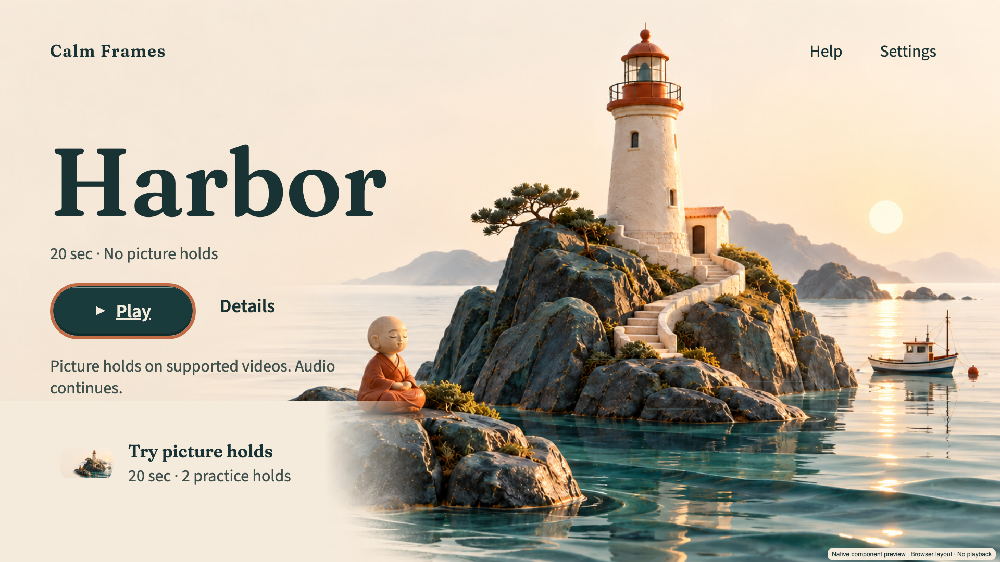
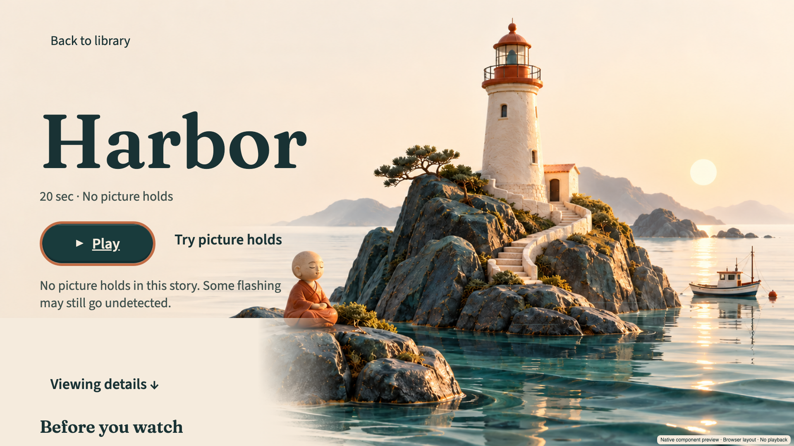

# Calm Frames

**A calmer way to watch**

[](https://github.com/alejandro-publius/calm-frames/actions/workflows/ci.yml)
[](https://github.com/alejandro-publius/calm-frames/actions/workflows/audit.yml)
[](LICENSE)
[](.python-version)
[](.nvmrc)

**Calm Frames checks every frame of a title before a child can pick it, and the Fire TV player hides each part it flags before it reaches the screen while sound and captions carry the story.**

Calm Frames reduces exposure to flashing above published limits in the videos it plays. It is not a medical device.



| Details |
|---|
|  |

<sub>Browser renders of the app's own React Native trees with the bundled fonts and artwork, exported from commit 819de40 ([render receipt](results/coastal-renders-2026-10-14/receipt.json)). They are review aids, not Vega screenshots; the native acceptance of this interface is in progress. The shelf holds two Harbors on purpose, one that plays straight through and one with two labelled practice holds, and the calm gradient is the playback test. The palette, type, contrast and motion rules are on [the design page](docs/design/README.md).</sub>

---

## What it is

Calm Frames combines an offline video analyzer, a checked rendition pipeline and a Vega player for families affected by photosensitivity. Before playback, the pipeline analyzes the source, signs its flash map and verifies the prepared rendition. The player adds a scheduled cover and guarded seeks, with audio and captions intended to preserve the story; signed context images, a checked still from before the hide shown in place of black, ship today only on the labelled Harbor demo, and every prepared title uses the opaque cover. Parent settings can make the standard floor stricter and now persist locally. A reusable hook and analyzer provide adoption paths for other developers. Detection, delivery integrity and physical screen behavior have separate limits, recorded below; a signature is not proof that every hazard was detected.

Why it is built this way, in one page: [WRITEUP.md](WRITEUP.md).

### What a family sees

The ivory and teal coast: a seated figure on a rock, a lighthouse island and a boat behind everything on Home, with text sized for a couch and a visible ring on whatever the remote has focused. Playback keeps dark controls over the video.

- **Home is one heading and two actions.** "Calm Frames" over the coast, a Play button with a triangle and a quiet Details action; How it works and Parents sit in the header, so the screen says who it is for without a paragraph. Details carries the facts: "Harbor" with "20 sec · No flashing found", one line saying it was checked frame by frame, the picture timeline, and the quiet Try picture holds entry beside Play, which opens the practice version, "20 sec · 2 practice holds".
- **A short setup, once.** A parent picks a four digit PIN, one of three presets (Standard, Broadcast, Extra cautious) and the room: the size of the television and how far away the children sit.
- **A library of checked titles only.** A title plays only after its flash map is verified; one that has not verified shows Needs check and stays hidden.
- **A card before anything is hidden.** A countdown with Skip in focus a few seconds ahead, and an optional chime.
- **The story keeps going.** During a hidden part a checked still from just before it, or a dark cover, stands over the picture while sound and captions continue; afterwards one line says what was hidden. The ordinary Harbor has nothing to hide and simply plays; the practice version holds twice so a family can see it work.
- **Settings behind the PIN.** Presets, the room, the chime, a profile per child (which can only be stricter than the household), and two opt-in effects, a gentle artwork entrance and quiet selection sounds, both Off unless a parent turns them on.
- **What it keeps stays on the television.** The household record (the salted hash of the PIN, the profiles, presets, room and switches) is saved on the device, and the list of what was hidden lives in memory only, so it is gone after a restart. A release build sends nothing about the household anywhere: its only network request fetches a flash map when a catalog entry names a web address, and the bundled titles name none.
- **Built for the remote and for screen readers.** The D-pad reaches every control, Back closes one level at a time, cards are announced, and reduced motion keeps the artwork still. VoiceView is covered by tests and still owes its check on the device.

### What it does underneath

- **Every frame is measured before a title can play** by [flashmap](flashmap/), against WCAG 2.2 SC 2.3.1's general and red flash rules, with the thresholds quoted from their sources in [SPEC_SOURCES.md](flashmap/docs/SPEC_SOURCES.md).
- **The flash map is signed** (Ed25519) and bound to the file's SHA-256, and **verify blocks publishing**: the pipeline renders a kid-safe rendition, and verify analyzes the whole rendition again and proves the cover is drawn at the first frame, the middle and the last frame of the first six covered spans of each preset.
- **The player fails closed.** A missing, stale, unsigned, unreadable or wrong-hash map keeps the picture hidden.
- **One function moves the playhead**, so every seek path is guarded; a lint rule refuses any other.
- **Adoptable by others**: a small hook for any Vega video app ([hook/](hook/)), the analyzer as a CLI and a GitHub Action, and a self-contained report page for a title.

### Try it in a minute

The analyzer runs on any machine with Python 3.12; PyAV brings its own FFmpeg. The clip is the project's own Harbor film under Apache-2.0, with generated artwork, animated water, original captions and synthesized ambience. The production source checks pass all three flash profiles.

```sh
python -m pip install -e 'flashmap[dev]'
python -m flashmap check app/assets/raw/benign-story/harbor.mp4 --profile wcag
python -m flashmap report app/assets/raw/benign-story/harbor.mp4 --out report.html --license-csv media/LICENSES.csv
```

The first prints `PASS`, the second writes one HTML page for the title that opens with the network off. The TV app itself needs the Vega SDK on a Mac; [Install and run](#install-and-run) has both.

### Where things stand

**Oct 14: the approved coast, and a candidate to accept.** Alex approved the ivory and teal coastal interface, and it is applied to every menu screen on `claude/final-candidate-2026-10-14`, which carries one aarch64 Debug package with its receipt ([FINAL_HANDOFF.md](FINAL_HANDOFF.md)). A first acceptance session on the Vega Virtual Device, driven from the app's own log without any capture, played the ordinary Harbor to the end with no holds and the practice film through both holds, and found that the device's image loader refuses the data URI the signed map carries for each still, so a practice hold showed black; the two stills now also ship as bundled copies checked byte for byte against the signed map. The remaining steps are the owner's: the native acceptance in the handoff, the recording, and the submission. That night a remote-driven session on the Vega Virtual Device, judged from the app's own log, found every playback ending on the recovery screen, because the device's player never fills the frame counter the opening waited for, and found the signed hold still refused as a data URI; both are fixed with tests, and after the fixes the session reported cold launch, browsing, Details and return focus, Harbor start to finish with zero holds, pause and resume, both practice holds with the still loading, Help, the Settings gate and a relaunch (`results/native-acceptance-2026-10-14/receipt.json`). Nobody has yet looked at that build's pixels; `FINAL_HANDOFF.md` carries the owner's checklist.

**Oct 13 visual update.** The library and details now use centered compositions, and both Harbor titles contain a new 20 second water-and-lighthouse film. The latest Mac observation covers the earlier source at `06190c7` ([receipt](results/polish_native_validation.json)); this centered layout and new film still need a matching Mac build and recording. [Preview and media evidence](results/centered_harbor_2026-10-13.json).

Earlier checkpoint: **Sun Oct 11, 2026.** A solo entry for the Fire TV track of Build, Ship, Shape: Amazon Developer Hackathon. The Vega Virtual Device is the acceptance target; no physical Fire TV has been used and no screen-level timing has been measured anywhere. The analyzer, the pipeline, the cover layer, the signed scene holds, the household record and the packaged library are built and tested. The native benign journey and an English demo video were recorded on Oct 10 from build cba1a29 (package 73fbbed): PIN correction, saved settings, all three presets, catalog playback, captions and audio through both practice holds, transport fallback and focus return, with the exact package hash in [the completion checklist](docs/COMPLETION_CHECKLIST.md) and [the native receipt](results/redesign_validation_2026-10-10.json). The source has changed since, through the Oct 10 polish and the Oct 11 dependency, copy and focus changes, and has not been built, installed or recorded on the simulator again yet; the recorded cut also carries an earlier closing sentence and has to be re-rendered before upload. The software-level cover lead time from the virtual device: of the <!--n results/gate1_software_vvd.json:trials_attempted -->55<!--/n--> trials started, <!--n results/gate1_software_vvd.json:in_time -->48<!--/n--> covered in time; six produced no usable evidence and one was late, so the strict reading is <!--n results/gate1_software_vvd.json:in_time_strict_fraction -->0.8727<!--/n-->, not the <!--n results/gate1_software_vvd.json:in_time_fraction -->0.9796<!--/n--> from the trials that could be measured. The dependency audit has been green on the hosted runner since the Oct 11 push ([results/github_push_2026-10-11.json](results/github_push_2026-10-11.json)); the public video, the upstream pull request and the release are still open, and [docs/STATUS.md](docs/STATUS.md) section 2 is the dated list of what remains. Every number below says where it came from, and the rows with nothing in them are measurements that have not happened.

## Contents

- [What it is](#what-it-is): what a family sees, what it does underneath, and how to try it
- [How it fits together](#how-it-fits-together)
- [Who it is for, and how it leaves this hackathon](#who-it-is-for-and-how-it-leaves-this-hackathon)
- [Required tech at runtime](#required-tech-at-runtime)
- [What has been measured](#what-has-been-measured)
- [Install and run](#install-and-run)
- [How this is checked](#how-this-is-checked)
- [Limits](#limits)
- [Safety](#safety)
- [Licences and credits](#licences-and-credits)

## How it fits together

```
  a title arrives (upload, or a local file)
                 |
                 v
  +--------------------------------+          +--------------------------------+
  |  pipeline/                     |  frames  |  flashmap/  (Apache-2.0)       |
  |                                | -------> |                                |
  |  probe  -> analyze per preset  |          |  WCAG 2.2 SC 2.3.1             |
  |         -> hide plan           | <------- |  general flash + red flash     |
  |         -> kid-safe rendition  |   map    |  sliding 1 s window            |
  |         -> posters, trickplay  |          |  sliding 10 degree area window |
  |         -> sign (Ed25519)      |          |  letterbox and pillarbox aware |
  +---------------+----------------+          |  room rule: can only add hides |
                  |                           +--------------------------------+
                  v
        +--------------------+
        |  pipeline/verify   |   a title cannot be published until this passes
        +---------+----------+
                  |
        passes    |    refused: stays out of kid mode, with the reason recorded
                  v
  +-------------------------------------------+
  |  delivery: rendition + signed map          |
  |            + poster + trickplay            |
  +---------------------+---------------------+
                        |
                        v   signed map, bound to the file's SHA-256
  +----------------------------------------------------------------------+
  |  Fire TV (Vega OS) app                                                |
  |                                                                       |
  |   voice  ---+                                                         |
  |   D-pad  ---+--> one seek function: cover first, then seek            |
  |   card   ---+                                                         |
  |                                                                       |
  |   +---------------------------------------------------------------+   |
  |   |  KeplerCaptionsView        zIndex 2   captions stay readable   |   |
  |   |  CoverLayer                zIndex 1   the picture is hidden    |   |
  |   |  KeplerVideoSurfaceView    zIndex 0   the sound keeps going    |   |
  |   +---------------------------------------------------------------+   |
  |                                                                       |
  |   scheduler: a wall clock re-synced to media time, 500 ms guard band  |
  |   fail closed: missing, stale, unsigned, unparseable or wrong-hash    |
  |                map  ->  the picture stays hidden                      |
  +----------------------------------------------------------------------+

  A Vega video app built on Amazon's W3C media player can add the same
  protection with a small hook. Studios can check their own content in CI
  with the flashmap GitHub Action.
```

Two things in that picture are worth saying out loud.

**The cover is scheduled, not reacted to.** The player's own position reports are irregular. In the recorded run below, the longest gap between two of them was <!--n results/vvd_timeupdate_stats.json:timeupdate.interval_ms.max -->5219<!--/n--> ms while the clip kept playing. Anything that waited for a position report before covering would have been that late. So the cover runs on a wall clock that is re-synced to media time at every report, and anything that makes the playhead uncertain, including a stall, a seek, a pause or the app going to the background, hides the picture at once instead of trusting the estimate.

**Verify is a gate, not a report.** `pipeline/verify.py` blocks publishing. A violation left in a rendition, a violation under the modelled cover, a tampered map, a wrong hash, or a poster taken from a flagged moment all fail it, and the title does not reach kid mode.

## Who it is for, and how it leaves this hackathon

Calm Frames reduces exposure to flashing above published limits in the videos it plays. It is not a medical device. Everything below is written inside that sentence.

Two of the Fire TV track's six priority categories are this project by name. It is **family entertainment**, because the whole thing exists so that a child can pick a title on the family television without a parent having to preview it first. And it is **multi-modal UX**, because voice, D-pad and on-screen cards are not three ways into the same app, they are three inputs to one seek function that covers the picture before it moves the playhead. A spoken "skip forward" and a press of the remote go through the same gate, and neither can land inside a flagged interval. That single flow is the part that does not work if you build it three times. The D-pad and on-screen paths were observed on the Vega Virtual Device; the voice path is exercised by tests only, because the virtual device has no Alexa.

### The people

The Epilepsy Foundation's page on photosensitivity says this:

> For about 3% of people with epilepsy, exposure to flashing lights at certain intensities or to certain visual patterns can trigger seizures. This condition is known as photosensitive epilepsy or visually-provoked seizures.

Read that number carefully, because it is easy to repeat wrongly. It is about 3% **of people who have epilepsy**, not 3% of people. The same page says who it lands on:

> Photosensitive epilepsy is more common in children and adolescents, especially those with generalized epilepsy and with certain epilepsy syndromes, such as juvenile myoclonic epilepsy and epilepsy with eyelid myoclonia (Jeavon's syndrome). It becomes less frequent with age, with relatively few cases in the mid-twenties.

And what sets it off:

> Generally, flashing lights between the frequency of 5 to 30 flashes per second (Hertz) are most likely to trigger seizures. However, this number varies from person to person. The likelihood of such conditions combining to trigger a seizure is small.

That last sentence is the Epilepsy Foundation's own caution and it belongs here as much as the rest. This is not a common event. It is a rare event with a bad outcome, landing mostly on children, in front of a screen, and its first two items on that page's list of triggers are television screens and TV broadcasts with rapid flashes.

The Epilepsy Foundation's expert panel published its current consensus in *Epilepsia*: online on Nov 24, 2025, and in the February 2026 issue. Both dates are the same paper, and the citation below carries both, because a reader who meets one of them somewhere else should not think there are two. Two sentences from its abstract say why a tool like this one can exist at all:

> Media designers of video games, movies, TV productions, web videos, and artificial or virtual reality images are advised to avoid bright flashing patterns in the 10-20 Hz range, repetitive color flashes, and oscillating or static stripes of ~1-8 cycles per visual degree. Signal analysis or trained human inspectors can identify provocative visual patterns.

The same abstract records that "Government and regulatory agencies require screening of potentially provocative media in some nations", and calls visually provoked seizures "both an individual and public health problem".

**Signal analysis or trained human inspectors.** Broadcasters have had both for years. A living room has neither. A child picks a title, it plays, and nobody has looked at it. Calm Frames is the signal analysis, run before the title can be chosen, with the result signed and carried to the player.

**What these sources are not.** They are why the problem is real, not where our thresholds come from. Every threshold in this project comes from [`flashmap/docs/SPEC_SOURCES.md`](flashmap/docs/SPEC_SOURCES.md) and nowhere else, which means WCAG 2.2 SC 2.3.1 and ITU-R BT.1702-3. The 10 to 20 Hz range and the stripe guidance in the consensus paper are not implemented and are not claimed. Neither source says that hiding flagged segments prevents a seizure, and neither do we.

### Four things that outlive the deadline

The app is the demo. These four are the part that keeps working after the judging period, and none of them needs anyone to install Calm Frames.

**1. The hook, so a Vega video app built on Amazon's W3C media player can reuse the scheduler and guarded seeks.** The guard is one React hook with no knowledge of our screens, navigation or storage. [`docs/INTEGRATION_DIFF.md`](docs/INTEGRATION_DIFF.md) is the real `git diff` of adding it to a clean [AmazonAppDev/vega-video-sample](https://github.com/AmazonAppDev/vega-video-sample) checkout at tag `v0.24-RN83`: <!--n results/integration_diff.json:lines_added -->32<!--/n--> lines added and <!--n results/integration_diff.json:lines_replaced -->2<!--/n--> replaced across <!--n results/integration_diff.json:files_touched -->4<!--/n--> files. <!--n results/integration_diff.json:busiest_file_lines_added -->23<!--/n--> of those added lines are in one file, `src/screens/PlayerScreen.tsx`, and each of the other three files adds exactly <!--n results/integration_diff.json:other_files_lines_added_each.0 -->3<!--/n--> lines. `hook/tools/make_integration_diff.mjs` regenerates that patch from the pinned checkout, and `eval/integration_diff_stats.py` counts what is committed file by file, so every number in this paragraph is measured rather than asserted.

What an app gets for it: every flagged part of a title hidden before it starts while sound and captions keep going, a card ahead of it with a D-pad Skip and a card afterwards, a missing or stale or unsigned or wrong-hash map keeping the picture hidden, every seek path safe including Alexa and the remote's transport commands, and a VoiceView announcement for each card. What it costs: one rule, which is that nothing in the app writes `currentTime` or calls `fastSeek` any more. Everything goes through `guard.requestSeek`. The package README is [`hook/README.md`](hook/README.md). **The package is not published to npm yet**, but a Vega app can now install a locally packed tarball from a reviewed checkout. The offline consumer check uses that installed tarball, current Vega peer types, Metro resolution and React Native transforms, not repository-source aliases. The name `@calm-frames/flash-guard` was free when we checked on Sep 17, 2026, and that is the whole of the claim on it.

**2. The GitHub Action, so a studio can catch it before it ships.** [`flashmap/examples/flash-check.yml`](flashmap/examples/flash-check.yml) drops into any repository that holds images or video. Every pull request that adds or changes one is measured against WCAG 2.2 SC 2.3.1, and the job fails when a file goes over the general or red flash thresholds. Exit codes are `0` under the thresholds, `1` over them and `2` when flashmap could not tell, and a caller that treats `2` as a pass has a hole in it; the Action fails a file it cannot measure by default for that reason. The sample pins the action to a commit on this repository, because no release tag and no PyPI release exist yet, and the action installs flashmap from the checkout it came from; the pin moves to the judged tag once it is cut. The analyzer is Apache-2.0 and runs standalone, so this works for a studio, a game team, a marketing site or a documentation repository with animated GIFs in it, none of whom have to care that Calm Frames exists.

**3. The sidecar spec, so a map is portable.** [`docs/SIDECAR_SPEC.md`](docs/SIDECAR_SPEC.md) is the flash map format, version 1: what was measured, under which profile, with which colour assumptions, which segments were flagged, and an Ed25519 signature over a canonical serialization bound to the source file's SHA-256. It is written so that a player that has never seen our code can read a map it did not make, check the signature and the hash, and honour it. That is the difference between one app having a feature and a format existing. The spec also has a section on what a map does not say, which is the part a second implementer needs most.

**4. The feature request, because this should not be an app's job.** Photosensitivity is a property of a person, not of an app. A child should not have to hope that whichever app they opened happens to have built protection into it. The request we are filing with Amazon, as **Critical**, is a **system-wide Fire TV "dim flashing lights" setting** in Accessibility settings, next to the options already there, that any app can read and honour.

This is not a thing nobody has tried. Apple's Media Accessibility framework documents exactly this, and its developer page says:

> The Dim Flashing Lights setting allows the system to calculate, mitigate, and inform people about flashing lights in a piece of media.

> Dim Flashing Lights is a setting that allows a person to indicate that they want to avoid bright, frequent flashes of light on their Apple device. When a person turns on this setting, the device automatically dims video content when the system detects flashing or strobing effects.

A person turns it on at Settings, Accessibility, Motion. An app can read whether it is on, can register for a notification when it changes, and Apple ships `MAFlashingLightsProcessor`, described in the same documentation as "A class that processes a framebuffer object to detect and dim sequences of flashing lights". So the setting, the query, the change notification and the processing class all exist, and they are documented for app developers to use.

We have not found an equivalent on Fire TV. That is a statement about what we looked for and did not find, not a proof that nothing exists, and it is the first thing the request should be checked against by someone inside the Fire TV team. The gap we are describing is not the idea, it is the platform. A system setting turns this from one app's feature into a guarantee, gives every developer a single flag to respect, and would reach the children this project is about faster than any app could. It is request 1 in [`docs/FEEDBACK.md`](docs/FEEDBACK.md), at the top of the list of everything we would ask the Fire TV team for.

Two differences are worth being clear about, because they are the reason this project exists rather than being a copy. Apple's detection runs on the device, in real time, on the frames as they are drawn. Calm Frames analyses the whole title ahead of time, signs the result, and the player acts on a schedule rather than on what it has just seen, which is what makes it possible to cover a flash **before** its first frame instead of dimming after it starts. And Apple's approach needs no cooperation from the app, while ours needs a signed map, which means it only ever protects content somebody measured.

### How any of this would actually reach somebody

The rules ask whether a project "could realistically serve an audience beyond the hackathon", and give the Fire TV Appstore as the example. So, plainly, and without promising anything:

- **The analyzer and the Action need no distribution at all.** `flashmap` is Apache-2.0 and standalone. A studio, a game team or a documentation repository adopts it by copying one workflow file. That route is open today and needs nobody's permission.
- **The sidecar spec needs adoption, not distribution.** It is worth something the moment a second player reads a map it did not make. That has not happened and it is the thing we would most like to be asked about.
- **The hook needs publishing.** It is not on npm yet. Local tarball installation is checked with the current Vega peers, not a fresh registry or physical-device install.
- **The app itself would need the Fire TV Appstore, and we have not started that.** No developer account submission, no listing, no policy review. A safety claim in a store listing is a different bar from a safety claim in a README, and the wording would have to be checked by someone qualified before it went near a store. **We are not claiming a route we have not walked.**

The shape of it: the analyzer and its Action can travel without us today, the hook and the map format can once the hook is published and a second player reads a map, and the feature request needs Amazon. The app is the one part that cannot travel at all. That is the opposite of how most entries are built, and it is deliberate.

### What has not been shown

- **Nobody outside this project has used it or commented on it yet.** No parent, no clinician, no studio. [`docs/VALIDATION.md`](docs/VALIDATION.md) is the place those quotes will go, and it is marked as empty until they arrive. Nothing in this README should be read as anyone else's endorsement.
- **It is not a medical device and it does not prevent seizures.** It reduces exposure to flashing above published limits in the videos it plays.
- **Only titles that passed verify are protected, and passing verify means two different things.** <!--n results/verify_pool.json:analyzed -->30<!--/n--> titles have a verdict. <!--n results/verify_pool.json:cover_proven_drawn -->7<!--/n--> had a flagged segment, a cover planned for it, and the cover measured on the rendition that plays. <!--n results/verify_pool.json:no_flagged_segments -->14<!--/n--> had no flagged segment at all: the analyzer looked and nothing was over the thresholds, which for cloud and sunset footage is the right answer and is not evidence that any cover works. <!--n results/verify_pool.json:failed -->9<!--/n--> failed verify and cannot play; a title that fails is kept out of kid mode whatever the reason, and the pool record keeps only the count, not the reasons. Four more titles in the pool have no verdict at all, <!--n results/verify_pool.json:not_analyzed.no_entry_json -->3<!--/n--> that never got an entry and <!--n results/verify_pool.json:not_analyzed.pending -->1<!--/n--> still pending, and they are in none of these counts. **The 7 is the number to read as evidence**, and adding more calm footage raises the other one without adding any. Anything that was never through verify was never measured. The rest of what is not true yet is in [Limits](#limits), including the fact that no cover has been timed on a physical stick.

### Where the numbers here came from

The three numbers about the integration diff are markers pointing at `results/integration_diff.json`, and CI fails if they drift, the same as every other number in this README. The two quoted statistics are not ours: they are quoted from their sources below, with the date each was read, and they measure the problem rather than this project.

**Sources, re-read on Thu Sep 17, 2026.**

1. Epilepsy Foundation, "Photosensitivity and Seizures", reviewed by Elaine Wirrell MD.
   <https://www.epilepsy.com/what-is-epilepsy/seizure-triggers/photosensitivity>
   **How it was read.** The live page returned HTTP 403 to every automated request from this machine, which is a Cloudflare bot check rather than a missing page, so the text quoted above was read from the Internet Archive's capture of that URL taken on **Aug 16, 2026**: <https://web.archive.org/web/20260816074759/https://www.epilepsy.com/what-is-epilepsy/seizure-triggers/photosensitivity>. Quoting an archived capture is quoting what the page said on a date, not what it says today. Open the live URL in a browser and confirm these three sentences before the submission goes in.
2. Fisher RS, Wilkins A, Takahashi Y, Thio LL, Acharya J, Alkhaldi M, Baumer FM, Beran RG, Craiu D, French J, Mirza N, Parisi P, Solodar J, Szaflarski JP, Tolchin B, Kasteleijn-Nolst Trenite D. "Visually-provoked seizures: Consensus of the Epilepsy Foundation Working Group." *Epilepsia*. 2026;67(2):565-581. doi:[10.1111/epi.18702](https://doi.org/10.1111/epi.18702). Published online Nov 24, 2025.
   **How it was read.** The DOI resolves to Wiley Online Library, which returns HTTP 403 to automated requests, so the record was confirmed twice against databases instead: Crossref, and PubMed (PMID [41283196](https://pubmed.ncbi.nlm.nih.gov/41283196/)). Both agree on the title, all sixteen authors, the journal, volume 67, issue 2 and pages 565 to 581. The sentences quoted above are from the published abstract as PubMed renders it. **Only the abstract has been read.** Nothing in this project cites the body of that paper, and no threshold comes from it.
3. Apple Developer Documentation, Media Accessibility: "Flashing lights" (<https://developer.apple.com/documentation/mediaaccessibility/flashing-lights>) and "Responding to changes in the flashing lights setting" (<https://developer.apple.com/documentation/mediaaccessibility/responding-to-changes-in-the-flashing-lights-setting>).
   **How it was read.** Both pages render their text in the browser, so fetching the HTML returns the navigation and nothing else. The quoted sentences come from the documentation content that those same pages load, at `developer.apple.com/tutorials/data/documentation/mediaaccessibility/flashing-lights.json` and the matching path for the second page, both fetched on Sep 17, 2026. Nothing about Apple's implementation is claimed beyond what those two pages say.

## Required tech at runtime

Every row links the exact file and line in this repository. Line numbers are against the commit containing this README; the symbol name is given too, so a moved line is still findable.

| Required technology | Package | Called at | What it does here |
|---|---|---|---|
| **W3C media player** | `@amazon-devices/react-native-w3cmedia` | [`app/src/utils/VideoHandler.ts:147`](app/src/utils/VideoHandler.ts#L147) `new VideoPlayer()`, imported at [`:5`](app/src/utils/VideoHandler.ts#L5) `VideoPlayer`; attached to Shaka at [`:286`](app/src/utils/VideoHandler.ts#L286) `new ShakaPlayer(...)` | All playback. Calm Frames never replaces it and never lowers its opacity. It reads `currentTime`, `playbackRate` and the media events from it, and covers on top of it. |
| **W3C media player, video surface** | `@amazon-devices/react-native-w3cmedia` | [`app/src/screens/PlayerScreen.tsx:647`](app/src/screens/PlayerScreen.tsx#L668) `KeplerVideoSurfaceView`, imported at [`:17`](app/src/screens/PlayerScreen.tsx#L17) `KeplerVideoSurfaceView` | The hardware video layer at zIndex 0. The cover sits above it, which is what keeps the sound running while the picture is hidden. |
| **Vega Media Controls** | `@amazon-devices/react-native-w3cmedia` for the handler base class and the focus call; the session and time types come from `@amazon-devices/kepler-media-controls`, whose module `app/manifest.toml` declares | Focus set at [`app/src/utils/VideoHandler.ts:159`](app/src/utils/VideoHandler.ts#L159) `setMediaControlFocus(...)`. The safe handler is [`app/src/calmframes/SafeMediaControlHandler.ts:54`](app/src/calmframes/SafeMediaControlHandler.ts#L54) `class SafeMediaControlHandler`, with `handleSeek` at [`:80`](app/src/calmframes/SafeMediaControlHandler.ts#L80) and `handleFastForward` at [`:107`](app/src/calmframes/SafeMediaControlHandler.ts#L107) | System and voice transport, and the path an Alexa "skip forward" arrives on. It can land the playhead inside a flagged interval without the remote being touched, so none of these handlers call `super`. Each one goes through [`app/src/calmframes/seekSafety.ts`](app/src/calmframes/seekSafety.ts), `planSeek` at [`:113`](app/src/calmframes/seekSafety.ts#L113). |
| **KeplerCaptionsView** | `@amazon-devices/react-native-w3cmedia` | [`app/src/screens/PlayerScreen.tsx:667`](app/src/screens/PlayerScreen.tsx#L689) `KeplerCaptionsView`, the element; the handle is set by [`:614`](app/src/screens/PlayerScreen.tsx#L634) `setCaptionViewHandle` | Captions, at zIndex 2, above the cover. One captions view per process. This is the reason a hidden segment is still followable: the words carry on over a black picture. |
| **Accessibility APIs** | `react-native` `AccessibilityInfo`, plus the `com.amazon.devconf.privilege.accessibility` privilege at [`app/manifest.toml:96`](app/manifest.toml#L96) | [`app/src/calmframes/announce.ts:58`](app/src/calmframes/announce.ts#L58) `announceForAccessibilityWithOptions(message, { queue: true })`; the card carries `accessibilityLiveRegion="polite"` at [`app/src/calmframes/CalmCard.tsx:78`](app/src/calmframes/CalmCard.tsx#L78) and `accessibilityRole="alert"` at [`:79`](app/src/calmframes/CalmCard.tsx#L79); the cover is hidden from the tree at [`app/src/calmframes/CoverLayer.tsx:74`](app/src/calmframes/CoverLayer.tsx#L78) `accessibilityElementsHidden` | VoiceView is told what is about to be hidden, and told it in a queue rather than by interrupting, because a child hearing "flashing part coming up" cut off halfway is worse than hearing it a beat later. The cover itself is taken out of the accessibility tree, so VoiceView never reads a black rectangle and focus never lands on it. |
| **Kepler UI Components and `react-native-kepler`** | `@amazon-devices/kepler-ui-components`, `@amazon-devices/react-native-kepler` | The seek bar is the components' own, [`app/src/components/Seekbar.tsx:9`](app/src/components/Seekbar.tsx#L9) `KUICSeekbar`, inside a [`:10`](app/src/components/Seekbar.tsx#L10) `TVFocusGuideView`; the drawer uses the same guide at [`app/src/components/navigation/navigationDrawerContent/DrawerItemList.tsx:8`](app/src/components/navigation/navigationDrawerContent/DrawerItemList.tsx#L8) `react-native-kepler` | Ten foot focus management and the themed seek bar, which is one of the seek paths that has to go through the one guarded seek function. |
| **Kepler File System** | `@amazon-devices/kepler-file-system` | [`app/src/calmframes/harnessConfig.ts:24`](app/src/calmframes/harnessConfig.ts#L24) `KeplerFileSystem`, read at [`:197`](app/src/calmframes/harnessConfig.ts#L197) `getEntries` and [`:203`](app/src/calmframes/harnessConfig.ts#L203) `readFileAsString` | Looks in the app's own data directory for a measurement run config at startup. On OS 1.2 the host cannot write a file there, so when none is found a debug build fetches the config over HTTP instead. |

The whole guard is one hook, [`app/src/calmframes/useFlashGuard.ts`](app/src/calmframes/useFlashGuard.ts). Give it a player and where the map is, and it verifies the map, builds the schedule, drives the cover, decides the card, announces it and hands back the one seek function every control has to use. It deliberately knows nothing about Calm Frames screens, navigation or storage, which is what makes it the thing another Vega app can drop in. Around it: the cover is [`app/src/calmframes/CoverLayer.tsx`](app/src/calmframes/CoverLayer.tsx), the scheduler is [`coverSchedule.ts`](app/src/calmframes/coverSchedule.ts) and [`mediaClock.ts`](app/src/calmframes/mediaClock.ts), the map check is [`flashMap.ts`](app/src/calmframes/flashMap.ts), the PIN is [`parentGate.ts`](app/src/calmframes/parentGate.ts) and the run harness is [`useCoverHarness.ts`](app/src/calmframes/useCoverHarness.ts).

Fail closed is the hook's starting state rather than an error path: `covered` begins true, and only a verified map turns it off.

**Device evidence.** Every run in this README posts its events to the machine that started it, because the device drops the app's console output under load. The raw event streams are committed: [`results/vvd_timeupdate_stats_events.json`](results/vvd_timeupdate_stats_events.json) and [`results/vvd_layering_rehearsal_events.json`](results/vvd_layering_rehearsal_events.json). Each line carries media time, wall-clock time and playback rate.

## What has been measured

Every number on this page is written as a marker that points at a file in [`results/`](results/). `python eval/readme_sync.py --check` fails if any of them drifts, and CI runs it on every push. A row with no number is a measurement that has not happened yet, and it is left empty on purpose.

### The app on a device

Recorded by `eval/vvd_smoke.py` into [`results/vvd_smoke.json`](results/vvd_smoke.json). **Vega Virtual Device, not the stick.**

| What | Value |
|---|---|
| Device build | <!--n results/vvd_smoke.json:device.build -->OS 1.2 (TV Ship/101520710)<!--/n--> |
| Package | <!--n results/vvd_smoke.json:package_id -->io.github.alejandropublius.calmframes<!--/n--> |
| Playback started events | <!--n results/vvd_smoke.json:playback_started_events -->2<!--/n--> |
| Seconds of play recorded | <!--n results/vvd_smoke.json:play_seconds -->40<!--/n--> |
| Segment fetches during play | <!--n results/vvd_smoke.json:segment_fetches_during_play -->8<!--/n--> |
| Streaming errors | <!--n results/vvd_smoke.json:streaming_errors -->0<!--/n--> |
| Crash lines | <!--n results/vvd_smoke.json:crash_lines -->0<!--/n--> |
| Peak memory, kB | <!--n results/vvd_smoke.json:peak_pss_kb -->353178<!--/n--> |

### Cover timing: a software-level number, and one late cover

**There is still no screen-level lead time. The simulator software events below do not measure pixel delivery.** What there is now is a software-level number from the virtual device, and the story of how it was almost published wrong is worth keeping, because an earlier version of this page had a figure that was not real.

A rehearsal run appeared to show all twenty markers covered in time with a worst lead of 449 ms. Those numbers have been withdrawn. The run they came from never actually played: the player reported positions between 0.17 s and <!--n results/gate1_rehearsal_vvd.json:furthest_position_the_player_reported_ms -->259<!--/n--> ms and got no further, while the cover scheduler, which runs on a wall clock by design, kept advancing its own estimate and fired every cover on time against that estimate. The analysis then agreed with itself. A stricter second script refused to count any of it, which is how it surfaced. Both analysis scripts now require a position report from the player before a lead time is counted.

Re-run under that rule, this is what the same evidence says:

| What | Value | Source |
|---|---|---|
| Markers in the clip | <!--n results/gate1_rehearsal_vvd.json:markers_in_schedule -->20<!--/n--> | gate1_rehearsal_vvd.json |
| Markers counted | <!--n results/gate1_rehearsal_vvd.json:markers_counted -->0<!--/n--> | gate1_rehearsal_vvd.json |
| Markers not counted, no position report | <!--n results/gate1_rehearsal_vvd.json:markers_not_counted -->20<!--/n--> | gate1_rehearsal_vvd.json |
That rehearsal clip is 20 markers long and none of them survived the rule. The measurement was then run again on a packed clip, across <!--n results/gate1_software_vvd.json:trials_counted -->49<!--/n--> usable trials from 22 app launches:

| What | Value | Source |
|---|---|---|
| Trials started | <!--n results/gate1_software_vvd.json:trials_attempted -->55<!--/n--> | gate1_software_vvd.json |
| **In time, counting every dropped trial as a failure** | **<!--n results/gate1_software_vvd.json:in_time -->48<!--/n--> of <!--n results/gate1_software_vvd.json:trials_attempted -->55<!--/n-->**, <!--n results/gate1_software_vvd.json:in_time_strict_fraction -->0.8727<!--/n--> (<!--n results/gate1_software_vvd.json:wilson_95_interval_strict.low -->0.7598<!--/n--> to <!--n results/gate1_software_vvd.json:wilson_95_interval_strict.high -->0.937<!--/n-->) | gate1_software_vvd.json |
| Trials counted | <!--n results/gate1_software_vvd.json:trials_counted -->49<!--/n--> | gate1_software_vvd.json |
| Covered in time | <!--n results/gate1_software_vvd.json:in_time -->48<!--/n--> | gate1_software_vvd.json |
| Dropped, no position report either side | <!--n results/gate1_software_vvd.json:trials_dropped_no_timeupdate -->4<!--/n--> | gate1_software_vvd.json |
| Dropped, playback stalled mid-trial | <!--n results/gate1_software_vvd.json:trials_dropped_playback_stalled -->2<!--/n--> | gate1_software_vvd.json |
| Median lead | <!--n results/gate1_software_vvd.json:lead_ms.median -->488.4<!--/n--> ms | gate1_software_vvd.json |
| 95th percentile lead | <!--n results/gate1_software_vvd.json:lead_ms.p95 -->4097<!--/n--> ms | gate1_software_vvd.json |
| Longest lead | <!--n results/gate1_software_vvd.json:lead_ms.max -->6197.5<!--/n--> ms | gate1_software_vvd.json |
| 95th percentile lead, in media time | <!--n results/gate1_software_vvd.json:lead_media_ms.p95 -->491<!--/n--> ms | gate1_software_vvd.json |
| Longest lead, in media time | <!--n results/gate1_software_vvd.json:lead_media_ms.max -->500<!--/n--> ms | gate1_software_vvd.json |
| Worst lead | <!--n results/gate1_software_vvd.json:worst_lead_ms -->-86<!--/n--> ms | gate1_software_vvd.json |
| Guard band | <!--n results/gate1_software_vvd.json:guard_band_ms -->500<!--/n--> ms | gate1_software_vvd.json |
| Required lead | <!--n results/gate1_software_vvd.json:required_lead_ms -->150<!--/n--> ms | gate1_software_vvd.json |

The median sits about where the 500 ms guard band puts it. **That is the friendliest row in the table and it is not the one to judge this by.** The 95th percentile lead is <!--n results/gate1_software_vvd.json:lead_ms.p95 -->4097<!--/n--> ms and the longest is <!--n results/gate1_software_vvd.json:lead_ms.max -->6197.5<!--/n--> ms, against a guard band of <!--n results/gate1_software_vvd.json:guard_band_ms -->500<!--/n--> ms. A cover that goes on four seconds early is safe, and it is not the schedule firing early. The results file and [docs/GATES.md](docs/GATES.md) trace every trial with more than 1.5 s of wall-clock lead to the virtual device playing slower than real time near the start of the clip: in media time, which is what the schedule works in, the same covers led by <!--n results/gate1_software_vvd.json:lead_media_ms.p95 -->491<!--/n--> ms at the 95th percentile and <!--n results/gate1_software_vvd.json:lead_media_ms.max -->500<!--/n--> ms at most, inside the band. The wall-clock rows stay in the table because they are what a clock on the wall would have seen on that device; the media-time rows are the measure of the schedule itself. Three things in that table matter more than the median.

**One cover was late.** The worst lead is negative: in one trial the cover went on 86 ms after the marker had already started. Every other pass fired at the first position report past the guard band, around 6.5 s into the clip. In that one, the report at 6.744 s was skipped and the cover fired at 7.079 s. The scheduler re-anchors to media time on every report and re-checks every 50 ms, so a 335 ms gap means the JavaScript thread was not available, not that the schedule was wrong. **The guard band has to be wider than the worst pause of that thread.** Nothing measures that pause on real hardware yet, and no physical timing claim is made. It has been measured here, though, and the number is bad enough that it belongs in this section rather than one click away. Re-running the same harness with the host under load ([`results/under_load/gate1_software_vvd_load218.json`](results/under_load/gate1_software_vvd_load218.json), written up in [docs/GATES.md](docs/GATES.md)) gave <!--n results/under_load/gate1_software_vvd_load218.json:in_time -->8<!--/n--> of <!--n results/under_load/gate1_software_vvd_load218.json:trials_counted -->9<!--/n--> trials in time, a worst lead of <!--n results/under_load/gate1_software_vvd_load218.json:worst_lead_ms -->-454.6<!--/n--> ms, and a worst gap between two scheduler ticks of <!--n results/under_load/gate1_software_vvd_load218.json:worst_tick_gap_ms -->72755<!--/n--> ms. That is seventy-two seconds in which a 50 ms timer did not run. A guard band cannot be wider than that, which means the guard band is the wrong instrument for a machine under that much load, and the honest position is that we do not yet know what is.

**The evidence rebuilds itself.** [`results/gate1_software_vvd.json`](results/gate1_software_vvd.json) ships with the events it was computed from, and `eval/verify_gate1_archive.py` runs in CI to rebuild the summary from those events and fail if the two ever disagree. That check exists because the first attempt to rebuild it by hand got 54 trials rather than 49, with one lead of 13.3 s, by splitting the passes on the wrong marker. The wrong answer looked completely ordinary.

A software-level figure measures the gap between the moment the app applied the cover and the moment the marker was due. Everything after the app sets its state, which is the React commit, the compositor, scan-out and the panel, is unmeasured, and all of it lands in the real figure. Treat this as an upper bound on how well the real thing can do. The historical GATE 1 camera protocol is outside the simulator-only submission scope. These software events do not establish physical screen lead time.

### What the player does, which Amazon does not document

Measured in the same run, into [`results/vvd_timeupdate_stats.json`](results/vvd_timeupdate_stats.json). This is the evidence behind the scheduled-ahead design.

| What | Value |
|---|---|
| Position reports in the run | <!--n results/vvd_timeupdate_stats.json:timeupdate.count -->10<!--/n--> |
| Gap between them, median | <!--n results/vvd_timeupdate_stats.json:timeupdate.interval_ms.median -->426<!--/n--> ms |
| Gap between them, shortest | <!--n results/vvd_timeupdate_stats.json:timeupdate.interval_ms.min -->75<!--/n--> ms |
| Gap between them, longest | <!--n results/vvd_timeupdate_stats.json:timeupdate.interval_ms.max -->5219<!--/n--> ms |
| Smallest step `currentTime` reported | <!--n results/vvd_timeupdate_stats.json:current_time_precision_ms -->3<!--/n--> ms |
| Worst gap between the app's estimate and the player | <!--n results/vvd_timeupdate_stats.json:worst_wall_clock_drift_ms -->2756<!--/n--> ms |
| Dropped video frames at the end of the run | <!--n results/vvd_timeupdate_stats.json:playback_quality_last.droppedVideoFrames -->0<!--/n--> of <!--n results/vvd_timeupdate_stats.json:playback_quality_last.totalVideoFrames -->1164<!--/n--> |

Read the drift figure with the gap figure. With no position report for over five seconds, the wall-clock estimate had run nearly three seconds away from the player by the time one arrived. That is why an uncertain playhead hides the picture rather than trusting the estimate.

### Layering

Recorded into [`results/vvd_layering_rehearsal.json`](results/vvd_layering_rehearsal.json).

| What | Value |
|---|---|
| Cover cycles driven | <!--n results/vvd_layering_rehearsal.json:layering.cover_cycles -->8<!--/n--> |
| Verdict | <!--n results/vvd_layering_rehearsal.json:layering.verdict -->inconclusive<!--/n--> |
| Media seconds advanced while covered | <!--n results/vvd_layering_rehearsal.json:layering.media_seconds_advanced_while_covered -->0.05<!--/n--> |

The harness side works and nothing crashed, but playback did not run in that take, so the run says nothing about whether the sound keeps going under a cover. It is recorded as inconclusive rather than dressed up. The current simulator journey must directly demonstrate continuing sound; this historical take does not.

### Screening real footage

`flashmap` run over a licensed media pool, into [`results/screening.json`](results/screening.json). Every file was downloaded only after its source page was opened and its licence and credit line confirmed, recorded in [`media/LICENSES.csv`](media/LICENSES.csv). The files themselves are never committed.

| What | Value |
|---|---|
| Clips in the pool | <!--n results/screening.json:totals.clips -->38<!--/n--> |
| Analyzed cleanly | <!--n results/screening.json:clips_analyzed_ok -->38<!--/n--> |
| flashmap could not decode | <!--n results/screening.json:clips_failed -->0<!--/n--> |
| Flagged segments found | <!--n results/screening.json:totals.flagged_segments -->456<!--/n--> |
| Sources with at least one flag | <!--n results/screening.json:totals.sources_with_at_least_one_flag -->6<!--/n--> |

Per source:

| Source | Files | Files with a flag | Flagged segments |
|---|---|---|---|
| Blender open movies | <!--n results/screening.json:per_source.Blender open movies.files -->3<!--/n--> | <!--n results/screening.json:per_source.Blender open movies.flagged_files -->3<!--/n--> | <!--n results/screening.json:per_source.Blender open movies.flagged_segments -->169<!--/n--> |
| 1930 public-domain film | <!--n results/screening.json:per_source.1930 public-domain film.files -->2<!--/n--> | <!--n results/screening.json:per_source.1930 public-domain film.flagged_files -->2<!--/n--> | <!--n results/screening.json:per_source.1930 public-domain film.flagged_segments -->229<!--/n--> |
| Wikimedia Commons | <!--n results/screening.json:per_source.Wikimedia Commons.files -->16<!--/n--> | <!--n results/screening.json:per_source.Wikimedia Commons.flagged_files -->3<!--/n--> | <!--n results/screening.json:per_source.Wikimedia Commons.flagged_segments -->19<!--/n--> |
| Wikimedia Commons fireworks | <!--n results/screening.json:per_source.Wikimedia Commons fireworks.files -->4<!--/n--> | <!--n results/screening.json:per_source.Wikimedia Commons fireworks.flagged_files -->3<!--/n--> | <!--n results/screening.json:per_source.Wikimedia Commons fireworks.flagged_segments -->21<!--/n--> |
| Wikimedia Commons lightning | <!--n results/screening.json:per_source.Wikimedia Commons lightning.files -->4<!--/n--> | <!--n results/screening.json:per_source.Wikimedia Commons lightning.flagged_files -->3<!--/n--> | <!--n results/screening.json:per_source.Wikimedia Commons lightning.flagged_segments -->9<!--/n--> |
| DVIDS | <!--n results/screening.json:per_source.DVIDS.files -->2<!--/n--> | <!--n results/screening.json:per_source.DVIDS.flagged_files -->2<!--/n--> | <!--n results/screening.json:per_source.DVIDS.flagged_segments -->9<!--/n--> |
| NASA SVS 5011 | <!--n results/screening.json:per_source.NASA SVS 5011.files -->1<!--/n--> | <!--n results/screening.json:per_source.NASA SVS 5011.flagged_files -->0<!--/n--> | <!--n results/screening.json:per_source.NASA SVS 5011.flagged_segments -->0<!--/n--> |
| NASA ISS time-lapse | <!--n results/screening.json:per_source.NASA ISS time-lapse.files -->3<!--/n--> | <!--n results/screening.json:per_source.NASA ISS time-lapse.flagged_files -->0<!--/n--> | <!--n results/screening.json:per_source.NASA ISS time-lapse.flagged_segments -->0<!--/n--> |
| unlabeled | <!--n results/screening.json:per_source.unlabeled.files -->3<!--/n--> | <!--n results/screening.json:per_source.unlabeled.flagged_files -->0<!--/n--> | <!--n results/screening.json:per_source.unlabeled.flagged_segments -->0<!--/n--> |

The `unlabeled` row is three files that carry no source label in `media/LICENSES.csv`, and they are not content: they are the marker clips the timing harness plays against itself, so the honest count of screened footage is three lower than the pool total. `NASA ISS time-lapse` is three night time-lapses that decode cleanly and flash at nothing, so they contribute no segments. Both are in the table because every source in the results file has to be, and the Files column has to add up to the <!--n results/screening.json:clips_analyzed_ok -->38<!--/n--> analyzed cleanly. `eval/tests/test_screening_table_is_complete.py` fails if either stops being true, because this table had already lost a row once.

The plain `Wikimedia Commons` row is sixteen calm clips, clouds, waves and sunsets, downloaded to give the pool something that should not flash at all. Three of them do: two stretches of sea and a lake panorama, nineteen segments between them, every one on the general rule. Sunlight on moving water is a real thing to flag, not a bug in the analyser, and it is worth knowing before anyone claims a false positive rate from calm footage. Those sixteen are in the labelling pool now. A title joins it only once every candidate list has seen it, and the two ffmpeg based baselines were the last to run: they were re-run over every clip on Sep 19, on one ffmpeg version, which is what let the calm sixteen in. The pool is back to <!--n results/realclips_status.json:segments -->40<!--/n--> segments over <!--n results/realclips_status.json:titles -->16<!--/n--> titles.

One thing this run found, recorded rather than smoothed over: every one of those segments fired the general flash rule and not one fired the red flash rule, because the free pool holds no saturated red strobe and no sustained regular strobe. That gap closes by filming. The clips to film are listed in [`results/screening.json`](results/screening.json) under `self_filmed_needed`, each with what it has to show, how long to roll, and how fast it has to flash written as a multiple of the analyser's own per second limit.

An earlier version of this table had four failures, all Theora `.ogv`, which flashmap could not decode at the time. The decoder was fixed and those four titles were screened again on Sep 17. The result file records that re-run under `rescreens`, with the rows it replaced and the rows it kept, so the table above is one run of sixteen titles plus a re-run of four rather than a single sweep.

### How well the analyzer does, on the conformance suite

The complete corrected synthetic SDR evaluation is recorded in [`results/conformance_current_report_2026-10-02.json`](results/conformance_current_report_2026-10-02.json), whose ground truth is computed from the quoted spec text in a module that cannot import flashmap.

| What | Value |
|---|---|
| Clips measured and kept | <!--n results/conformance_current_report_2026-10-02.json:published.clips_kept -->2999<!--/n--> of <!--n results/conformance_current_report_2026-10-02.json:published.clips_designed -->3000<!--/n--> designed |
| Windows judged | <!--n results/conformance_current_report_2026-10-02.json:published.windows -->8997<!--/n-->, of which <!--n results/conformance_current_report_2026-10-02.json:published.positive_windows -->1268<!--/n--> are positive in the ground truth |
| Precision | <!--n results/conformance_current_report_2026-10-02.json:published.flashmap_precision -->0.649<!--/n--> (<!--n results/conformance_current_report_2026-10-02.json:published.flashmap_precision_lo -->0.625<!--/n--> to <!--n results/conformance_current_report_2026-10-02.json:published.flashmap_precision_hi -->0.671<!--/n-->) pooled over every flagged window; on clips that sit on a limit it is **<!--n results/conformance_current_report_2026-10-02.json:published.precision_near_limits -->0.573<!--/n-->** (<!--n results/conformance_current_report_2026-10-02.json:published.precision_near_limits_lo -->0.516<!--/n--> to <!--n results/conformance_current_report_2026-10-02.json:published.precision_near_limits_hi -->0.629<!--/n-->) over <!--n results/conformance_current_report_2026-10-02.json:published.precision_near_limits_denominator -->293<!--/n--> flagged windows, and away from one <!--n results/conformance_current_report_2026-10-02.json:published.precision_away_from_limits -->0.665<!--/n-->. What the false positives cost a viewer across the suite: <!--n results/conformance_current_report_2026-10-02.json:published.false_positive_seconds_per_minute_of_calm -->4.53<!--/n--> seconds hidden per minute of calm footage, most of it the one second lead-in flashmap hides before a flash starts, which the report counts rather than excuses |
| Recall | <!--n results/conformance_current_report_2026-10-02.json:published.flashmap_recall -->0.85<!--/n--> (<!--n results/conformance_current_report_2026-10-02.json:published.flashmap_recall_lo -->0.829<!--/n--> to <!--n results/conformance_current_report_2026-10-02.json:published.flashmap_recall_hi -->0.869<!--/n-->) |
| Recall away from a limit | <!--n results/conformance_current_report_2026-10-02.json:published.recall_away_from_limits -->1<!--/n--> over <!--n results/conformance_current_report_2026-10-02.json:published.recall_away_from_limits_positive_windows -->910<!--/n--> positive windows |
| **Recall on clips that sit on a limit** | **<!--n results/conformance_current_report_2026-10-02.json:published.recall_near_limits -->0.469<!--/n-->** over <!--n results/conformance_current_report_2026-10-02.json:published.recall_near_limits_positive_windows -->358<!--/n--> positive windows |

All <!--n results/conformance_current_report_2026-10-02.json:published.clips_measured -->3000<!--/n--> frozen clip identities were measured, with <!--n results/conformance_current_report_2026-10-02.json:published.excluded_clips -->1<!--/n--> fidelity exclusion. CI rebuilds the report from the frozen design and the saved measurement rows with the committed scorer on every push, and fails on any byte that differs. The generator's matrix/range conversion was corrected under a logged protocol deviation; detector thresholds, intended-signal truth labels and production resolution were unchanged. Encoded near-limit signals can still cross thresholds, and those misses remain scored as misses.

The [archived partial report](results/conformance.json) and [paired protocol comparison](results/conformance_protocol_comparison_2026-10-02.json) remain intact. Baselines were not rerun for this complete evaluation. The comparisons below are historical, not matched comparisons against the new report. This is synthetic conformance evidence, not clinical validation, human-labelled real-video recall or a device test.

**What those two numbers mean for a child in front of the TV**, said plainly:

- Precision of <!--n results/conformance_current_report_2026-10-02.json:published.flashmap_precision -->0.649<!--/n--> means roughly a third of the windows flashmap flags are not over the threshold. The cost of that is picture hidden that did not need hiding. It is the direction we would rather err in, and it is still a cost, because a title full of unnecessary covers is a title a child stops choosing. On the clips that sit on a limit, precision is <!--n results/conformance_current_report_2026-10-02.json:published.precision_near_limits -->0.573<!--/n--> over <!--n results/conformance_current_report_2026-10-02.json:published.precision_near_limits_denominator -->293<!--/n--> flagged windows, so there nearly half of what is hidden did not need hiding, and that is the price of the recall the next line gives.
- Recall of <!--n results/conformance_current_report_2026-10-02.json:published.flashmap_recall -->0.85<!--/n--> means positive windows are still missed across the whole suite. **That blended number flatters the part that matters, and the split says so.** Away from a limit, recall is <!--n results/conformance_current_report_2026-10-02.json:published.recall_away_from_limits -->1<!--/n--> over <!--n results/conformance_current_report_2026-10-02.json:published.recall_away_from_limits_positive_windows -->910<!--/n--> positive windows in <!--n results/conformance_current_report_2026-10-02.json:published.recall_away_from_limits_clips -->1797<!--/n--> clips. On the <!--n results/conformance_current_report_2026-10-02.json:published.recall_near_limits_clips -->1202<!--/n--> clips that sit **on** a limit it is <!--n results/conformance_current_report_2026-10-02.json:published.recall_near_limits -->0.469<!--/n--> over <!--n results/conformance_current_report_2026-10-02.json:published.recall_near_limits_positive_windows -->358<!--/n--> positive windows, so more than half of the near-limit positive windows are missed. A safety tool lives at the limit, so that is the number to judge it by, and it is the reason this is a layer that reduces exposure rather than one that removes it. It is also the reason the approved wording is the wording it is. The archived discussion in [`eval/EVAL_RESULTS.md`](eval/EVAL_RESULTS.md) retains its historical figures; the table here uses the completed run.

Neither number has anything to say about the red flash rule against real footage, because the pool has no saturated red strobe. The historical ablation in [`results/ablations.json`](results/ablations.json) shows what the red rule is carrying on the synthetic suite: with it on, <!--n results/ablations.json:detection.arms.default.recall.numerator -->88<!--/n--> of <!--n results/ablations.json:detection.arms.default.recall.denominator -->98<!--/n--> positive windows are found; with it off, <!--n results/ablations.json:detection.arms.red_rule_off.recall.numerator -->64<!--/n--> of <!--n results/ablations.json:detection.arms.red_rule_off.recall.denominator -->98<!--/n-->.

### Baselines (historical)

Three independent tools were run over the same pool, so flashmap can be compared against something rather than trusted on its own. Per-clip results are in [`results/baselines/`](results/baselines/): `ffmpeg_photosensitivity` (FFmpeg's own photosensitivity filter, a mitigator whose flags are inferred from where its output differs from the unfiltered decode), `naive_luma_diff` (whole-frame mean luma only, no area rule, no colour rule, no rate window) and `iris` ([EA IRIS](https://github.com/electronicarts/IRIS), a published photosensitivity analyser, through its own example app built from source at a pinned commit). None of the three is a conformance result and none is a safety claim.

**EA IRIS matters more than a column in a table, because it is also the fourth candidate list the real clip pool is the union of.** While it was missing, every recall this repository could have quoted off that pool was measured against a union our own detector had helped choose, and this page used to say the estimate was optimistic by an amount nobody could name. It is built now, natively rather than in the shared Docker VM for the reason in [docs/DECISIONS.md](docs/DECISIONS.md), and it has run over every clip in the pool and over the sixteen calm ones as well: <!--n results/pool_recall.json:published.iris_clips_analyzed -->32<!--/n--> analyzed, <!--n results/pool_recall.json:published.iris_clips_it_could_not_decode -->6<!--/n--> it could not decode, <!--n results/pool_recall.json:published.iris_flagged_segments -->6<!--/n--> segments flagged.

**The amount was zero.** Every window IRIS proposed had already been proposed by something else: <!--n results/pool_recall.json:published.iris_only_windows -->0<!--/n--> windows in the union came from IRIS alone, so flashmap's coverage of the union is <!--n results/pool_recall.json:published.flashmap_pool_recall -->0.6<!--/n--> with IRIS in it and <!--n results/pool_recall.json:published.flashmap_pool_recall_before_iris -->0.6<!--/n--> without. That is a measured zero, not a missing measurement, and it is the reason the caveat is gone rather than reworded. It says nothing about whether IRIS is a good analyser and everything about this pool: IRIS is far stricter than the other three here, and on natural footage its area rule and its one second transition window almost never both fire.

The number the caveat was about, now that it is real: against the pooled union of all four candidate lists, flashmap covers <!--n results/pool_recall.json:published.flashmap_pool_recall -->0.6<!--/n--> of the windows any of them proposed (<!--n results/pool_recall.json:published.flashmap_pool_recall_lo -->0.324321<!--/n--> to <!--n results/pool_recall.json:published.flashmap_pool_recall_hi -->0.763265<!--/n-->, bootstrap over titles), over <!--n results/pool_recall.json:published.union_windows -->2425<!--/n--> windows in <!--n results/pool_recall.json:published.titles -->28<!--/n--> titles. **Read that number carefully, because on its own it is misleading in both directions.** It is not recall against ground truth: a window counts as positive because some detector proposed it, not because a person looked at a plot and said a flash was there, so it cannot be compared with the conformance recall above. And the union is dominated by FFmpeg's filter, which flags broadly enough to be the only proposer of more than a third of it, so what looks like flashmap missing a third of the hazards is mostly flashmap declining to flag what a mitigator smoothed. The interval is wide because there are only <!--n results/pool_recall.json:published.titles -->28<!--/n--> titles to resample. The real number needs the labelling, and nobody has labelled anything yet.

### Not measured yet

These rows exist so nobody has to guess what is missing.

| What | Why it is empty |
|---|---|
| Physical screen-level cover timing | Unmeasured and outside the simulator-only submission scope. |
| Current Harbor simulator journey | Requires a visible current build and recorded observation; historical software timing is not screen timing. |
| Physical device end-to-end behavior | Outside this submission scope; no hardware validation is claimed. |
| Prevented exposure, in seconds | Computed from flash maps once the KPI run happens. Never by playing flashing content with the filter off. |
| Test counts | The suites run in CI. The records of their counts are typed records of single local runs whose logs stay outside the repo: [`results/redesign_validation_2026-10-10.json`](results/redesign_validation_2026-10-10.json) at cba1a29, and on Oct 11 two Python runs that disagreed with each other over a race in the cover measurement, since fixed, [`results/interaction_evidence_2026-10-11.json`](results/interaction_evidence_2026-10-11.json) on 7.1.5 and [`results/local_python_run_2026-10-11.json`](results/local_python_run_2026-10-11.json) on 6.1.1. [docs/STATUS.md](docs/STATUS.md) quotes them side by side. Nothing regenerates them, so no count is a headline here. |
| Red flash segments from real footage | The free pool has none. Self-filmed red clips are the plan, under the rules in [docs/SAFETY.md](docs/SAFETY.md). |
| Voice transport on a device | The virtual device has no Alexa, so no device run has delivered a spoken seek. The media-session path, `SafeMediaControlHandler`, is exercised by jest only; the D-pad and on-screen paths were observed on the virtual device. |

## Install and run

### What you need

| Tool | Version | Why |
|---|---|---|
| Vega SDK | 0.24.9914 | The SDK this is pinned to |
| Vega CLI | 1.3.4 | Device and virtual device commands |
| Node | 22 (`.nvmrc`) | The sample declares `engines.node >= 22`. The `make` targets use fnm when it is installed and the node on PATH otherwise |
| Python | 3.12 (`.python-version`) | flashmap, the pipeline and the measurement scripts, installed into `.venv` at the repository root, which the `make` targets and the scripts look for ([docs/ENVIRONMENT.md](docs/ENVIRONMENT.md) has the `uv` steps) |
| JDK 21 | for `npm install` only | The Shaka Player build runs in `postinstall` |
| ffmpeg and ffprobe | 9.0.1, see [docs/ENVIRONMENT.md](docs/ENVIRONMENT.md) | The pipeline, the conformance generator and every measurement script. The published numbers came off 9.0.1. Two tests that failed on 6.1.1 on Oct 11 were a race in the cover measurement, not the encoder, fixed the same day (docs/STATUS.md section 5) |

```sh
source ~/vega/env                       # Vega CLI and SDK
eval "$(fnm env)" && fnm use            # Node 22
export JAVA_HOME=/opt/homebrew/opt/openjdk@21
```

### The app on the Vega Virtual Device

Use the aarch64 package on this Apple Silicon Mac. From the repository root:

```sh
cd app
npm install
npm run build:debug -- --target aarch64
cd ..
nohup vega virtual-device start > /tmp/calm-frames-vvd.log 2>&1 < /dev/null &
vega device is-connected --device Simulator
vega device info --device Simulator
vega device install-app --device Simulator --packagePath app/build/aarch64-debug/calm-frames-app_aarch64.vpkg
vega device launch-app --device Simulator --appName io.github.alejandropublius.calmframes.main
```

Start the virtual device only if it is stopped. Wait until `vega device is-connected` confirms readiness before installing. The CLI's `virtual-device status` can report running before it is usable; avoid `vega device list`, which previously failed on this SDK. These are the install and launch commands the Oct 10 run used ([docs/COMPLETION_CHECKLIST.md](docs/COMPLETION_CHECKLIST.md)); the app name is the interactive component's ID, which keeps the launch unambiguous.

Then run the checked benign journey preflight:

```sh
.venv/bin/python -m eval.benign_native_smoke --device Simulator \
  --vpkg app/build/aarch64-debug/calm-frames-app_aarch64.vpkg
```

After successful preflight, repeat with `--execute --restart` to collect fresh software logs. Use the visible remote to complete setup, select Harbor story (benign demo), enable English practice captions, and observe playback, practice holds, sound, seeks, parent settings and restart. Logs alone do not prove screen composition or audio continuity. `eval/vvd_smoke.py` now delegates to the same benign smoke entrypoint; its historical helper functions remain for separate timing tools.

For a fresh Python environment, follow [the reviewer setup](docs/ENVIRONMENT.md#python-setup-for-a-fresh-reviewer-checkout) before the preflight.

The simulator-only submission does not require a physical Fire TV device.

### The analyzer on its own

```sh
python -m pip install -e 'flashmap[dev]'

python -m flashmap keygen --out team_key
python -m flashmap analyze VIDEO --profile wcag --out MAP.json \
    --diag 55 --distance-ft 8 --key team_key.pem
python -m flashmap verify MAP.json VIDEO --pub team_key.pub.pem
python -m flashmap check VIDEO --profile wcag
```

Exit codes: `0` below the thresholds, `1` over them, `2` flashmap could not tell. A caller that treats `2` as a pass has a hole in it. The private key never enters the repository.

### The report page

```sh
python -m flashmap report VIDEO_OR_MAP --out report.html \
    --map broadcast=BROADCAST_MAP.json \
    --title "Some title" --license-csv media/LICENSES.csv
```

One HTML file for one title: the flash timeline, every span that went over the thresholds, what the player hides on each of the three household presets, the licence line and the hashes. It opens with the network off. There is no sibling asset, the CSS is inline and every picture is a PNG embedded as a data URI, so the file can be mailed to somebody as it is.

**It never shows a frame of the film.** There is no still, no poster and no thumbnail anywhere in it. The timeline is drawn from the numbers in the map and holds no picture data from the title at all, and the report says so on its own first screen.

The timeline is drawn so it cannot be a hazard of its own. Nothing thinner than eight pixels is drawn and nothing sits closer than eight pixels to its neighbour, and a lane never draws more than five bars, which is the regular pattern criterion the broadcast profile measures. A title with fifty spans has its neighbouring spans joined, closest first, until five bars are left, so a bar can cover calm time as well as flagged time. Every lane that was drawn coarser than the numbers says so in a line under it, and the tables carry the exact milliseconds.

Every picture the report draws goes through flashmap itself, under both profiles, in `flashmap/tests/test_report.py`. It has two negative controls, because without them a green run would prove nothing: a file flashing at 10 Hz, which the WCAG profile refuses, and a full frame of forty stripe pairs, which the broadcast profile refuses and the WCAG profile passes.

A judge who would rather not use a terminal can run the same thing from a page:

```sh
python -m pipeline.upload_server            # http://127.0.0.1:8765
```

Drop in a clip, get the report back. It runs on this machine only. The clip is measured by the pipeline's own analyzer door and deleted before the answer is sent, it is never played and there is no route that serves it back. **The page sends nothing to AWS.** Anything that would reach AWS waits behind the same two locks as `make deploy`. Those were opened once, on Oct 9, 2026, by a person, for the deploy under [AWS](#aws) below, in a separate deploy worktree; the committed repository never holds the open lock.

### The GitHub Action

Copy [`flashmap/examples/flash-check.yml`](flashmap/examples/flash-check.yml) into `.github/workflows/`. Every pull request that adds or changes an image or video is measured, and the job fails if the file goes over the general or red flash thresholds. The map format is [`docs/SIDECAR_SPEC.md`](docs/SIDECAR_SPEC.md).

### The pipeline

```sh
python -m flashmap keygen --out /path/to/team_key.pem    # once; the .pub.pem lands beside it
python -m pipeline.ingest VIDEO --workdir build/ingest --key /path/to/team_key.pem \
    --pub /path/to/team_key.pub.pem   # probe, analyze, hide plan, rendition, posters, scene holds
python -m pipeline.verify --workdir build/ingest --sha SHA256 \
    --pub /path/to/team_key.pub.pem   # the publication gate
```

Verify refuses a map whose signature it cannot check, so `--pub` is not optional: without it the `map_signature` check fails and the title cannot publish. Ingest is idempotent and keyed by the source file's SHA-256, so a repeated run picks up where it stopped. Scene holds are enabled by default when ingest has a signing key.

For each covered interval, ingest selects an exact preceding source frame outside
every requested preset's guarded intervals and calm margin, with a five-second
lookback. If no eligible frame exists, extraction fails, or the still fails its
pattern check, it uses a flat neutral image. The inline JPEGs are bounded and
signed; intervals without a descriptor use black. Verification checks their
source provenance, bytes, and the encoded MP4, HLS and live-cover model before
publication. `--no-scene-holds` retains the legacy rendition and cover path.
Existing maps without scene holds remain supported. The wire contract is in
[`docs/SIDECAR_SPEC.md`](docs/SIDECAR_SPEC.md).

### A checked local library, without AWS

One command wraps ingest and verification and prints a readiness receipt:

```sh
python -m pipeline.local_library prepare /path/to/calm-video.mp4 \
    --workdir build/local-library --key /path/to/team_key.pem \
    --pub /path/to/team_key.pub.pem --title 'Our calm video' \
    --presets wcag,broadcast,extra-cautious
python -m pipeline.local_library catalog --workdir build/local-library
```

Use a benign clip, external signing keys and the normal pipeline dependencies.
Nothing is served, opened, played or uploaded automatically. The receipt links
only the prepared MP4, HLS, map and verification report, not the source video,
private key or cover model. `local-library.json` lists only complete checked
titles, and rebuilding it rechecks current artifact bytes against the receipt.
A failed re-import withdraws the old ready receipt. Overlapping imports into
the same workspace are refused rather than racing shared catalog writes.

The receipt says **ready for local playback of the prepared rendition**. To
include the checked titles in the next Vega build, export their prepared assets:

```sh
python -m pipeline.packaged_library export --workdir build/local-library \
    --output app/assets/raw/prepared-library --pub /path/to/team_key.pub.pem
python -m pipeline.packaged_library check --output app/assets/raw/prepared-library
cd app && npm run build:debug
```

The app selects the prepared rendition for the household's preset. The compiled
catalog keeps the analyzed source hash distinct from the rendition hash and
binds the local media, signed maps and extracted captions. Build checks verify
those exact bytes again inside every package. Playback rejects a substituted
route before loading its media and still performs the normal signed-map check.
This is a bounded library packaged at build time; adding titles requires a new
build. It does not establish native playback or physical-TV composition.

Local preparation now uses the app's profile unions and guard timings, with
opaque live fallback and a verified pre-covered picture. Its default analysis
room covers the current selectable room sizes. Signed per-interval scene images
remain available in the separate scene-hold pipeline and the labelled Harbor
practice demo; arbitrary prepared imports do not yet carry union scene images.

Detailed commands, exit statuses and workspace limits are in
[`pipeline/LOCAL_LIBRARY.md`](pipeline/LOCAL_LIBRARY.md).

In the app, setup now ends with a review of the chosen preset, television size
and seating distance. A checked title's viewing plan explains which maps were
checked, how scene holds fall back to an opaque cover, and the limits of the
protection. Pending or failed titles get no ready plan. These are presentation
changes; timing, seek guards and household floors are unchanged.

Household setup is saved locally for later app launches: the selected
child, profiles, room, preset, chime choice, the two interface effects (artwork
motion and selection sounds, both off unless a parent turns them on), salted
PIN hash and failed-attempt lockout are saved together in a versioned local record. The library opens only
after that record is read and validated. Unreadable or malformed records keep
it closed; a failed save offers a retry of the intended change. No plaintext
PIN or unlocked parent session is saved. The hide history remains in memory.
These paths are covered by app regressions, with native storage behavior still requiring the current simulator restart check.

### Current validation scope

Use the benign simulator preflight above and the Harbor capture plan in [docs/SHOT_MANIFEST.md](docs/SHOT_MANIFEST.md). Historical hardware preflight and camera protocols remain in the repository for future work; they are not submission prerequisites. No physical-TV timing or composition result is claimed.

### AWS

The CDK app in [`pipeline/infra/`](pipeline/infra/) synthesizes, is unit tested, and was **deployed once, on Oct 9, 2026**, by hand from a terminal, with the IAM changes read and approved at the CDK prompt. `CalmFramesStack` in us-east-1 stands at <!--n results/aws_deploy_2026-10-09.json:stack_status -->UPDATE_COMPLETE<!--/n-->: <!--n results/aws_deploy_2026-10-09.json:stack.resources_total -->42<!--/n--> resources, <!--n results/aws_deploy_2026-10-09.json:stack.nat_gateways -->0<!--/n--> NAT gateways, private buckets and a <!--n results/aws_deploy_2026-10-09.json:budget.limit_usd -->20<!--/n--> US dollar budget. A calm test clip went through it twice that night: unsigned, it was analyzed and refused, and nothing was published; signed with a cloud demo key, it was published to S3, DynamoDB and CloudFront. The GitHub OIDC deploy role is defined and unit tested but was not created, so no AWS key is stored in the repository or in CI.

The TV app does not call AWS. Its library is compiled into the package, and the cloud demo key is one the app does not trust, so a map made in the cloud plays on no TV. The record of that night, with every account identifier left out, is [`results/aws_deploy_2026-10-09.json`](results/aws_deploy_2026-10-09.json); [`pipeline/infra/README.md`](pipeline/infra/README.md) has the deploy, what it taught and how to take it down.

```sh
make synth                                # offline: no credentials, no account touched
```

### The parent area and the demo PIN

The parent area is behind a four digit PIN, set on the device by whoever sets the app up. The PIN itself is never stored: what is stored is a salted, iterated hash of it ([`app/src/calmframes/parentGate.ts`](app/src/calmframes/parentGate.ts), which is also plain about what that does and does not buy).

**There is no preset PIN in the package.** On a fresh simulator installation, choose and confirm your own PIN during onboarding. Installing the package on another simulator does not transfer household state. For an already configured demo simulator, use its owner-provided PIN; do not clear existing data to bypass the gate.

### Run the checks

The same commands CI runs, for a checkout on any box. `make ci` wraps them and uses fnm and the repository `.venv` when they are there.

```sh
cd app && npm ci --ignore-scripts && npm run typecheck && npm run lint && npx jest --ci --colors=false && cd ..
uv pip install --python .venv/bin/python matplotlib==3.11.2   # the evaluation tests draw plots; CI pins the same
.venv/bin/python -m pytest flashmap pipeline eval -q -m "not slow"
.venv/bin/python eval/readme_sync.py --check    # every published number against results/
.venv/bin/python eval/style_check.py            # no dashes, none of the three words
make lint-py typecheck-py                       # ruff over the Python, mypy over flashmap and the pipeline
```

`npm ci --ignore-scripts` skips the Shaka Player build, which the tests mock; a device package needs the full `npm install` with the JDK. `make synth`, the offline CDK synthesis, also needs `pip install -r pipeline/infra/requirements.txt` in that `.venv`. The whole Python suite passes on ffmpeg 6.1.1 as well as 9.0.1: the two tests that failed on 6.1.1 on Oct 11 were a race in the cover measurement, fixed the same day ([`results/local_python_run_2026-10-11_fixed.json`](results/local_python_run_2026-10-11_fixed.json), docs/STATUS.md section 5). `make hooks` installs the gitleaks pre-commit hook and `make hooks-selftest` watches it block a planted key; `make help` lists every target.

## How this is checked

Every push runs two workflows, and a record of each green head is kept in `results/github_push_*.json`.

| Workflow | Job | What it refuses |
|---|---|---|
| CI | Vega app | A type error, a lint error (including a playhead write outside the one seek function), a failing jest test, coverage under the floors in `app/jest.config.json`, a prepared asset that does not match its record |
| CI | Python packages | A failing analyzer, pipeline or evaluation test, Python source coverage under its floor in `.coveragerc`, a ruff finding, a mypy error in flashmap (strict) or the pipeline, and a conformance report that does not rebuild byte for byte from its own rows |
| CI | The app's own UI passes flashmap | A screen of the app that flashes, checked by the same analyzer, with a negative control that has to refuse a flashing sequence and a grating |
| CI | Mutation gate, property tests and the map fuzz corpus | A safety guard whose tests no longer notice it being broken |
| CI | Secret scan | A committed key or token |
| CI | Published numbers match results | A number in a document that disagrees with `results/`, any dash or banned word in what we wrote, and any action not pinned to a commit |
| Audit | pip-audit and npm audit | A known advisory outside the reviewed exceptions in `scripts/audit_exceptions.toml` |
| Audit | The bills of materials are current | A dependency change without its bill of materials |
| Audit | The stack and the container rules | A CDK template that does not synthesize without credentials, a NAT gateway in it, or an infra test that skips instead of running |
| Audit | The ingest image builds for ARM64 | An ingest image that does not build |

**The guards are tested by breaking them.** [`eval/mutate_gate.py`](eval/mutate_gate.py) breaks each safety guard on purpose and runs the tests that should notice: <!--n results/mutation.json:totals.killed -->68<!--/n--> of <!--n results/mutation.json:totals.mutations -->70<!--/n--> mutations are caught, and the <!--n results/mutation.json:totals.survived -->2<!--/n--> that survive are written up as equivalent, an edit that cannot change what the program does. That rate covers the listed safety properties only, not the whole codebase ([`results/mutation.json`](results/mutation.json)); CI fails if a run disagrees with the committed report.

**The map readers are fuzzed.** <!--n results/fuzz.json:totals.cases -->69<!--/n--> malformed flash maps go through each of the <!--n results/fuzz.json:totals.readers -->3<!--/n--> readers that open one, and a reader that accepts a bad map without hiding what it flags, or throws, is a finding: <!--n results/fuzz.json:totals.findings -->0<!--/n--> in the recorded run ([`results/fuzz.json`](results/fuzz.json), Sep 18), and CI replays the corpus on every push.

**Coverage is measured and has floors.** Line coverage of the Python source is <!--n results/coverage_2026-10-11.json:published.python_percent -->91.2<!--/n--> percent (flashmap <!--n results/coverage_2026-10-11.json:published.flashmap_percent -->94.1<!--/n-->, the pipeline <!--n results/coverage_2026-10-11.json:published.pipeline_percent -->89.4<!--/n-->), measured with the CI job's own command on a clean install; the app's line coverage is <!--n results/coverage_2026-10-11.json:published.app_lines_percent -->78.11<!--/n--> percent and its branch coverage, the lowest measure, <!--n results/coverage_2026-10-11.json:published.app_branches_percent -->75.55<!--/n--> ([`results/coverage_2026-10-11.json`](results/coverage_2026-10-11.json)). Each floor sits one point under its measurement, and every run writes its totals to the run page. Until Oct 11 the Python job tested only `eval/`: its lane detection dropped flashmap and the pipeline without a word, and a test now keeps all three named.

**Every published number has a source.** A number in this README, the Devpost text or the docs is written as a marker against a file in `results/`, and [`eval/readme_sync.py`](eval/readme_sync.py) fails the build on drift. It cannot see which number was chosen, so where a number has a worse sibling both are published.

**What has never been run** is listed, by name, in [docs/SECURITY.md](docs/SECURITY.md#what-has-never-been-run).

## Limits

Worth knowing before trusting this with a child.

- **It is not a medical device, and it does not prevent seizures.** It reduces exposure to flashing above published limits in the videos it plays. Photosensitivity varies between people and published thresholds are a floor, not a promise.
- **Only titles that passed verify can play in kid mode.** Anything else is not protected, because it was never measured.
- **Live streams and other apps' content are out of scope.** So are DRM titles from other apps.
- **HDR is not measured.** flashmap refuses HLG and PQ input rather than measuring it with the wrong transfer curve.
- **Decoder support is bounded.** The earlier Theora failures were fixed and rescreened; unsupported or undecodable inputs still fail closed.
- **There is no screen-level cover lead time.** The software-level number above is the app's own timing on the virtual device, and it stops at the moment the app sets its state. The timing claim is a software observation, not a measurement of what a screen showed; physical camera timing is outside this submission scope.
- **One cover in 49 went on after its marker started.** The cause looks like the JavaScript thread being unavailable for about a third of a second, which the 500 ms guard band did not cover. Until the worst thread pause is measured on real hardware, the right guard band is unknown.
- **"Cover first, then seek" is the order of the calls, not yet of what is on screen.** The seek function sets the cover before it writes the playhead, and the cover is a React state update that reaches the screen on the next commit. Whether it is drawn before the player shows the new frame has not been observed frame by frame on a device; the Mac acceptance step records it.
- **The layering question is open.** The one recorded run is inconclusive, because playback did not run in that take.
- **Scene-hold composition is not measured on a TV.** The encoded outputs and
  runtime guards have automated checks, but native image loading, aspect ratio,
  captions and continuing audio still need direct observation in the current benign simulator journey. No physical cover timing is claimed.
- **Red flash coverage is untested against real footage**, because no free source in the pool has a saturated red strobe.
- **The room rule can only add hides.** A household cannot make Calm Frames weaker than WCAG. That is a design rule and it is enforced in code, but it also means a household cannot switch protection off for one title without leaving kid mode.
- **Physical hardware is untested and outside this submission scope.** The Vega Virtual Device journey is the acceptance target. Simulator observations do not establish physical display behavior.

## Safety

Read [docs/SAFETY.md](docs/SAFETY.md) before running anything in this repository.

Nobody on this project watches strobes at full speed. Hazard files carry the `HAZARD_` prefix, live under `media/` which is gitignored, never autoplay, and are inspected only as luminance plots or as slowed and dimmed playback. Generated conformance clips are hazardous by design and are made, measured and deleted in the same job. Exposure that the filter prevented is computed from the flash map. It is never demonstrated by playing flashing content with the filter off.

The approved wording, everywhere, is: **reduces exposure to flashing above published limits in the videos it plays; not a medical device.** Never "prevents seizures" and never "seizure-proof".

## Licences and credits

| What | Licence |
|---|---|
| Calm Frames, including `flashmap/`, `pipeline/` and `eval/` | Apache-2.0, see [LICENSE](LICENSE) and [NOTICE](NOTICE) |
| `app/`, derived from [AmazonAppDev/vega-video-sample](https://github.com/AmazonAppDev/vega-video-sample) at tag `v0.24-RN83` | MIT-0, see [app/LICENSE](app/LICENSE). The player wrapper and the Shaka archive it builds from carry Amazon's own proprietary notice beside that grant, kept as published; [docs/AMAZON_SAMPLE_LICENSE_REVIEW.md](docs/AMAZON_SAMPLE_LICENSE_REVIEW.md) says what was checked and what was asked |
| App third-party dependencies | [app/LICENSE-THIRD-PARTY](app/LICENSE-THIRD-PARTY) |
| Inter 4.001, the app's typeface | SIL Open Font License 1.1, see [app/assets/fonts/LICENSE-Inter](app/assets/fonts/LICENSE-Inter) |
| Presentation artwork and animation plates | Ours, per file in [media/LICENSES.csv](media/LICENSES.csv): the cinematic Harbor and water plates are Apache-2.0; the earlier illustration and gradient are CC0-1.0. Playback stills are extracted and signed through the pipeline |
| Our own videos: the Harbor film, its prepared renditions, and the calm gradient | Ours, per file in [media/LICENSES.csv](media/LICENSES.csv): the current cinematic Harbor is Apache-2.0; the historical geometric film and calm gradient are CC0-1.0 |
| The sample's photographs under `app/src/assets/movie-content/` | [Pexels licence](https://www.pexels.com/license/), as the sample's own `app/README.md` states. Only the sample's own screens draw them; kid mode draws our artwork |
| Screening media | Per file in [media/LICENSES.csv](media/LICENSES.csv), with URL, licence, credit line, SHA-256, duration and resolution |

Screening media credits: Blender open movies (Cosmos Laundromat, Sintel, Tears of Steel, Big Buck Bunny) from Blender Foundation under CC BY 3.0, with the Tears of Steel credit scroll kept and Blender logos excluded; NASA Scientific Visualization Studio and ISS time-lapse footage, following NASA's credit-line guidance; DVIDS footage, which carries a non-endorsement notice; Wikimedia Commons fireworks and lightning footage under its per-file licences; two 1930 public-domain films.

Thresholds are quoted, with links, in [`flashmap/docs/SPEC_SOURCES.md`](flashmap/docs/SPEC_SOURCES.md). Nothing in this project may use a threshold that is not on that page, and the three things that could not be verified from a primary source are named there and are not used as thresholds.

## Where else to look

| File | What is in it |
|---|---|
| [WRITEUP.md](WRITEUP.md) | The short version: the problem, why it is harder than a black box, and the limits |
| [docs/SUBMISSION.md](docs/SUBMISSION.md) | Every Devpost field, ready to paste |
| [docs/RUBRIC.md](docs/RUBRIC.md) | The rules we are judged against, quoted from the hackathon's own pages |
| [docs/VALIDATION.md](docs/VALIDATION.md) | Outreach and what anyone outside this project has said. Empty so far, and it says so |
| [docs/FRICTION_LOG.md](docs/FRICTION_LOG.md) | Developer friction found while building, in Amazon's six-field format |
| [docs/OPEN_SOURCE_PR.md](docs/OPEN_SOURCE_PR.md) | The upstream contribution: what it fixes and why |
| [docs/VIDEO_SCRIPT.md](docs/VIDEO_SCRIPT.md) | The demo video, timed |
| [docs/GATES.md](docs/GATES.md) | Every gate, checkpoint and kill rule, with evidence |
| [docs/STATUS.md](docs/STATUS.md) | Where each lane stands today |
| [docs/SIDECAR_SPEC.md](docs/SIDECAR_SPEC.md) | The flash map format, version 1 |
| [docs/EVAL_PLAN.md](docs/EVAL_PLAN.md) | Committed before any real clip was labelled |
| [eval/EVAL_RESULTS.md](eval/EVAL_RESULTS.md) | What the conformance run actually says, including where recall falls off |
| [docs/DECISIONS.md](docs/DECISIONS.md) | Every call made, with why and what it cost |
| [docs/design/README.md](docs/design/README.md) | The design page: identity, palette, contrast, type, spacing, focus, motion, sound and copy, held to the code by a test; [POLISH_REVIEW.md](docs/design/POLISH_REVIEW.md) has the rendered screens and [docs/brand/](docs/brand/) the icons |
| [docs/README.md](docs/README.md) | Every document in `docs/`, split into what is for readers and what is a project record |
| [CONTRIBUTING.md](CONTRIBUTING.md) | How to set up, run the checks and follow the rules; the [changelog](CHANGELOG.md) has what changed and when |
| [docs/SECURITY.md](docs/SECURITY.md) | Secrets, the threat model, the scan findings, and what has never been run |
| [docs/HACKATHON_REVIEW.md](docs/HACKATHON_REVIEW.md) | The Oct 2 assessment; the three mock judge reports are [1](docs/MOCK_JUDGE_1.md), [2](docs/MOCK_JUDGE_2.md) and [3](docs/MOCK_JUDGE_3.md) |
