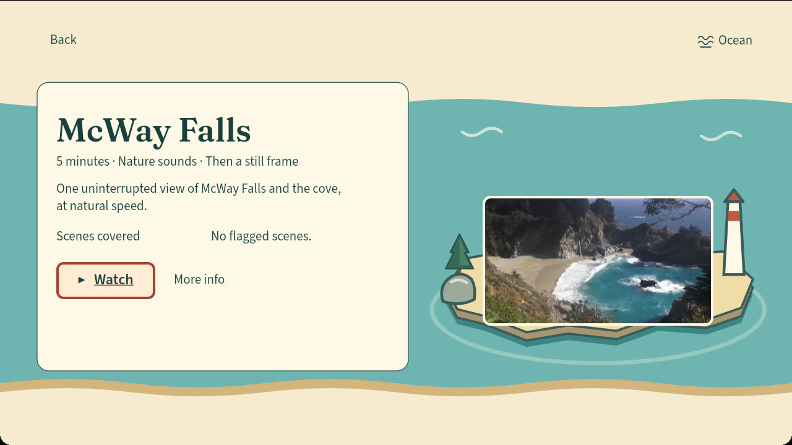
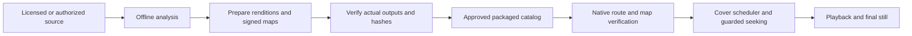

# Calm Frames 🌊

**Prepared nature scenes and guarded playback on Fire TV, built for people with photosensitive epilepsy and their caregivers.**

Choose a place, read what the session contains, then press Watch. Calm Frames is a
native Vega OS prototype that analyzes eligible media before playback, binds the
result to the exact file, and uses scheduled covers and guarded seeking inside
its own prepared catalog.

**Not a medical device. Not clinically validated. No guarantee of seizure prevention
or safe viewing for any individual.** It does not intercept other Fire TV apps,
Prime Video, DRM content or arbitrary streams system-wide.




Verified native review captures from source `fbe53bf`: Release Home and Debug
Details, using the disposable fictional household. They show the four-card
layout retained in the combined source. Later Home repairs change focus routing;
these images do not demonstrate that behavior. [Capture manifest](results/native-validation-fbe53bf-2026-10-25/evidence/MANIFEST.json).
The older `60c3bbb` gallery is [historical](docs/presentation/README.md).
McWay imagery: MoneySavingVideos, CC BY 3.0.

[Earlier demo video](https://www.youtube.com/watch?v=6lAP1FH16vc) ·
[Build instructions](#running-locally) · [Evidence and limits](#evidence-and-limits) ·
[Documentation](docs/README.md)

## The experience

- **A place to choose.** Ocean and Forest share a coastal map, consistent focus
  rings and remote navigation. Details explain duration, sound and ending before
  playback starts.
- **A deliberate ending.** The continuous McWay edition uses a fixed coastal view
  at natural speed and holds its final frame until Back. Other catalog entries
  remain still by default; their moving previews are separate actions.
- **Prepared media with traceable identity.** Offline analysis, source/rendition
  hashes, signed maps and original verification reports travel with each edition.
- **Caregiver controls.** Local profiles, stricter cover preferences and optional
  Reading comfort support household use. Saving a preference does not weaken the
  protection floor.
- **A separate file pre-check.** The local caregiver browser can analyze an
  eligible personal file without playing it. Processing permission, preparation,
  trusted signing and TV delivery remain distinct steps. Exported reports can be
  read in unlocked Parents; this does not activate personal-video playback.

## Architecture



The pipeline checks the media before it reaches the player. The app checks the
selected route and signed map again. A signature establishes artifact identity;
it does not prove the detector found every issue. Playback uncertainty keeps
the picture covered. Transport controls use a shared seek planner so a target
inside a flagged interval is covered before the playhead moves.

The [architecture guide](docs/presentation/ARCHITECTURE.md) and
[sidecar format](docs/SIDECAR_SPEC.md) explain the contracts in detail.

## Engineering decisions

| Decision | Why it matters | Implementation |
|---|---|---|
| Long scenes and explicit endings | The earlier short-preview experience was rejected as too brief and uncomfortable. The current continuous edition ends without an automatic repeat. | [Continuous scene](app/src/calmframes/continuousScene.ts) |
| Verify the exact artifact | File identity, signed analysis and package identity must agree before playback. | [Map verification](app/src/calmframes/flashMap.ts), [packaged catalog](app/src/calmframes/packagedLibrary.ts) |
| Cover before seeking | Remote and media-control paths share one timing decision. | [Seek planner](app/src/calmframes/seekSafety.ts), [guard](app/src/calmframes/useFlashGuard.ts) |
| Measure the real inset viewport | Reading comfort must keep the focused control within the visible scroll area. | [Caregiver settings](app/src/calmframes/ParentAreaScreen.tsx), [bounded native receipt](docs/native-receipt-fixes-773334a.md) |
| Keep failures recoverable | A damaged saved review must not hide intact imports or silently authorize delivery. | [Local intake](pipeline/local_intake.py) |

## Tech stack

| Layer | Choices |
|---|---|
| TV app | React Native, TypeScript, Vega OS, Amazon W3C media APIs |
| Design | Fraunces titles, Source Sans 3 controls, shared coastal geometry and focus tokens |
| Analysis | Python, flashmap, PyAV and ffmpeg |
| Preparation | Source/rendition hashes, Ed25519 maps and output verification reports |
| Optional infrastructure | AWS CDK, S3, ECS/Fargate, DynamoDB and CloudFront; [deployment record](docs/FEEDBACK.md) |
| Checks | Jest, TypeScript, ESLint, Node checks, pytest, ruff, mypy, secret scan and strict package gates |

<a id="start-here"></a>

## Running locally

Main is the consolidated development branch, including baseline `001b4867` and
later bounded fixes. Use this checkout's instructions and lockfiles together.
The [report-inbox receipt](results/personal-review-inbox-2026-10-26.json) identifies
its tested source and separate validation package. Record the full source SHA
before preparing an artifact; older screenshots and the demo identify other builds.

Requires the pinned Node 22, Python 3.12, ffmpeg/ffprobe, and JDK 21. A native
build also needs the documented Vega SDK installation. No private signing key
or cloud account is needed to inspect the bundled catalog.
The [reviewer quickstart](docs/submission/REVIEWER_QUICKSTART.md) gives the current
public-source and isolated install path; older private-branch directions are superseded.

```sh
git clone https://github.com/alejandro-publius/calm-frames.git
cd calm-frames
git rev-parse HEAD
git checkout main
```

### App checks without a simulator

App source checks, with Node 22 selected:

```sh
cd app
npm ci --ignore-scripts
npm run typecheck
npm run lint
npm test -- --runInBand --ci
```

### Native build and launch

Native preparation needs generated player inputs in addition to source tests.
With the Vega SDK environment and JDK 21 configured, from `app/`:

```sh
npm run setup:player
npm run check:native-inputs
npm run build:debug
```

The normal build checks original media verification reports, approved editions,
package identity and budget. A missing input is a blocker, not permission to skip
a gate. [Release preparation](docs/RELEASE.md) describes artifacts and install
steps; [environment details](docs/ENVIRONMENT.md) lists the toolchain. A fresh
public clone-to-native-build has not been certified in this consolidation, and
there is no accepted public downloadable release for this revision.

Python checks, with Python 3.12 and ffmpeg/ffprobe available, from the root:

```sh
python3.12 -m venv .venv
.venv/bin/python -m pip install -e './flashmap[dev]' matplotlib==3.11.2
.venv/bin/python -m pytest flashmap pipeline eval -q -m 'not slow'
.venv/bin/python eval/readme_sync.py --check
.venv/bin/python eval/style_check.py
```

These are reproduction commands, not a claim they all passed on this revision.
For optional caregiver file review, see the [computer workflow](docs/overnight-2026-10-25/personal-import/README.md)
and [read-only TV report transfer](docs/PERSONAL_REVIEW_INBOX.md).

## Evidence and limits

The [native repair record](docs/native-receipt-fixes-773334a.md) distinguishes
source tests, package checks and observed device behavior. Pale openings passed
within recorded cases. Reading comfort visibility and focus passed at both requested resolutions;
Release 720p VoiceView save speech/focus also passed, with the recorded
[owner acceptance scope](results/owner-acceptance-2026-10-26.json). No new 1080p
VoiceView save recording is claimed. Pause announcements remain unreliable
in the recorded Release retest. [Dependency closure](docs/checklist12-dependencies-2026-10-27.md)
removed the obsolete host toolchain; Audit passes with no exceptions. Exact-lock
Debug/Release builds, shipped inventories and bounded native SDK/Release checks
pass in the [current receipt](results/checklist12-native-2026-10-27.json).
This does not certify general release acceptance or vendor redistribution rights.

Lee Point Australian woodland has been acquired and prepared separately, but is
unaccepted and unintegrated. Its temporary signatures are not trusted by the app.
The owner selected the woodland scene and a silent candidate for review; package
budget, authorized preparation and native activation checks remain open. It is
not the current Prairie Creek Forest scene. No qualifying Sea Otters replacement
is available. Editorial overlays are drafts, not a completed native demo.

The earlier video description names `claude/ocean-layout-fix-2026-10-19` without
pinning an exact build. Its private-repository access note is stale. Repository
[submission notes](docs/SUBMISSION.md) and [feedback reconciliation](docs/FEEDBACK_RECONCILIATION.md)
do not establish what was actually submitted to Devpost.

<details>
<summary>Implementation map for this source</summary>

The installed app uses Vega's W3C media player. The remaining rows distinguish local preparation from runtime verification; they are code references, not extra hackathon requirements. Symbol names accompany line links so they remain checkable on this branch.

| Stage | Entry point | Responsibility |
|---|---|---|
| Native playback | `new VideoPlayer()` [source](app/src/utils/VideoHandler.ts#L157) | Create the Vega player |
| Runtime map | `verifyFlashMap` [source](app/src/calmframes/flashMap.ts#L217) | Check signed map identity and validity |
| Runtime catalog | `createPackagedLibrary` [source](app/src/calmframes/packagedLibrary.ts#L218) | Bind the packaged route and evidence |
| Runtime coverage | `useFlashGuard` [source](app/src/calmframes/useFlashGuard.ts#L159) | Coordinate cover state and player clock |
| Runtime seeking | `planSeek` [source](app/src/calmframes/seekSafety.ts#L113) | Plan a seek against covered intervals |
| Runtime ending | `continuousEndingForRoute` [source](app/src/calmframes/continuousScene.ts#L23) | Recognize the exact continuous edition |
| Offline preparation | `ingest_title` [source](pipeline/ingest.py#L212) | Orchestrate preparation |
| Offline verification | `verify_title` [source](pipeline/verify.py#L485) | Check actual output against its source |
| Offline package | `export_packaged_library` [source](pipeline/packaged_library.py#L467) | Export verified editions and reports |
| Offline replacement | `export_ambient_catalog` [source](pipeline/ambient_export.py#L24) | Independently reproduce replacement media |

</details>
</details>

<details>
<summary>Historical September screening evidence</summary>

These measurements describe the historical screening pool, not clinical safety,
current catalog size or acceptance of the consolidated build. Original failures,
withdrawn measurements and limitations remain in [results](results/) and the
[evaluation record](docs/EVAL_PLAN.md).


| Source | Files | Files with a flag | Flagged segments |
|---|---|---|---|
| Blender open movies | <!--n results/screening.json:per_source.Blender open movies.files -->3<!--/n--> | <!--n results/screening.json:per_source.Blender open movies.flagged_files -->3<!--/n--> | <!--n results/screening.json:per_source.Blender open movies.flagged_segments -->169<!--/n--> |
| 1930 public-domain film | <!--n results/screening.json:per_source.1930 public-domain film.files -->2<!--/n--> | <!--n results/screening.json:per_source.1930 public-domain film.flagged_files -->2<!--/n--> | <!--n results/screening.json:per_source.1930 public-domain film.flagged_segments -->229<!--/n--> |
| Wikimedia Commons | <!--n results/screening.json:per_source.Wikimedia Commons.files -->16<!--/n--> | <!--n results/screening.json:per_source.Wikimedia Commons.flagged_files -->3<!--/n--> | <!--n results/screening.json:per_source.Wikimedia Commons.flagged_segments -->19<!--/n--> |
| Wikimedia Commons fireworks | <!--n results/screening.json:per_source.Wikimedia Commons fireworks.files -->4<!--/n--> | <!--n results/screening.json:per_source.Wikimedia Commons fireworks.flagged_files -->3<!--/n--> | <!--n results/screening.json:per_source.Wikimedia Commons fireworks.flagged_segments -->21<!--/n--> |
| Wikimedia Commons lightning | <!--n results/screening.json:per_source.Wikimedia Commons lightning.files -->4<!--/n--> | <!--n results/screening.json:per_source.Wikimedia Commons lightning.flagged_files -->3<!--/n--> | <!--n results/screening.json:per_source.Wikimedia Commons lightning.flagged_segments -->9<!--/n--> |
| DVIDS | <!--n results/screening.json:per_source.DVIDS.files -->2<!--/n--> | <!--n results/screening.json:per_source.DVIDS.flagged_files -->2<!--/n--> | <!--n results/screening.json:per_source.DVIDS.flagged_segments -->9<!--/n--> |
| NASA SVS 5011 | <!--n results/screening.json:per_source.NASA SVS 5011.files -->1<!--/n--> | <!--n results/screening.json:per_source.NASA SVS 5011.flagged_files -->0<!--/n--> | <!--n results/screening.json:per_source.NASA SVS 5011.flagged_segments -->0<!--/n--> |
| NASA ISS time-lapse | <!--n results/screening.json:per_source.NASA ISS time-lapse.files -->3<!--/n--> | <!--n results/screening.json:per_source.NASA ISS time-lapse.flagged_files -->0<!--/n--> | <!--n results/screening.json:per_source.NASA ISS time-lapse.flagged_segments -->0<!--/n--> |
| unlabeled | <!--n results/screening.json:per_source.unlabeled.files -->3<!--/n--> | <!--n results/screening.json:per_source.unlabeled.flagged_files -->0<!--/n--> | <!--n results/screening.json:per_source.unlabeled.flagged_segments -->0<!--/n--> |

The `unlabeled` row is three files that carry no source label in `media/LICENSES.csv`, and they are not content: they are the marker clips the timing harness plays against itself, so the honest count of screened footage is three lower than the pool total. `NASA ISS time-lapse` is three night time-lapses that decode cleanly and flash at nothing, so they contribute no segments. Both are in the table because every source in the results file has to be, and the Files column has to add up to the <!--n results/screening.json:clips_analyzed_ok -->38<!--/n--> analyzed cleanly. `eval/tests/test_screening_table_is_complete.py` fails if either stops being true, because this table had already lost a row once.


</details>

## License and credits

Code: [Apache 2.0](LICENSE). Media permissions and attribution are separate in
[media/LICENSES.csv](media/LICENSES.csv) and the [presentation credits](docs/presentation/README.md).
