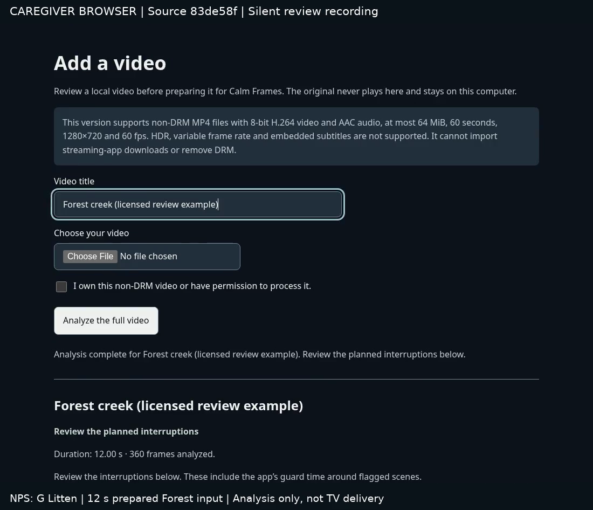

# Actual caregiver review and recorded walkthrough

Continued from `67e10f065e0e3448ba39d09d6e11a5d51853c962` on
`codex/native-defect-fixes-2026-10-25`. Current implemented source is
**`5bd9f6c4cdc6b8ea4b9427270810cd5de2c78b53`**. The final documentation HEAD is
recorded in the verified export's `SYNC_MANIFEST.json`. No source was pushed.

## Item 13: repaired saved plans and verified the real file flow

An incomplete nested review could still appear complete. A missing preset or
malformed interval could break browser rendering and hide intact imports. The
store now checks the saved producer format, both analysis-map identities, all
three preset plans, ordered interval bounds, covered-time totals and the review
digest and analysis-run identity before returning the record to a reader or action. An incomplete record
becomes the existing **Unreadable import** entry; its files remain untouched.
It cannot authorize review export, preparation or delivery. Explicit removal
still affects only that copied import, never the original or another review.

Nine new damaged-review regressions failed before the fix and pass afterward.
A real HTTP regression confirms that the damaged report returns 400 while an
intact report remains downloadable. Existing delivery tests retain cancellation
and changed-file refusal. Simplified fixture records now carry the complete
three-preset metadata that the actual producer has always emitted; no production
gate or test was removed. A nonempty app guard plan remains accepted.

The real browser run selected the existing approved **12-second Forest rendition**
and analyzed **all 360 frames** through both analyzer profiles. All three preset
reviews were inspected and the exact JSON was downloaded using the keyboard.
The input is an existing prepared rendition, not a new original, long edition
or private household file. Its source-specific recorded credit is **NPS: G Litten**;
the repository's October 18 public-domain provenance is retained. No fresh
license-page verification or new content acquisition is claimed.

Frame inspection also exposed a stale "Analysis is starting" message after
completion. The live status now announces the completed analysis and directs
the caregiver to the interruption plan. This was verified in the real browser.
The saved report remains analysis only: no signer, new key, exact-edition
approval, TV library change or playback authorization was supplied.

- [Exact caregiver report](../../results/cloud-deliverables-2026-10-25/browser/caregiver-review.json)
- [Browser observations](../../results/cloud-deliverables-2026-10-25/browser/browser-checks.json)
- [Narrow view with damaged and intact reviews](../../results/cloud-deliverables-2026-10-25/browser/narrow-isolated-review.png)
- [Validation receipt and logs](../../results/cloud-deliverables-2026-10-25/validation.json)

## Item 16: an actual video, with its scope visible

[Watch or download the 25.80-second caregiver walkthrough](assets/caregiver-browser-walkthrough.mp4).
The verified transfer also contains `OPEN_WALKTHROUGH.html`, a self-contained
preview with embedded video and JSON download. It makes no external requests
and does not autoplay. The cloud browser blocks direct file URLs by policy; the
self-contained page was checked through a local HTTP server without changing
that policy. The MP4 also opens independently of the preview. This is a silent recording of the real caregiver browser,
not a Fire TV capture, mock app, produced narration or final eight-cue demo.

The recording retains actual waiting between browser frames, shows the three
presets, and saves the review. Its visible header identifies the browser and
source; the footer credits the input and states that analysis is not TV delivery.
The captured browser-frame timestamps are IPC observations, not native decoder
or compositor timing measurements. Browser source, input file, frame and final
MP4 hashes are recorded in the [capture receipt](../../results/cloud-deliverables-2026-10-25/demo/capture-receipt.json).

The final MP4 is **460,930 bytes**, SHA-256
`af7e936682f2cacf32d11d34293b2bdab2c11177756946a06140f55227ec1b93`.
Full decode and the existing [video gate](../../results/cloud-deliverables-2026-10-25/demo/video-gate.json)
pass on those exact bytes. Native/human acceptance and medical safety do not
follow from those checks. The original approved storyboard is unchanged. The footage records source
`83de58f907b48484ea44f8b855ff94322894ff9c`, before the final malformed-run-ID
refusal. Current source re-verified the retained actual review, original copy
and both map hashes without repeating analysis; valid flow and UI are unchanged.

The repeatable [capture tool](../../eval/capture_intake_walkthrough.py) uses only
the existing hashed Forest sample and an isolated local server. It requires
installed Playwright/Chromium/ffmpeg and the normal pipeline Python environment.
It refuses an existing output directory or dirty source checkout. Raw frames,
timing, private copies and intermediate captures stay outside Git. A stop-timing
race discovered during the first capture is fixed; raw timing now persists
before encoding so a later encoding failure does not erase that evidence.

## What remains, in the original order

The [one original 20-item ledger](../cloud-integration-2026-10-23/CHECKPOINT.md)
remains **6 complete, 12 partial, 2 blocked**. No whole item newly closes. Items
**5, 6, 9, 14, 15 and 18** retain their completed scope.

- **#12:** four advisories and two expired exception groups still block Audit.
  The [separate migration decision](../cloud-followup-2026-10-25/REMAINING_DEPENDENCIES.md)
  remains unchanged: use a supported SDK/tooling update or authorize a bounded
  compatibility migration. No forced upgrade or renewed acceptance occurred.
- **#7:** no qualifying uninterrupted 300-second Forest or Sea Otters original
  with a source-specific rights record is available. Current sources are shorter
  or cut B-roll. [Fresh source-access attempts](../../results/cloud-deliverables-2026-10-25/primary-access.json)
  failed; the NPS diagnostic confirms a proxy CONNECT 403. The configured policy
  omits NPS, NOAA video and Wikimedia hosts. The next acquisition path needs
  supported access to the primary sources, or supplied qualifying files and
  rights records. No looping, stretching, budget increase or activation.
- **#13:** local selection, analysis and caregiver review are verified. Direct
  Fire TV file selection and separately authorized exact-edition preparation/
  delivery remain absent. This cloud has no configured authorized signer.
- **#16:** this usable caregiver segment exists. The final native replacement
  still lacks accepted-build raw takes, generated story art, approved-script
  narration and full human review. Manga/ElevenLabs remain parked until product
  acceptance and script reconciliation. No purchase or publication occurred.
- **Native and human items:** use the [single latest-source queue](../cloud-followup-2026-10-25/NATIVE_VERIFICATION.md)
  when home. App source, dependency locks, existing generated player inputs,
  approved media, protections, household/PIN code, signing and D1/D2/D3 are
  unchanged from 67e10f0. No new native package or screenshot is claimed.
- **#17:** current official rules could not be retrieved, and owner account,
  eligibility and judge-access confirmation remain unavailable. No account action
  or guessed access/deadline is substituted.

Earlier app, dependency and pipeline evidence retains its original source scope.
The unchanged full app suite, dependency installation, SBOM generation and Audit
were not repeated. No original worktree, never-merge branch, submitted fallback,
judging package or live submission was changed.
