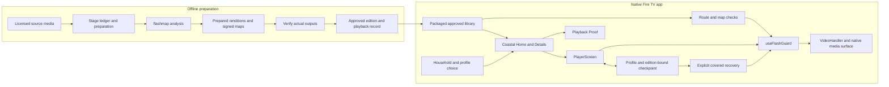

# Calm Frames presentation drafts

Prepared from source `6360417814d684d41c94789a9e406fc27de53c66`; its application code is at `12125b2970342b5376b0bc7964383e547b407376`. The canonical continuation adds contrast proposal `ae30cc7` and compatible tooling dependency fixes, without changing the product journey described here. Its exact source and validation are in [the checkpoint](CHECKPOINT.md). These are private working drafts. They do not select a replacement submission, certify the current native build, or authorize publication. Preserve submitted `bf2f615` and its linked materials.

The [canonical checkpoint](CHECKPOINT.md) distinguishes implemented changes from native acceptance. The older [integration status](../handoff-2026-10-23/INTEGRATION_STATUS.md) is historical input. Check the integration owner's exact-source CI receipt before selecting any wording about hosted results. Dependency audit findings and human audiovisual acceptance remain open at drafting time.

## Proposed GitHub opening

> # Calm Frames
>
> **A calmer way to watch.**
>
> Calm Frames is a native Fire TV app for deliberate ambient viewing. Choose a nature scene from a coastal map, watch at your own pace, and return to your profile's saved place. McWay Falls provides a sustained moving scene that ends on a still frame; the older nature titles keep their stationary defaults and explicitly selected previews.
>
> Behind that simple journey, an offline preparation pipeline analyzes media and verifies the prepared outputs. The player checks the approved edition and its signed map before allowing playback, while household settings and guarded seeks retain their protective role. A saved position is optional viewing history, never permission to weaken those checks.
>
> Calm Frames reduces exposure to flashing above published limits in the videos it plays; not a medical device.
>
> **Review status:** the development candidate and its native evidence are identified separately below. The submitted fallback remains available. See the current integration checkpoint for hosted checks, exact source/package identities and outstanding native review.

Before using this opening, insert the selected, verified checkpoint link. Do not silently replace the existing clone command with a development branch. Keep [the preserved offline judging guide](../judging-package/index.html) available with its historical evidence scope explained by the integration checkpoint.

## Devpost story draft

### 🌊 A place to settle in

Calm Frames starts with a small decision: choose a nature scene and spend time with it. The coastal map, quiet typography and remote-first controls are intended to make that decision clear. Moving footage stays at natural speed, and McWay Falls finishes on a still frame until the viewer leaves.

The intent is a more deliberate viewing experience. This is not a claim of clinical benefit, universal comfort or a completed user study.

### 🧭 A journey that remembers its viewer

The native app brings browsing, Details and playback into the same coastal world. Profiles keep separate viewing positions. When a viewer returns to an eligible prepared title, they can resume or start over; the stored position does not replace current media verification or household protection settings.

The recent integration work also addresses profile-picker focus during saving, consistent Watch labels and readable card text. Those changes have source-level regression evidence. Final native acceptance of the exact integrated build remains a separate step.

### 🔎 Preparation and playback share a chain of evidence

The offline pipeline records its preparation stages and verifies the resulting media before making a title available. The native player accepts approved prepared editions, validates their maps and routes playhead changes through the playback guard. Playback Proof exposes the record behind a title without making the viewer read it before watching.

Recovery is explicit and covered while the player re-establishes its state. The implementation has automated checks, but complete native compositor and decoder ordering evidence remains limited. We keep that limitation visible instead of describing a test harness as production acceptance.

Calm Frames reduces exposure to flashing above published limits in the videos it plays; not a medical device.

### What we learned and what remains

The difficult work is keeping the visible experience simple while preserving media identity, focus, profiles and playback ordering. A passed analysis or source test is different from observing the installed app, and both are different from a person accepting its picture, sound and pacing.

The development candidate still needs its outstanding dependency review and native/human acceptance gates closed before promotion. Personal-file import, broad catalog expansion and Reading comfort mode should not be described as shipped features without their own verified consumer flows. AWS is not a required dependency of the native prepared-library journey shown here.

## YouTube description draft

> Calm Frames | A calmer way to watch
>
> A native Fire TV journey: choose a quiet scene, spend time with it, leave, and return to personal progress.
>
> Illustrated story panels are original narrative illustrations. App demonstrations use actual native footage, with the source commit and any time cuts identified in the final edit. Illustrations are not screenshots or evidence of app behavior.
>
> McWay Falls footage: MoneySavingVideos, "Relaxing 3 Hour Video of a Waterfall on an Ocean Beach at Sunset," CC BY 3.0. The prepared edition uses the opening natural-speed segment, downsampled and encoded for the app, with a final audio fade. The final description must identify the additional excerpts and edits used in this demo. No endorsement implied.
>
> Original source: https://commons.wikimedia.org/wiki/File:%E2%99%A5%E2%99%A5_Relaxing_3_Hour_Video_of_a_Waterfall_on_an_Ocean_Beach_at_Sunset.webm
>
> License: https://creativecommons.org/licenses/by/3.0/
>
> Calm Frames reduces exposure to flashing above published limits in the videos it plays; not a medical device.
>
> Code, evidence and source-specific limitations: use the exact reviewer link selected at release review. Do not substitute an unreviewed development branch.

Do not upload this description unchanged: replace the final reviewer-link instruction, supply actual chapters from the rendered timeline, identify the recorded source, and confirm all media/font/illustration/narration credits. Do not describe the new video as available until its bytes, playback, captions and human review are verified. The old replacement demo depicts `d96c088` and does not prove the current profile/recovery work.

## Screenshot ordering and captions

The following files were visually inspected in this cloud review. They are existing Vega Virtual Device window captures with simulator chrome and a remote panel, not newly captured frames of `6360417`. Keep their original bytes. If a later presentation crops to the app viewport, label that crop and retain the source/hash in its asset manifest; no content replacement, recoloring or invented native UI.

| Order | Existing file | Proposed caption | Source and scope |
|---|---|---|---|
| 1 | [Coastal Home](../../results/native-profiles-retry-polish-2026-10-23/38-polish-selected.png) | "A coastal home for choosing a scene. The selected profile remains visible." | Production `bd55e47`. The image visibly says Settle in; the current source later standardized this action to Watch. Do not relabel the pixels. |
| 2 | [McWay Details](../../results/native-profiles-retry-polish-2026-10-23/40-polish-details.png) | "McWay Falls: a sustained natural-speed view, nature sound, and a still-frame ending." | Production `bd55e47`; this is a Details screen, not proof of full playback or final-frame behavior. |
| 3 | [Profile choice](../../results/native-profiles-retry-polish-2026-10-23/37-polish-picker.png) | "Choose who is watching. The active profile is checked and the current control has a visible focus outline." | Production `bd55e47`; later saving/focus fixes need their own current-source native observation. |
| 4 | [Kid 2 return](../../results/native-profiles-retry-polish-2026-10-23/17-kid2-resume.png) | "Kid 2 returns to its own saved place." | Profile acceptance source `4b04877`; use together with the next image and the receipt, not as current-build acceptance. |
| 5 | [Kid return](../../results/native-profiles-retry-polish-2026-10-23/22-kid-isolated.png) | "Switching back preserves the other profile's saved place." | Profile acceptance source `4b04877`; proves the recorded position-isolation observation, not different protection presets or caption restoration. |

The [native receipt](../../results/native-profiles-retry-polish-2026-10-23/receipt.json) records production, profile-acceptance and harness identities separately, plus screenshot hashes. Its `30-probe-focused`, `31-probe-error`, `33-retry-ready` and `35-retry-playing` images are from the separate Retry harness. Exclude them from a production screenshot gallery or production demo. Never merge that harness to make a recording easier.

Use the ordered screenshots as an evidence appendix now. A final current-candidate gallery needs source-bound native captures supplied by the Mac acceptance executor; browser renders or generated images cannot fill that gap.

## Architecture draft

This diagram describes source relationships. It is not a deployment or native-acceptance certificate. Preparation happens outside the TV; the approved packaged-library journey does not depend on an AWS service.

| Diagram responsibility | Code grounding |
|---|---|
| Preparation ledger, output verification, publication of checked bytes | [ingest.py](../../pipeline/ingest.py), [verify.py](../../pipeline/verify.py), [analyze.py](../../flashmap/src/flashmap/analyze.py) |
| Accepted prepared library and visible evidence | [packagedLibrary.ts](../../app/src/calmframes/packagedLibrary.ts), [playbackProof.ts](../../app/src/calmframes/playbackProof.ts), [PlaybackProofPanel.tsx](../../app/src/calmframes/PlaybackProofPanel.tsx) |
| Coastal journey and household scope | [KidHomeScreen.tsx](../../app/src/calmframes/KidHomeScreen.tsx), [TitleDetailsScreen.tsx](../../app/src/calmframes/TitleDetailsScreen.tsx), [ProfilePicker.tsx](../../app/src/calmframes/ProfilePicker.tsx), [household.ts](../../app/src/calmframes/household.ts) |
| Route acceptance, covered presentation, guarded seeks and native lifecycle | [PlayerScreen.tsx](../../app/src/screens/PlayerScreen.tsx), [playerAccess.ts](../../app/src/calmframes/playerAccess.ts), [useFlashGuard.ts](../../app/src/calmframes/useFlashGuard.ts), [VideoHandler.ts](../../app/src/utils/VideoHandler.ts) |
| Optional progress and explicit recovery | [playbackCheckpoint.ts](../../app/src/calmframes/playbackCheckpoint.ts), [usePlaybackMemory.ts](../../app/src/calmframes/usePlaybackMemory.ts), [playbackRecovery.ts](../../app/src/calmframes/playbackRecovery.ts), [RecoverablePlayback.tsx](../../app/src/calmframes/RecoverablePlayback.tsx) |

The diagram deliberately makes no claim that saved progress authorizes media, that captions exist on every title, or that a code path establishes exact native compositor ordering. Those boundaries are explicit in the checkpoint schema, recovery comments and native receipt.

## Claim and publication checks for these drafts

- Product behavior above is grounded in the linked source and native receipt. No fabricated interviews, adoption, competitor limitations, medical outcomes or competition scores are included.
- The source has already incorporated focus, Watch-label and text-size changes described by the integration status. Do not present this drafting work as having implemented them again.
- Historical screenshots and the older demo remain historical. The actual current build, final narration and completed movie must be identified independently.
- Keep eligibility, current judge access and the editing cutoff as owner/source checks. This draft does not certify those external states or create invitations/accounts.
- The exact narration draft, calm built-in voice selection and unlimited ElevenLabs budget are already authorized. Generation stays parked until product acceptance and exact-source script reconciliation. Material script changes, the final edit and publication remain separate decisions. No paid generation or publication was performed while preparing this file.
- After the permitted editing window, preserve frozen submitted materials. Unfinished drafts remain isolated until any later publication scope is confirmed.

Status: presentation drafts and source-grounded architecture prepared; current-source native gallery, final movie, human acceptance and publication remain pending.
