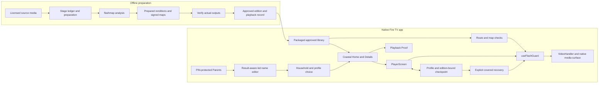

# Calm Frames presentation drafts

Reconciled against received native handoff `37d10c2db57fc0868499adc133cff7560600d5cc` for fbe53bf and local product/toolchain fixes through `5bd9f6c4cdc6b8ea4b9427270810cd5de2c78b53`. The [current checkpoint](CHECKPOINT.md) separates observed native behavior from newer source fixes. These private drafts authorize no release or submission change. The approved eight-cue narration in demo/STORYBOARD.md is unchanged; native replacement footage, manga and ElevenLabs narration do not yet exist for the new build. A separate [caregiver browser walkthrough](../cloud-deliverables-2026-10-25/README.md) exists; it is not native footage or the final replacement demo.

The [canonical checkpoint](CHECKPOINT.md) distinguishes implemented changes from native acceptance. The older [integration status](../handoff-2026-10-23/INTEGRATION_STATUS.md) is historical input. Check the integration owner's exact-source CI receipt before selecting any wording about hosted results. Dependency audit findings and human audiovisual acceptance remain open at drafting time.

## Proposed GitHub opening

> # Calm Frames
>
> **A standalone Fire TV prototype designed with people with photosensitive epilepsy in mind.**
>
> Calm Frames combines prepared nature content with flash analysis, signed maps and protective-playback mechanisms. Choose a scene from the coastal map and decide when to watch. McWay Falls provides a sustained moving scene that ends on a still frame; the other nature titles keep their stationary defaults and explicitly selected previews.
>
> Behind that simple journey, an offline preparation pipeline analyzes media and verifies the prepared outputs. The player checks the approved edition and its signed map before allowing playback, while household settings and guarded seeks retain their protective role. A saved position is optional viewing history, never permission to weaken those checks.
>
> This is a standalone app for its own prepared catalog, with no integration into Prime Video, Netflix or live TV. It is not a medical device and does not establish seizure prevention or individual comfort. Exact-build native validation and release issues remain open.
>
> **Review status:** the development candidate and its native evidence are identified separately below. The submitted fallback remains available. See the current integration checkpoint for hosted checks, exact source/package identities and outstanding native review.

Before using this opening, insert the selected, verified checkpoint link. Do not silently replace the existing clone command with a development branch. Keep [the preserved offline judging guide](../judging-package/index.html) available with its historical evidence scope explained by the integration checkpoint.

## Devpost story draft

### 🌊 Why we built it

Calm Frames was designed with people with photosensitive epilepsy in mind. The engineering question is how a standalone TV app can prepare content before viewing, retain evidence of that preparation, and preserve protective checks during playback and recovery. The coastal interface supports that purpose through deliberate choices and readable remote controls.

The prepared catalog is the implemented scope. We have not integrated these mechanisms into Prime Video, Netflix, live TV or arbitrary video apps. We have not demonstrated medical effectiveness or completed a user study. Native acceptance of the final integrated build remains open.

### 🧭 A journey that remembers its viewer

The native app brings browsing, Details and playback into the same coastal world. Profiles keep separate viewing positions. When a viewer returns to an eligible prepared title, they can resume or start over; the stored position does not replace current media verification or household protection settings.

The recent integration work also addresses profile-picker focus during saving, consistent Watch labels and readable card text. Those changes have source-level regression evidence. Final native acceptance of the exact integrated build remains a separate step.

Within unlocked Parents, a parent can give a kid a recognizable name using the
remote letter grid. Saving changes the name while retaining that kid's identity,
preferences and saved places. Cancel and Back discard an unfinished edit. A
failed storage write is not presented as a successful rename. Letters and spaces
are supported; accents, digits and punctuation are not current input options.
The [recorded native acceptance](../design-polish-2026-10-23/claude-integration/README.md#acceptance-pass-on-the-candidate)
retains typing, persistence and focus observations and adds sibling-name refusal
and controlled failed-write recovery with VoiceView in a made-up household.
The failure fixture is identified separately from the production package. The
platform keyboard was not used. Later cloud changes retain separate source and
native acceptance identities.

Optional per-kid Reading comfort enlarges help/body text and spacing in Parents
and More info. Its received fbe53bf native evidence covers isolation, persistence,
wrapping and VoiceView; saving exposed a focus/visibility defect. The local D2
fix retains focus and reveals the switch using measured layout, with source
regressions passing. New native confirmation and owner comfort remain pending;
no treatment benefit is claimed.

### 🔎 Preparation and playback share a chain of evidence

The offline pipeline records its preparation stages and verifies the resulting media before making a title available. The native player accepts approved prepared editions, validates their maps and routes playhead changes through the playback guard. Playback Proof exposes the record behind a title without making the viewer read it before watching.

Recovery is explicit and covered while the player re-establishes its state. The implementation has automated checks, but complete native compositor and decoder ordering evidence remains limited. We keep that limitation visible instead of describing a test harness as production acceptance.

Caregivers can also use the separate local file pre-check workflow for their
own eligible, non-DRM media. It analyzes a file without playing it and keeps
review separate from signing, verification and explicit TV-library approval.
This workflow does not bypass copyright, DRM, the compiled catalog or map trust.
It is not a native TV file-picker feature.

The mechanisms are designed to reduce exposure to mapped flashing in the prepared videos this app plays. Analyzer misses and device timing limits remain relevant. A signed map is evidence of identity and approval, not a medical safety certificate.

### What we learned and what remains

The difficult work is keeping the visible experience simple while preserving media identity, focus, profiles and playback ordering. A passed analysis or source test is different from observing the installed app, and both are different from a person accepting its picture, sound and pacing.

The development candidate still needs its outstanding dependency review and native/human acceptance gates closed before promotion. Personal-file import, broad catalog expansion and Reading comfort mode should not be described as shipped features without their own verified consumer flows. AWS is not a required dependency of the native prepared-library journey shown here.

## YouTube description draft

> Calm Frames | A calmer way to watch
>
> A native Fire TV journey: choose a quiet scene, spend time with it, leave, and return to personal progress.
>
> The planned replacement edit will identify the recorded source and any time cuts. Native demonstrations require actual app footage. Any later illustrations must be labelled as illustrations and credited separately; they are not screenshots or evidence of app behavior.
>
> McWay Falls footage: MoneySavingVideos, "Relaxing 3 Hour Video of a Waterfall on an Ocean Beach at Sunset," CC BY 3.0. The prepared edition uses the opening natural-speed segment, downsampled and encoded for the app, with a final audio fade. The final description must identify the additional excerpts and edits used in this demo. No endorsement implied.
>
> Original source: https://commons.wikimedia.org/wiki/File:%E2%99%A5%E2%99%A5_Relaxing_3_Hour_Video_of_a_Waterfall_on_an_Ocean_Beach_at_Sunset.webm
>
> License: https://creativecommons.org/licenses/by/3.0/
>
> Calm Frames reduces exposure to flashing above published limits in the videos it plays; not a medical device.
>
> Code, evidence and source-specific limitations: use the exact reviewer link selected at release review. Do not substitute an unreviewed development branch.

Do not upload this description unchanged: replace the final reviewer-link instruction, supply actual chapters from the rendered timeline, identify the recorded source, and confirm all media/font/illustration/narration credits. Do not describe the new video as available until its bytes, playback, captions and human review are verified. The old replacement demo depicts `d96c088` and does not prove the current profile/recovery work.

## Screenshot ordering and captions

The current gallery uses the received fbe53bf native review copies, before the
new defect fixes. Do not label them as captures of the newer cloud source. Keep their original
repository bytes and retain the [manifest](../../results/native-validation-fbe53bf-2026-10-25/evidence/MANIFEST.json)
that binds each JPEG to its original capture and transformation.

| Order | Actual native file | Caption and scope |
|---|---|---|
| 1 | [Home](../../results/native-validation-fbe53bf-2026-10-25/evidence/e02-720-home.jpg) | Four separate destination islands; Acadia selected and Watch focused. Fictional Kid 2. The image does not prove D1 is fixed. |
| 2 | [Acadia Details](../../results/native-validation-fbe53bf-2026-10-25/evidence/h09-1080-acadia-details.jpg) | A still-scene default, replacement summary and deliberate Watch choice. Review copy of a 1080 capture. |
| 3 | [McWay in Release](../../results/native-validation-fbe53bf-2026-10-25/evidence/r24-720-release-playing.jpg) | Actual McWay playback and transport at 720. No complete audio, timing or comfort claim from a still. |

[Package identities and observations](../../results/native-validation-fbe53bf-2026-10-25/receipt.json)
are native evidence for fbe53bf only. The older Retry harness screenshots remain
excluded from production presentation. These images are suitable evidence
references; the replacement demo still needs raw accepted-build app footage,
not screenshots animated into a purported native walkthrough. See the
[production input plan](../cloud-followup-2026-10-25/DEMO_PREPARATION.md).

## Architecture draft

This diagram describes source relationships. It is not a deployment or native-acceptance certificate. Preparation happens outside the TV; the approved packaged-library journey does not depend on an AWS service.

| Diagram responsibility | Code grounding |
|---|---|
| Preparation ledger, output verification, publication of checked bytes | [ingest.py](../../pipeline/ingest.py), [verify.py](../../pipeline/verify.py), [analyze.py](../../flashmap/src/flashmap/analyze.py) |
| Accepted prepared library and visible evidence | [packagedLibrary.ts](../../app/src/calmframes/packagedLibrary.ts), [playbackProof.ts](../../app/src/calmframes/playbackProof.ts), [PlaybackProofPanel.tsx](../../app/src/calmframes/PlaybackProofPanel.tsx) |
| Coastal journey and household scope | [KidHomeScreen.tsx](../../app/src/calmframes/KidHomeScreen.tsx), [TitleDetailsScreen.tsx](../../app/src/calmframes/TitleDetailsScreen.tsx), [ProfilePicker.tsx](../../app/src/calmframes/ProfilePicker.tsx), [household.ts](../../app/src/calmframes/household.ts) |
| Editable names with stable profile identity | [ParentAreaScreen.tsx](../../app/src/calmframes/ParentAreaScreen.tsx), [ProfileNameEditor.tsx](../../app/src/calmframes/ProfileNameEditor.tsx), [profiles.ts](../../app/src/calmframes/profiles.ts), [route persistence checks](../../app/test/screens/profileNameSave.test.tsx) |
| Route acceptance, covered presentation, guarded seeks and native lifecycle | [PlayerScreen.tsx](../../app/src/screens/PlayerScreen.tsx), [playerAccess.ts](../../app/src/calmframes/playerAccess.ts), [useFlashGuard.ts](../../app/src/calmframes/useFlashGuard.ts), [VideoHandler.ts](../../app/src/utils/VideoHandler.ts) |
| Optional progress and explicit recovery | [playbackCheckpoint.ts](../../app/src/calmframes/playbackCheckpoint.ts), [usePlaybackMemory.ts](../../app/src/calmframes/usePlaybackMemory.ts), [playbackRecovery.ts](../../app/src/calmframes/playbackRecovery.ts), [RecoverablePlayback.tsx](../../app/src/calmframes/RecoverablePlayback.tsx) |

The diagram deliberately makes no claim that saved progress authorizes media, that captions exist on every title, or that a code path establishes exact native compositor ordering. Those boundaries are explicit in the checkpoint schema, recovery comments and native receipt.

## Claim and publication checks for these drafts

- Product behavior above is grounded in the linked source and native receipt. No fabricated interviews, adoption, competitor limitations, medical outcomes or competition scores are included.
- The source has already incorporated focus, Watch-label and text-size changes described by the integration status. Do not present this drafting work as having implemented them again.
- Historical screenshots and the older demo remain historical. The actual current build, final narration and completed movie must be identified independently.
- Keep eligibility, current judge access and the editing cutoff as owner/source checks. This draft does not certify those external states or create invitations/accounts.
- The exact narration draft, calm built-in voice selection and unlimited ElevenLabs budget are already authorized. Generation stays parked until product acceptance and exact-source script reconciliation. Material script changes, the final edit and publication remain separate decisions. No paid generation or publication was performed while preparing this file.
- After the permitted editing window, preserve frozen submitted materials. Unfinished drafts remain isolated until any later publication scope is confirmed.

Status: presentation drafts and source-grounded architecture prepared; current-source native gallery, final movie, human acceptance and publication remain pending.
