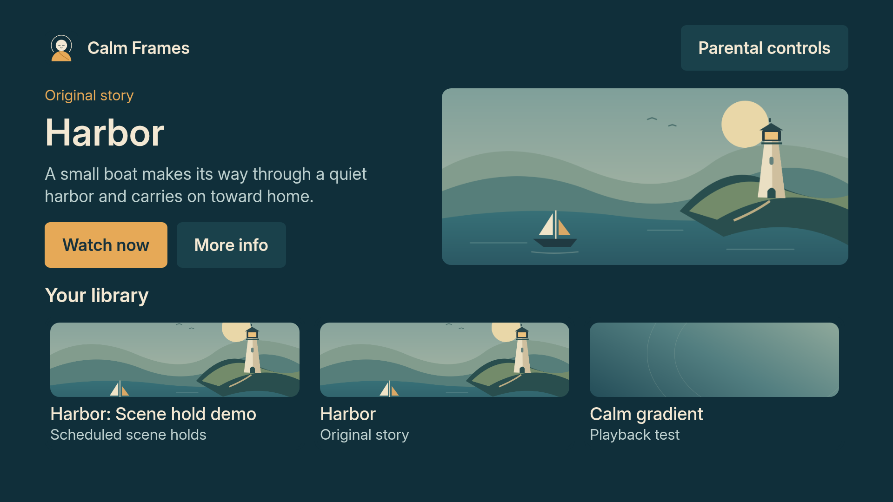
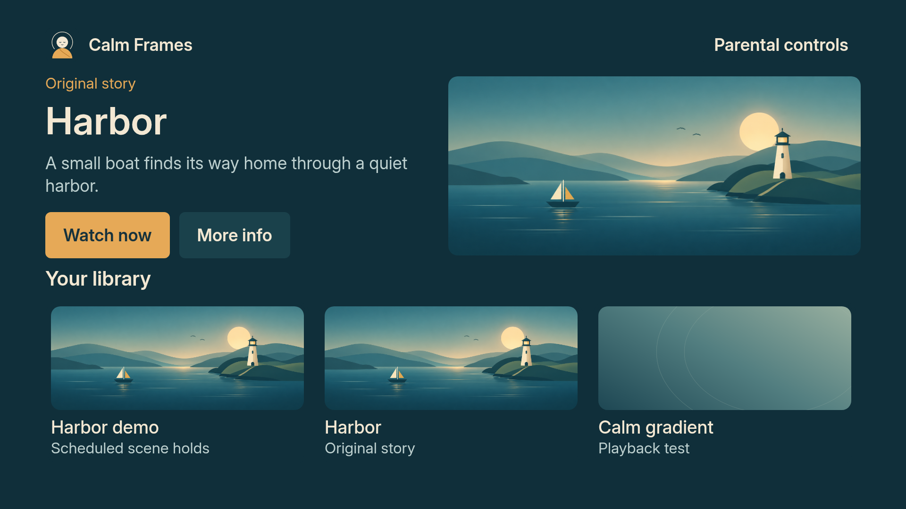

# Calm Frames visual refinement

This pass refines the native app's existing design: calm teal surfaces, warm
cream type, saffron actions and the peaceful monk mark. The implementation is
in the React Native screens. A fresh Vega build and native review are still
required; the earlier simulator package and demo do not include this pass.

## What changed

- Harbor has a new panoramic illustration with layered coastlines, a small
  sailboat and a warm lighthouse. Its focal subjects remain visible in both
  the hero and library crops.
- Library cards show more artwork. Shorter display names, aligned navigation
  and consistent corner spacing make the shelf easier to scan.
- Title details separate the story, check summary and viewing settings.
  Supporting text has a clearer reading width and hierarchy.
- Setup has a static progress indicator. Parent settings use consistent row
  spacing and simpler copy, with the existing Inter faces throughout.
- Remote focus keeps its reserved outline and text underline. Display and
  accessible card names agree, and supporting type keeps the existing floor.

## Visual review

These images approximate the layout in Chromium from the actual rendered
React Native component trees, bundled Inter fonts and artwork. They are
review aids, not Vega screenshots. Browser text and flex measurements can
differ from the device. Both comparison images use the same standalone shelf
fixture; the family image additionally exercises the real profile control.

| Before | After |
|---|---|
|  |  |

[Family library](polish/library-family-after.png) ·
[Story details](polish/details-after.png) ·
[Full viewing settings](polish/details-bottom.png) ·
[Setup](polish/setup-after.png) ·
[Parental controls](polish/parent-after.png) ·
[Lower parent settings](polish/parent-bottom.png)

## Artwork provenance

`app/assets/image/tv/harbor.png` was generated with OpenAI image generation
during this refinement, using the project's previous Harbor illustration as
a visual reference. The brief requested a restrained panoramic children's
illustration: layered teal coastlines, a cream and saffron boat, warm moon and
lighthouse, soft reflections, no text, and a composition that preserves the
boat and lighthouse when cropped. The returned PNG is used without further
image editing. Dimensions, timestamp and SHA-256 are recorded in
[`design_polish_2026-10-10.json`](../../results/design_polish_2026-10-10.json).

The earlier `app/assets/brand/tv/harbor.svg` remains as a reference; it no longer
generates the current Harbor PNG. This artwork is for browsing. It is not a
frame from the story and does not replace its film, signed stills or flash map.

## Validation and next native check

The receipt records automated app, type, lint, image and palette-transition
checks separately from the browser layout proofs. The image check holds each
asset independently. The palette model does not measure real artwork or text
transitions. Neither establishes native rendering or medical safety.

On the Mac, rebuild and install the current review branch in the Vega Virtual
Device. Check the family library and expanded profile picker, remote focus and
Back behavior, setup, and full details/settings scrolling. Replay the benign
Harbor story and scheduled-hold demo, then capture and analyze the actual
updated screens. Refresh the submission recording and review package so their
source and package hashes match the design being submitted.

Existing dependency, source-license and publication items remain tracked in
the [completion checklist](../COMPLETION_CHECKLIST.md).
