# Calm Frames design

This is the one page to read before designing anything for Calm Frames. It
describes the interface the code draws today. The source of truth is
[`app/src/calmframes/calmStyles.ts`](../../app/src/calmframes/calmStyles.ts):
the palette, type, spacing and focus values below are copied from it, and
[`eval/tests/test_design_page.py`](../../eval/tests/test_design_page.py) fails
if this page, [`tokens.json`](tokens.json) and the code stop agreeing, or if a
contrast ratio on this page is not the one the colours give.

The other files in this folder are the record of how the design got here: the
Oct 10 [brief](IMPLEMENTATION_BRIEF.md) (a proposal written before the
redesign was built; its second teal `#12343F` never shipped), the
[native implementation notes](NATIVE_IMPLEMENTATION.md), the
[polish review](POLISH_REVIEW.md) and the [seamless review](SEAMLESS_REVIEW.md).
Where one of them and this page differ, this page and the code are current.

The Oct 13 [details refinement](detail-refinement/README.md) brings a centered
Picture holds & settings action into the first screen and adds duration labels
and a plain-language timeline key. Its before/after browser previews and focused
check receipt cover the isolated design branch; native focus behavior still
needs a Mac/Vega observation.

The following [unavailable-state refinement](unavailable-refinement/README.md)
keeps the title, specific reason and focused Back action together in the initial
viewport. It removes the unused artwork space and repeated status wording,
while preserving the playable details layout. Comparisons cover 1080p and 720p.

The Oct 14 [parent-settings refinement](parent-refinement/README.md) centers the
unlocked settings column, adds Back beside the heading and moves profile
management beside the selector so viewing presets appear sooner. The PIN
screens and all settings semantics remain unchanged.

The Oct 14 [playback refinement](playback-refinement/README.md) adds named
controls and visible focus, pause-aware hold messages that survive hidden
controls, and a recovery screen above the safety cover. Before/after browser
comparisons cover both TV resolutions; native acceptance remains pending.

## Identity

A peaceful monk inside a rounded frame, with one open halo. Deep teal ground,
cream face and text, saffron robe. The mark is still: no pulsing, no animated
halo. The files, sizes and store requirements are in
[`docs/brand/README.md`](../brand/README.md).

The brand line is **A calmer way to watch**. It describes how watching feels.
It is not a clinical claim or a detection guarantee. When the product says what
it does for safety, it uses the approved sentence and no other: "reduces
exposure to flashing above published limits in the videos it plays; not a
medical device."

## Principles

| Principle | What it means on screen |
|---|---|
| Calm | One clear primary action per screen. Secondary navigation is quiet. Sentence case, short lines, no badges or borders competing with the content. |
| Still by default | Nothing moves unless a parent turns on Gentle artwork motion, and then only artwork, once. Text, focus rings, controls, setup and covers never move. Apart from that one entrance, nothing fades, slides or pulses. |
| Nothing flashes | The interface's own frames are run through flashmap under both the WCAG and broadcast profiles (`cd app && npm run ui:flashmap`), and a negative control (`node tools/ui_flashmap.mjs --negative-control`) shows that the check refuses a flashing sequence and a grating. |
| The cover is never decorative | The cover is a safety surface. It is opaque black, or a checked still signed for that title, and red segments always get an opaque cover. Dim mode exists only for non-red segments at 90% or darker. The cover is never used as a transition, a theme, a mood or a background, and presentation artwork is never used as a cover or a hold still. |
| Truthful | No invented ratings, durations, progress or watch history to fill a small library. Practice holds are always labelled as practice. |

## Palette

Approved dusk coast interface palette. Original logo and Harbor/zen artwork are preserved; their embedded colors are not UI tokens. Shared material gradients live in `CalmControlSurface.tsx`.

| Token | tokens.json | Hex | Use |
|---|---|---|---|
| `BACKGROUND` | `background` | `#151C26` | Ink ground behind interface screens; artwork retains its original palette. |
| `SURFACE` | `surface` | `#303B48` | Weathered slate cards, notices, status plates and fallback controls. |
| `SURFACE_FOCUSED` | `surfaceFocused` | `#3B4856` | Focused or chosen fallback controls. |
| `BORDER` | `border` | `#697585` | Slate edges and dividers. |
| `FOCUS_RING` | `focusRing` | `#E6B963` | Lighthouse gold for focus only, with an underline or control-specific focus cue. |
| `PRIMARY` | `primary` | `#D88B72` | Burnt coral primary action; gradient endpoints are in CalmControlSurface.tsx. |
| `TEXT_DISABLED` | `textDisabled` | `#9DA4AE` | Muted text on the neutral disabled material. |
| `ACCENT_DARK` | `accentDark` | `#8E5648` | Dark coral depth below the primary control. Never text. |
| `TEXT` | `text` | `#F4ECDD` | Warm ivory headings, body text and control labels. |
| `TEXT_DIM` | `textDim` | `#BDC2C9` | Supporting text and metadata. |
| `INK` | `ink` | `#151C26` | Dark text on coral and the separator inside gold focus rings. |
| `VERIFIED` | `verified` | `#E7D9BF` | Warm pale selection edge and verified status. |
| `PENDING` | `pending` | `#B9C9DA` | Pale slate-blue preparing status and non-red timeline marks. |
| `FAILED` | `failed` | `#F2BDB1` | Warm error status, unavailable notices and red timeline marks. |
| `COVER` | `cover` | `#000000` | Protective black cover; preserved independently of interface decoration. |

## Contrast

Contrast is the WCAG 2.2 contrast ratio, (L1 + 0.05) / (L2 + 0.05), over
relative luminance. [`flashmap/docs/SPEC_SOURCES.md`](../../flashmap/docs/SPEC_SOURCES.md)
section 3 quotes the relative luminance half; the ratio formula and the two
floors below are the app's own constants. WCAG 2.2's contrast ratio definition,
SC 1.4.3 and SC 1.4.11 still have to be quoted here with links: the Oct 11 cloud
box could not reach w3.org, and they are not quoted from memory. The app's own arithmetic in `app/src/calmframes/uiContrast.ts` uses
the older 0.03928 break point that WCAG's Note 2 mentions; for 8-bit colours
the two give the same answer, because no value n/255 falls between 0.03928 and
0.04045. Ratios here are truncated to two decimals, the way `roundRatio` in
`uiContrast.ts` truncates them, so a ratio is never rounded up past a floor.

The floors are the code's: `MINIMUM_TEXT_CONTRAST` is 4.5 to 1 for every line
of text and `MINIMUM_FOCUS_CONTRAST` is 3 to 1 for the focus ring against both
of its neighbours. All Calm Frames text is large text by WCAG's definition,
where AA asks only 3 to 1, so holding it to 4.5 is stricter than the rule on
purpose: a television is read from across a room.

### Text on background

| Text | On | Ratio | Where |
|---|---|---|---|
| `TEXT` | `BACKGROUND` | 14.59 | Headings and body text. |
| `TEXT` | `SURFACE` | 9.69 | Labels on slate cards. |
| `TEXT` | `SURFACE_FOCUSED` | 7.96 | Focused fallback labels. |
| `TEXT_DIM` | `BACKGROUND` | 9.56 | Supporting text and metadata. |
| `TEXT_DIM` | `SURFACE` | 6.35 | Descriptions and status plates. |
| `TEXT_DIM` | `SURFACE_FOCUSED` | 5.21 | Supporting text on selected fallback rows. |
| `INK` | `PRIMARY` | 6.40 | Primary action at its lightest endpoint; all endpoints are checked separately. |
| `TEXT` | `INK` | 14.59 | Text on ink. |
| `VERIFIED` | `SURFACE` | 8.17 | Verified status. |
| `PENDING` | `SURFACE` | 6.73 | Preparing status. |
| `FAILED` | `SURFACE` | 6.87 | Unavailable status. |
| `FAILED` | `COVER` | 12.68 | Playback error heading on the retained protective black surface. |

Material endpoint checks additionally require dark text on every normal/pressed coral endpoint ≥4.5:1, supporting text on every secondary/selected endpoint ≥4.5:1, and disabled text on the neutral disabled fill ≥4.5:1. The minimum across the approved material states is 4.63:1 (truncated). Focus uses a dark contour; gold directly against coral is not claimed to meet 3:1. Actual moving-picture pixels and native caption preferences are outside these solid-color measurements.

### Focus ring

| Ring | Beside | Ratio | Where |
|---|---|---|---|
| `FOCUS_RING` | `SURFACE_FOCUSED` | 5.11 | Ring beside focused fallback controls. |
| `FOCUS_RING` | `INK` | 9.36 | Dark contour separates gold from coral. |
| `FOCUS_RING` | `BACKGROUND` | 9.36 | Ring against the ground. |
| `FOCUS_RING` | `SURFACE` | 6.22 | Ring beside a slate group. |

## Coastal menus, Oct 14

On Oct 14 Alex approved the ivory coast for every menu screen: Home, Details,
Help, setup, parental controls, the credits and the opening shell. Playback
keeps the dark palette above, so the controls stay dark and readable over
video. The switch is `CoastalAppearance` in
`app/src/calmframes/CoastalAppearance.ts`, which `PlayerScreen` sets to false.
The values are `COASTAL_COLORS` and `COASTAL_PRIMARY_FOCUS` in `calmStyles.ts`;
the palette table above still describes playback.

| Name | Hex | Where |
|---|---|---|
| BACKGROUND | `#F5EBDD` | Every menu screen |
| SURFACE | `#E9DFD0` | Cards, notices and resting secondary controls |
| SURFACE_FOCUSED | `#DED0BD` | A focused or pressed secondary control |
| BORDER | `#8B8173` | Quiet edges |
| TEXT | `#193234` | Headings and labels |
| TEXT_DIM | `#40514D` | Supporting text |
| TEXT_DISABLED | `#60645F` | Disabled labels |
| PRIMARY | `#193B3C` | The one primary action, Play |
| INK | `#193234` | A focused or pressed primary's fill |
| FOCUS_RING | `#193B3C` | The ring on every focused menu control except a primary |
| COASTAL_PRIMARY_FOCUS | `#C16C45` | The ring on a focused primary, because teal on its teal fill would vanish |
| ACCENT_DARK | `#98492D` | Accents |
| VERIFIED, PENDING, FAILED | `#24584D`, `#4E5B68`, `#873F2C` | Status marks |
| COVER | `#000000` | Unchanged |

The floors are the ones above: text at 4.5 to 1 on its background, rings at
3 to 1 against their fill and against what is outside them.
`app/test/calmframes/coastalAppearance.test.tsx` checks the coastal pairs and
`tenFoot.test.tsx` measures every menu screen. A focused primary therefore
sits on the page and never inside a surface panel: terracotta on the panel
colour falls under 3 to 1, on the page it clears it.

Artwork: `app/assets/image/tv/coastal-zen.png`, full bleed behind Home,
Details and the opening shell (the round crop in the old Home card went with
the card on Oct 14). Its provenance is
the adjacent JSON and its ledger row; no ownership or dedication is claimed
for a generated picture. `harbor-illustrated.png` is a render of
`app/assets/brand/tv/harbor.svg` and remains for the title posters.

## Type

Fraunces supplies restrained major headings; Source Sans 3 supplies functional UI,
body text and equal-width keypad numerals. The three static OFL faces in
`app/assets/fonts` have unique matching family/file names, with `fontWeight` 400
so no synthetic weight is requested. Fraunces is fixed at weight 600, optical
size 32, softness 20 and wonk 0. License notices and pinned-source hashes live
beside the files. The prior Inter files remain preserved. New native glyph
rendering still needs observation; file placement follows the existing SDK
package and previously verified project font mechanism, not an assumed new API.
Sizes remain 1080p units. `MINIMUM_TEXT_SIZE`, 32 units, is the minimum.

| Role | Face | Size / line height | Use |
|---|---|---|---|
| `feature` | CalmDisplaySemibold | 80 / 92 | Featured titles. |
| `screen` | CalmDisplaySemibold | 64 / 76 | Major screen and scene titles. |
| `section` | CalmDisplaySemibold | 42 / 54 | Section headings. |
| `numeral` | CalmSansSemibold | 64 / 76 | PIN keys and entry marks. |
| `card` | CalmSansSemibold | 38 / 48 | Cards and small titles. |
| `body` | CalmSansRegular | 36 / 48 | Explanations and synopses. |
| `control` | CalmSansSemibold | 36 / 46 | Buttons and rows. |
| `supporting` | CalmSansRegular | 32 / 42 | Qualifiers, helper text and badges. |

Keep text in sentence case. Shorten the words before shrinking the type.
`CALM_TYPE` in the same file holds older size-only tokens; new work uses the
named `CALM_TEXT` styles above.

The cinematic library and details use a larger title treatment within their
hero composition, with smaller variants for long names. Their exact local
sizes remain in `KidHomeScreen.tsx` and `TitleDetailsScreen.tsx`; the shared
type roles above continue to govern the rest of the interface.

## Spacing and layout

The design canvas is 1920 by 1080 units, and `scale()` turns units into dp
(density-independent pixels) for the current screen height, rounded to the
nearest pixel.

| Token | Units | Use |
|---|---|---|
| `TIGHT` | 12 | Between a label and its helper line, and small paddings. |
| `ROW` | 20 | Between rows and neighbouring controls, and a button's vertical padding. |
| `BLOCK` | 32 | Between groups, and a button's horizontal padding. |
| `EDGE` | 64 | Generous separation, such as the player card's side padding. |
| `SAFE_X` | 96 | The left and right safe margin, 5% of 1920. |
| `SAFE_Y` | 54 | The top and bottom safe margin, 5% of 1080. |

Televisions still overscan, by different amounts, so nothing a person reads or
presses goes inside the safe margins. The ten-foot test fails any screen whose
content comes closer. On the player the picture and the cover fill the screen;
the practice plate hangs from the top left corner of the safe area, the card
hangs from the upper part of it (`PLAYER_LAYOUT`), and the bottom band belongs
to captions, which must never be covered by our own words.

Corners are modest: 12 units on controls and rows, 16 on cards and notices, 20
on shelf artwork, 26 on its focusable frame, 10 on badges and 6 on the flash map
strip. The featured scene is centered and blends into the teal background.
Library artwork is 720 units wide; details artwork is 1280. Title copy stays
within 1000 units and supporting details within 1040. Title copy and viewing settings sit directly on that background,
with space, headings and fine dividers doing the grouping. Secondary actions rest directly on the background and gain a visible outline
on focus.

## Focus

- Every focusable control carries a `FOCUS_RING_WIDTH` border, 6 units, whether
  it has focus or not. Focus changes the ring's colour and the fill together,
  so nothing moves or grows when focus moves.
- Focus is never colour alone: the focused label is also underlined.
- The primary action inverts with focus: saffron with ink text at rest, ink
  with cream text and a saffron ring when focused.
- Pressing does not dim a control (`activeOpacity` is 1). An unavailable
  control is not faded either: it keeps its background, takes a quieter edge
  and dim text, and says why in words.
- Each screen gives first focus to its main action (`hasTVPreferredFocus`). A
  countdown card moves focus to Skip with `requestTVFocus`, because a Vega app
  cannot rely on the D-pad to get there.
- Coming back from a title puts focus on the card you left from. Returning to
  a choice prefers the selected control, and controls keep focus while a save
  is pending.

## Motion

There is one movement in the whole interface, and it is off unless a parent
turns it on.

- **What:** library and title-details artwork settles upward into place once
  when the page opens: <!--n results/interface_finish_2026-10-10_pacific.json:behavior.motion.translation_scaled_units -->6<!--/n-->
  units over <!--n results/interface_finish_2026-10-10_pacific.json:behavior.motion.duration_ms -->240<!--/n--> ms, easing out
  ([`CalmArtworkMotion.tsx`](../../app/src/calmframes/CalmArtworkMotion.tsx)).
- **Who turns it on:** a parent, with Gentle artwork motion in Parental
  controls. It is off for new households and for every household saved before
  it existed; only an explicit true in the saved record enables it
  (`newFamily` and `clampFamily` in `profiles.ts`).
- **When it stays still anyway:** whenever the system reduced-motion setting
  is anything other than an explicit "off", including unknown or a failed
  query; when the app is not in the foreground; when lifecycle access fails.
  Leaving, backgrounding or turning it off settles the artwork at rest at
  once, and turning it on later never replays the entrance on a page that is
  already open.
- **What never moves:** text, focus rings, controls, setup, the player card,
  the practice plate and the cover.

The rules are tested in `app/test/calmframes/artworkMotion.test.tsx`. The
movement itself has not been seen on a device.

## Sound

Two sounds, kept separate, and neither replaces the other.

| | Warning chime | Selection sound |
|---|---|---|
| What it says | The picture is about to be hidden. | A menu action was accepted. |
| Sound | Two soft tones a fifth apart with a long fade (`calm-chime.mp3`). | A short, softly attacked tone with a quiet octave (`menu-select.mp3`). |
| Default | On (`CHIME_ON_BY_DEFAULT`). A household switch, "Chime before the picture is hidden", turns it off; that changes nothing about what is hidden. | Off. A parent turns on Selection sounds in Parental controls. |
| When | `CHIME_LEAD_MS`, two seconds, before a cover, while the countdown card is already on screen. | Accepted menu actions and successful settings saves. |
| Never | Without a cover following it: `chimeCue.ts` is a state machine whose count of broken promises is always zero. | On focus movement or Watch actions, during playback, while a screen reader is on or its state is unknown, or while the app is blurred or in the background. |
| Volume | `CHIME_VOLUME`, 0.35. | <!--n results/interface_finish_2026-10-10_pacific.json:behavior.sound.volume -->0.22<!--/n-->, at most one request every <!--n results/interface_finish_2026-10-10_pacific.json:behavior.sound.minimum_request_interval_ms -->220<!--/n--> ms, released after <!--n results/interface_finish_2026-10-10_pacific.json:behavior.sound.timeout_ms -->500<!--/n--> ms if the player never says it ended. |
| Code | `chimeCue.ts`, `useChimeCue.ts`, `chimeSound.ts` | `interfaceSound.ts`, `useInterfaceSound.tsx` |

Both are original sounds generated from sine waves; how to regenerate them is
in [`app/assets/raw/sound/README.md`](../../app/assets/raw/sound/README.md).
Neither has been heard on a device.

## Copy

The voice is in [`COPY_GUIDE.md`](COPY_GUIDE.md). Its core rules:

> Use familiar labels and natural sentences. Keep each message focused on what
> the viewer needs to know or do next.

> Avoid paired slogans, repeated sentence fragments, rhetorical contrasts such
> as “not X, but Y,” decorative descriptions of colors and typography, and
> statements about how carefully the interface was designed.

> Do not invent durations, ratings, progress, availability, plot details, or
> medical claims.

The labels are the familiar TV ones: Watch now, Watch demo, Play, More info,
Your library, Parental controls, Back to library. Screen-reader labels add the
context a short label leaves out, such as "Watch now: Harbor". House style on
top of the guide, and enforced by `app/test/calmframes/copy.test.ts` and
`eval/style_check.py`: no em dashes or en dashes anywhere, no exclamation marks
in notices, and never "prevents seizures" or "seizure-proof".

## Accessibility

| Area | Behaviour |
|---|---|
| D-pad | Every action is reachable with the remote, with one focus treatment everywhere. Back returns to the library; Back while a title is loading returns to its focused Watch button. While a countdown card is up, Skip has focus and owns OK. |
| Screen reader | The player card is a polite live region, and its words are also announced through `AccessibilityInfo` with `queue: true`, so an announcement already in progress finishes first (`announce.ts`). Notices are polite live regions that read their title and detail together. Saving feedback appears in a reserved space beside the title and is announced politely. Headings carry the header role, and the two interface preferences carry the switch role and their checked state. |
| Reduced motion | Honoured as described under Motion. Unknown means still. |
| Sound and screen readers | Selection sounds stay silent while a screen reader is on or its state is unknown, so they never talk over it. |
| Reading | Calm Frames draws no text below 32 units or at less than full opacity, and every text pair clears 4.5 to 1. |

## Renders

### Oct 14: the approved coast

The ivory and teal coast Alex approved on Oct 14, applied in `b22d275`, held
to the floors in `93cf800` and simplified later that day at Alex's request.
Home: the coastal artwork full bleed, one heading, "Calm Frames", at 120 units
on one line so it ends before the lighthouse island, Play with its triangle and
the quiet Details action under it, Help and Settings in the header, and
nothing else: no title line, no explanation, no demo card, no notice about
titles held back. Details keeps the same artwork and type with the title at
184, its length and hold count, the quiet Try picture holds entry beside Play,
which opens the practice demo's own page, and the viewing settings below.
Playback stays on the dark palette. The values are in
[Coastal menus, Oct 14](#coastal-menus-oct-14).

Browser render of the component export, not a device capture
([receipt](../../results/coastal-renders-2026-10-14/receipt.json), exported
from `52138fe`). Nothing in them has been seen on the device yet; the native
acceptance is the owner's next step.

### Oct 14: dusk lantern Home and Details

The harbor leads. The title sits low left at one size on Home and Details, Watch
now is the only coral action, and the right of Home is the lantern: the benefit,
the supported-title limitation, a sentence about the demo and the Picture hold
demo control. How it works and Parental controls are quiet header actions, so
nothing stands over the lighthouse. Details carries one factual line under the
title. The account, the safe-area and contrast checks and the build steps are in
[DUSK_LANTERN_2026-10-14.md](../DUSK_LANTERN_2026-10-14.md).

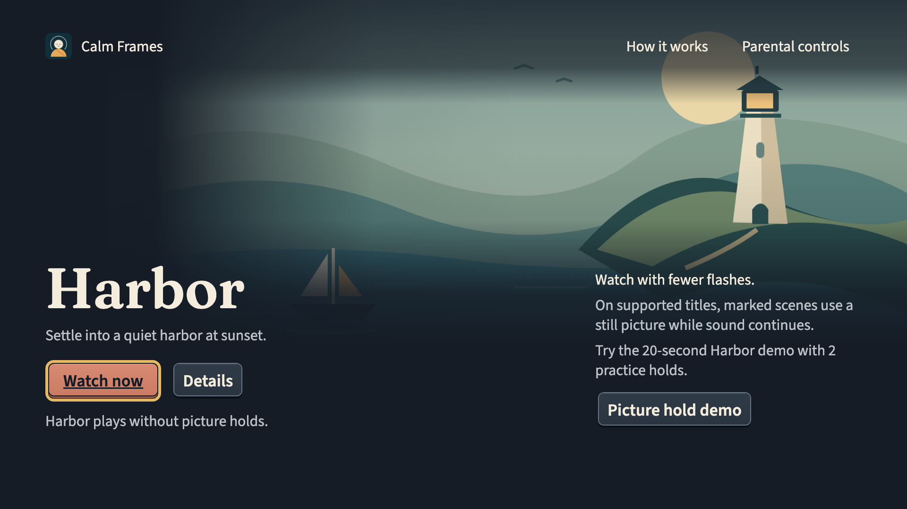

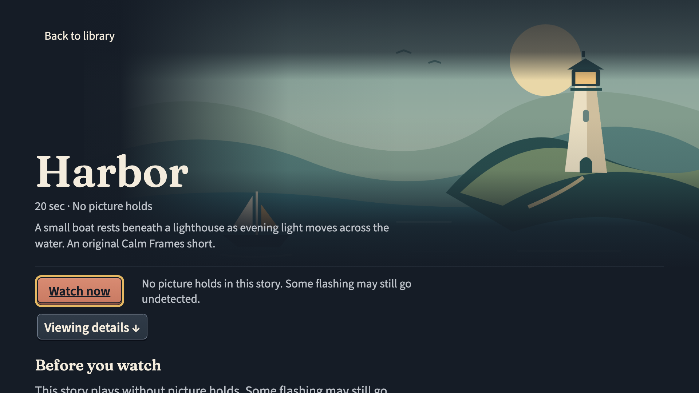

[Before and after at 1080p](../../results/dusk-lantern-2026-10-14/before-after.png).
Browser renders, not Vega screenshots; nothing in them has been seen on the
device.

### Oct 13: centered Harbor composition and the new film

The library and details center the artwork, title, short description and controls.
The title reads Harbor; Practice holds sits above it as a separate label. Library
cards and their labels fit above the footer at 1920 by 1080. Supporting details
stay in a centered column, including the picture timeline and viewing settings.

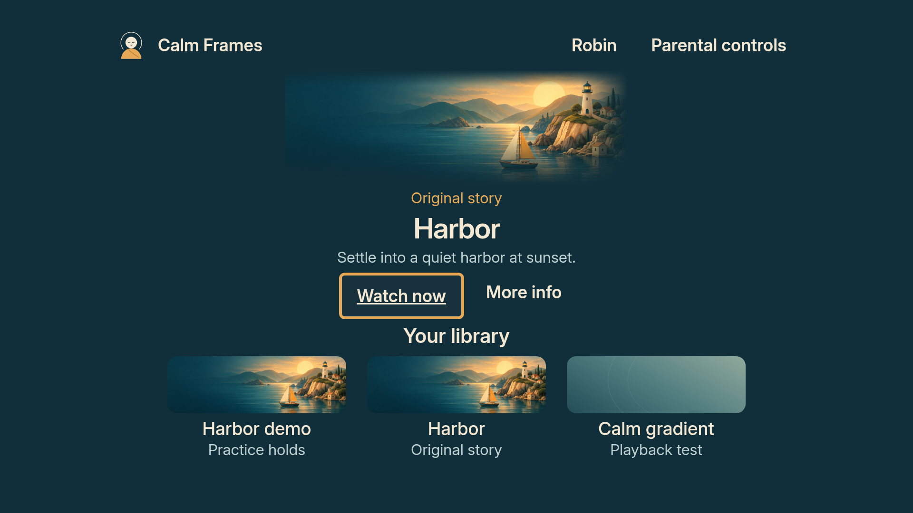

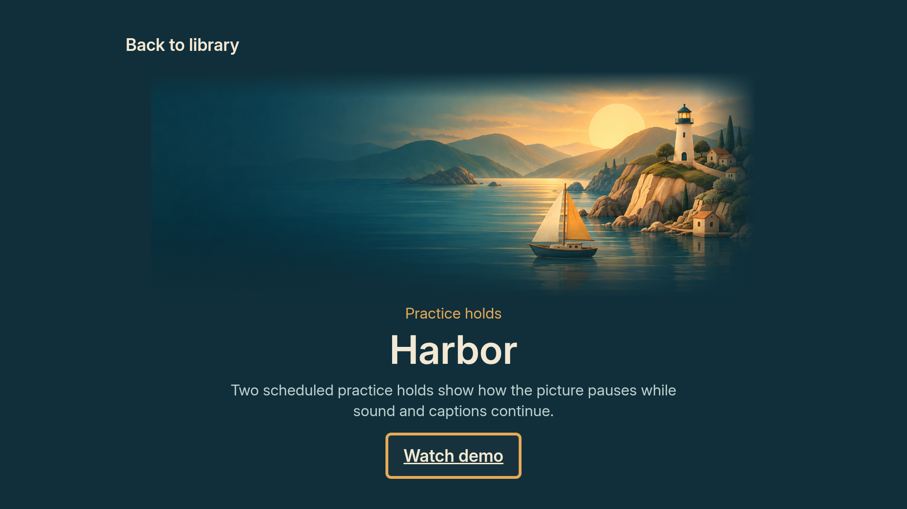

[Supporting details](centered/details-demo-bottom-browser.png) and
[library with an unavailable title](centered/library-unavailable-browser.png).
These are browser renders of actual component trees with synthetic household
inputs. They do not replace the matching Vega build.

Both playable Harbor versions now use the same 20 second animated illustration:
a 2.5 second water opening cuts to the bright boat and lighthouse, with slow
ripples, synthesized water ambience and story captions. The demo adds two
scheduled practice holds; the ordinary story plays through. The boat rests in
the harbor. This is a Blender animated illustration, not a fully modeled 3D scene.

[Watch the new source film](../../app/assets/raw/benign-story/harbor.mp4).
Production media and layout evidence: [receipt](../../results/centered_harbor_2026-10-13.json).
The Oct 13 Mac receipt covers the earlier source at `06190c7`; a native build and
recording containing this centered layout and film are still needed.

### Earlier Oct 13 checkpoint: water opening and natural copy

The library calls Harbor an Original story. Browsing and screen-reader labels
no longer announce that every title was checked. Loading, unavailable titles
and parental controls describe what is happening and what the viewer can do.
The playback rules and the safety note are preserved.

The opening fills the screen with a close view of Harbor's water and a small
Calm Frames wordmark. It cuts into the library once startup is complete. When
interface motion is enabled, a single 1.4 second drift precedes that cut;
reduced motion, Back, a background event or a failed preference query settles
it. It never replays on returning from a story. Motion remains off by default.

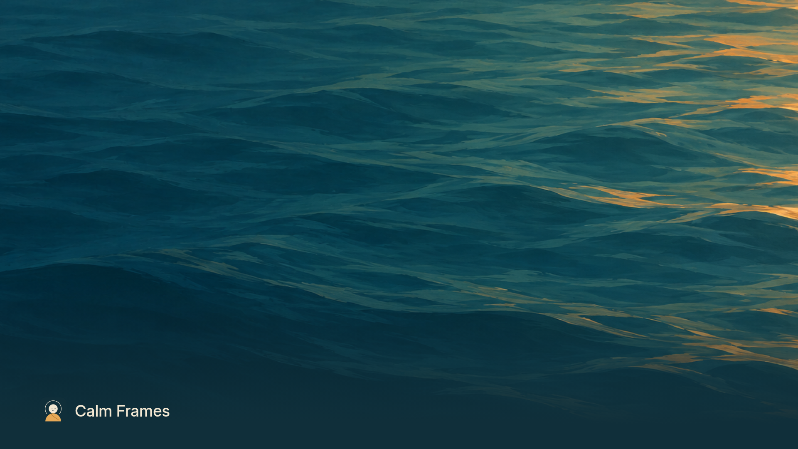

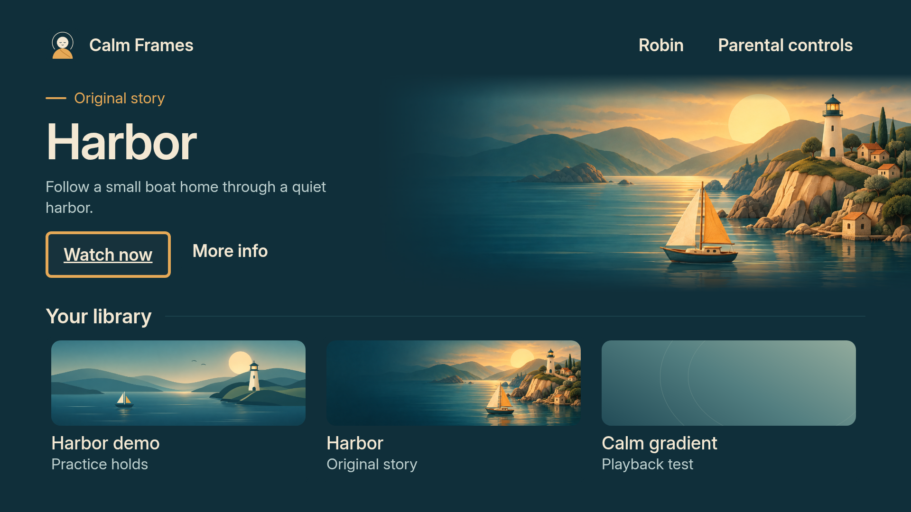

[Opening sequence, browser approximation](arrival/opening-browser.mp4).
These are browser renders of the app's component tree, not a Vega recording.
At this checkpoint the actual film still used the earlier geometric illustration.
The newer film is linked above.

### Earlier open-layout checkpoint

These are Chromium renders of the actual rendered React Native component
trees, with the bundled Inter faces and the real artwork, at 1920 by 1080. The
household, focus and saving states are synthetic inputs. **They are not Vega
screenshots**, and browser text and flex layout can differ from the device.
The current library and details refine the cinematic design from `b882d39`,
which includes Claude's work through `49f3a18`. Their exact source and image
hashes are recorded in [`open_layout_design.json`](../../results/open_layout_design.json).
The large Harbor scene is presentation artwork, not a frame from the film.
Text and actions sit on solid teal; the artwork blends into its edge. The
practice-hold demo retains its earlier illustration, so the two versions are
visually distinct. These stills do not demonstrate the optional entry motion.

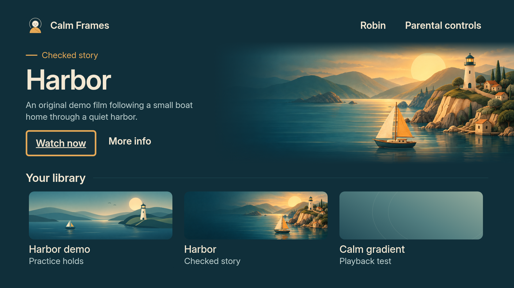

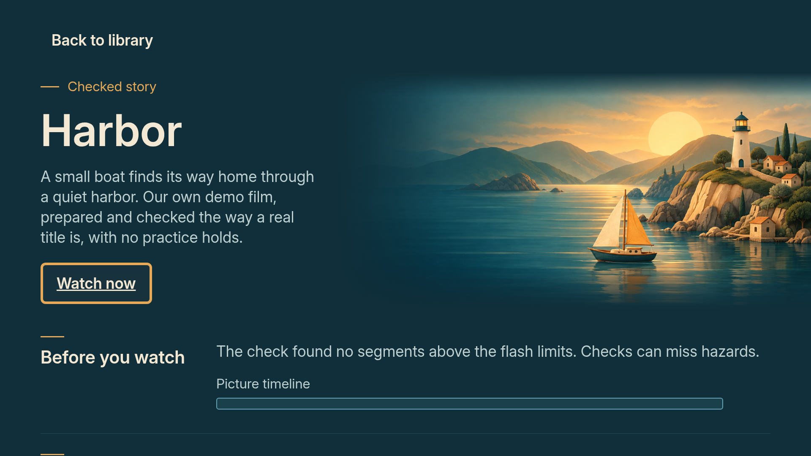

[Viewing settings after scrolling](open/details-bottom-browser.png).

Earlier review images remain below as historical references:

- `cinematic/` records the earlier framed composition on `b882d39`. Receipt:
  [`cinematic_design_2026-10-11.json`](../../results/cinematic_design_2026-10-11.json).
- `polish/` was rendered from `54dab0b` on Oct 10, before the Oct 11 shelf
  copy. Its shelf says "Scheduled scene holds" and "Original story" where the
  later October 11 code said "Practice holds" and "Checked story". Receipt:
  [`design_polish_2026-10-10.json`](../../results/design_polish_2026-10-10.json).
- `seamless/` was rendered on Oct 11 from the sources committed in `85c30f9`, on
  base `5316051`. It has the shelf copy but
  comes before the motion and sound pass, so its parental controls have no
  Interface group with the two opt-in switches. Receipt:
  [`seamless_design_2026-10-11.json`](../../results/seamless_design_2026-10-11.json).

Where an image and the code differ, the code is current. They are stills, so
none of them shows the artwork motion.

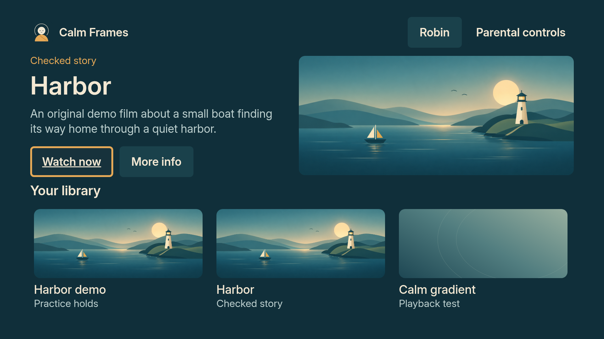

*The library, `seamless/`, Oct 11. Watch now has focus: ink fill, saffron
ring, underlined cream label. Browser render, not a Vega screenshot.*

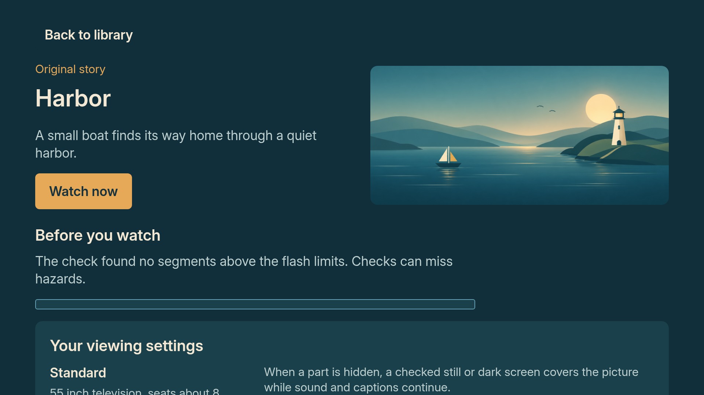

*Title details, `polish/`, Oct 10, before the shelf copy changed "Original
story" to "Checked story". Browser render, not a Vega screenshot.*

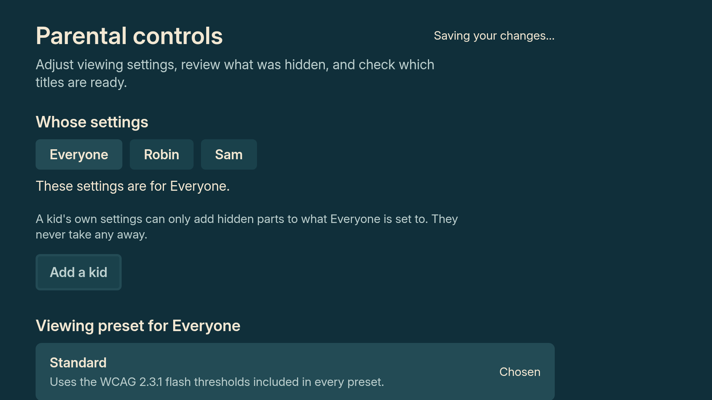

*Parental controls while a save is pending, `seamless/`, Oct 11. The message
sits beside the title so no control moves. Before the Interface group existed.
Browser render, not a Vega screenshot.*

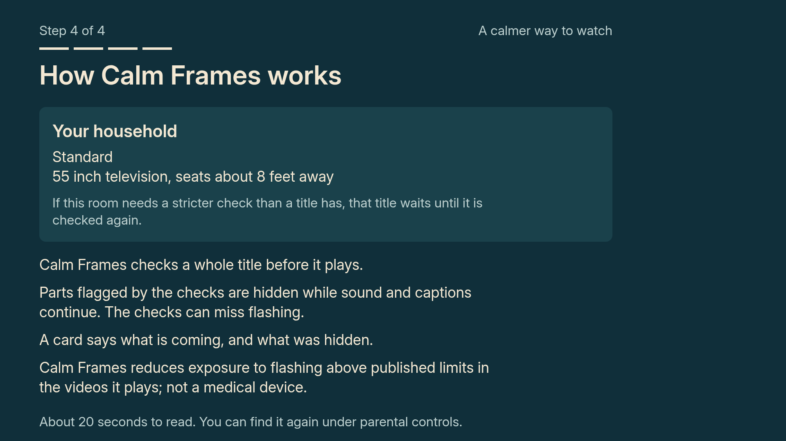

*The last setup step, `seamless/`, Oct 11. Browser render, not a Vega
screenshot.*

The rest: [library before the polish](polish/library-before.png),
[library after it](polish/library-after.png),
[family library](polish/library-family-after.png),
[full viewing settings](polish/details-bottom.png),
[setup](polish/setup-after.png),
[parental controls](polish/parent-after.png),
[lower parental controls](polish/parent-bottom.png),
[parental controls at rest](seamless/parent-idle-browser.png) and
[setup actions after scrolling](seamless/setup-review-bottom-browser.png).

## Limits

What has been seen on the Vega Virtual Device, on Oct 9 and 10, from packages
built at `cba1a29` (the recorded demo) and `73fbbed` (the final native check),
recorded in
[`redesign_validation_2026-10-10.json`](../../results/redesign_validation_2026-10-10.json):
setup with the PIN, presets and room; saved settings surviving a restart;
parental controls, the PIN keypad, details scrolling and credits driven by the
remote with the outline and underline visible; Back during loading; playback
with captions through both practice holds. The Inter medium and semibold faces
rendering as themselves was seen in the second native build and is recorded in
[NATIVE_IMPLEMENTATION.md](NATIVE_IMPLEMENTATION.md).

What has not been seen on a device:

- anything since `73fbbed`: the Oct 10 polish (the new Harbor artwork, taller
  cards, quieter navigation), the Oct 11 seamless pass (the shorter synopsis,
  saving feedback beside the title, Back in setup), and the motion and sound
  pass with its fixes;
- the artwork motion, on any build. Its intermediate frames have not been
  recorded or run through flashmap; the static interface check does not cover
  them;
- either sound, on any build. Neither the chime nor the selection sound has
  been heard on a device;
- reduced motion and screen-reader behaviour on the device, including
  VoiceView reading order. Both rest on unit tests today.

Physical televisions, sticks and camera timing are outside this submission.
The steps that close these gaps are in [`MAC_FINISH.md`](../MAC_FINISH.md), and
the release blockers are in
[`COMPLETION_CHECKLIST.md`](../COMPLETION_CHECKLIST.md).

## How this page is checked

From the repository root:

    .venv/bin/python -m pytest eval/tests/test_design_page.py -q

The test reads `CALM_COLORS`, `CALM_TEXT`,
`CALM_FONT`, `CALM_SPACE` and the focus and contrast constants out of
`calmStyles.ts`, then holds this page's palette, type and spacing tables and
`tokens.json` to them. It recomputes every ratio in the two contrast tables
and in `tokens.json`, and fails on any text pair under 4.5 to 1 or ring pair
under 3 to 1. It also checks that the logo's colours in
`app/assets/brand/make_logo.py` are palette colours, and that the logo table
on the brand page names the right token for each. Three negative controls in
the same file feed its comparisons an altered palette, ratio and pair, and
expect a complaint every time.
