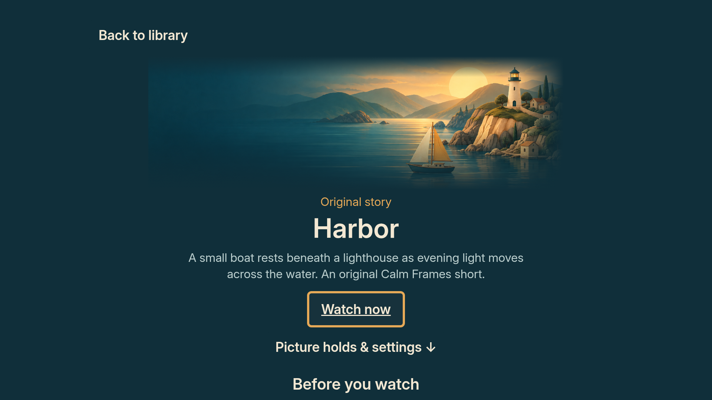
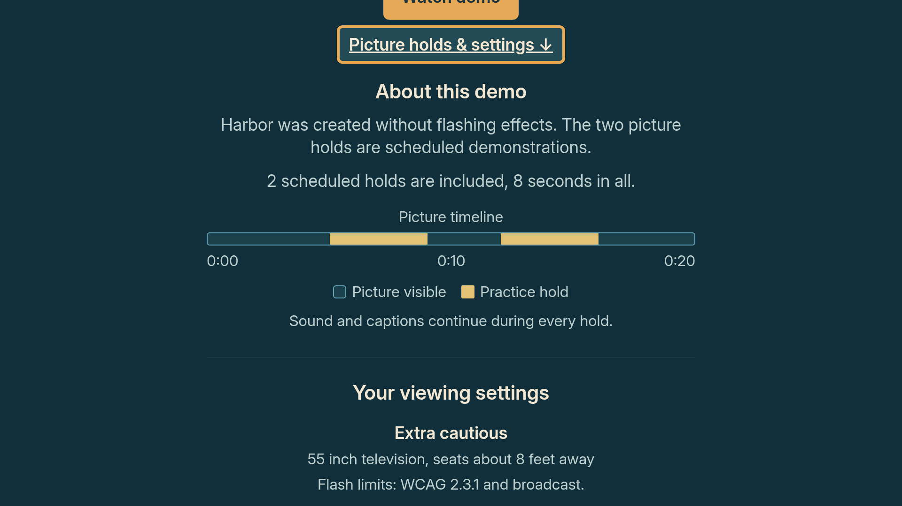

# Discovering the picture holds and viewing settings

Design milestone on `codex/design-details-2026-10-13`, based on
`4c9996d70dcc3327663679845f7c888648297d59`. These are 1920 x 1080 browser
approximations of exported React Native component trees, not Vega captures.

The previous Harbor page ended its first screen with Watch now. Its explanation
continued below the fold without a visible invitation to read it. A smaller
360 px artwork area and 72 px title now leave room for a centered **Picture
holds & settings** action. Pressing it scrolls the same focused control to the
54 px safe inset above the explanation, with no animated transition. The bottom
Back to library action also follows the page center.

The timeline now labels its start, midpoint and end from the actual duration.
Harbor reads 0:00, 0:10 and 0:20. The practice version retains its actual 5-9 s
and 12-16 s holds and explains the marks with a key and the sound/caption
continuity note. The ordinary version says No scheduled holds. Red-flash holds
have their own key entry when present; the label does not promise a particular
cover appearance. Mark positions, cover schedules and playback decisions are
unchanged.

## Compare the screens

| View | Before | After |
|---|---|---|
| Harbor opening | [Before](before/details-harbor-browser.png) | [After](after/details-harbor-browser.png) |
| Harbor explanation | [Before](before/details-harbor-plan-browser.png) | [After](after/details-harbor-plan-browser.png) |
| Harbor bottom | [Before](before/details-harbor-bottom-browser.png) | [After](after/details-harbor-bottom-browser.png) |
| Practice opening | [Before](before/details-demo-browser.png) | [After](after/details-demo-browser.png) |
| Practice explanation | [Before](before/details-demo-plan-browser.png) | [After](after/details-demo-plan-browser.png) |
| Practice bottom | [Before](before/details-demo-bottom-browser.png) | [After](after/details-demo-bottom-browser.png) |
| Unavailable title | [Before](before/details-unavailable-browser.png) | [After](after/details-unavailable-browser.png) |
| Library, unchanged | [Before](before/library-browser.png) | [After](after/library-browser.png) |





## Evidence and limits

The six focused app suites passed 166 tests; the preview export also passed.
The six new regression cases cover the measured scroll target, retained
component/focus indicator, non-playback action, real Harbor duration and marks,
red-flash key, and the unavailable state. Five new cases fail on the baseline
because the action or labels are absent. The unavailable-state case passes on
both versions. Typecheck and targeted lint pass. Typecheck uses
`--preserveSymlinks` because this isolated cloud worktree shares installed
dependencies with another worktree.

The renderer checks that both playable titles have a centered action fully
within the initial safe area and that the scrolled action is centered at y=54.
The button occupies y=896 through 978 before scrolling. The baseline Watch
button occupied y=918 through 1016 with no details action. The library images
have identical hashes. Source, preview and check details are in
[`results/detail_design_2026-10-13.json`](../../../results/detail_design_2026-10-13.json).

The focus indicator states come from component focus events. Browser scrolling
approximates the tested scroll command; it does not execute a Vega focus engine.
Native D-pad focus retention, navigation back up the page and VoiceView reading
still need the Mac/Vega check. No new native observation is claimed. All media,
maps, reports, household data and the shared branch are preserved.

## Reproduce the previews

With the app dependencies, Python Playwright and Chromium installed, copy
`eval/preview/harbor.fixture.tsx` to the temporary
`app/test/calmframes/designPreview.test.tsx`. From `app`, run:

```sh
node node_modules/jest/bin/jest.js --runInBand --no-cache --coverage=false test/calmframes/designPreview.test.tsx
```

After that command finishes, run from the repository root:

```sh
python eval/preview/render_harbor.py --stage after
```

Remove only the temporary test copy afterward. The committed fixture stays in
`eval/preview` so ordinary test runs do not write screenshots or exported trees.
For the before images, use a separate clean worktree at the baseline SHA, copy
the same fixture there with `const stage = 'before'`, finish the export, then
run the renderer with `--stage before --source-root /path/to/baseline-worktree`.
The renderer writes comparisons into the worktree containing the renderer.
