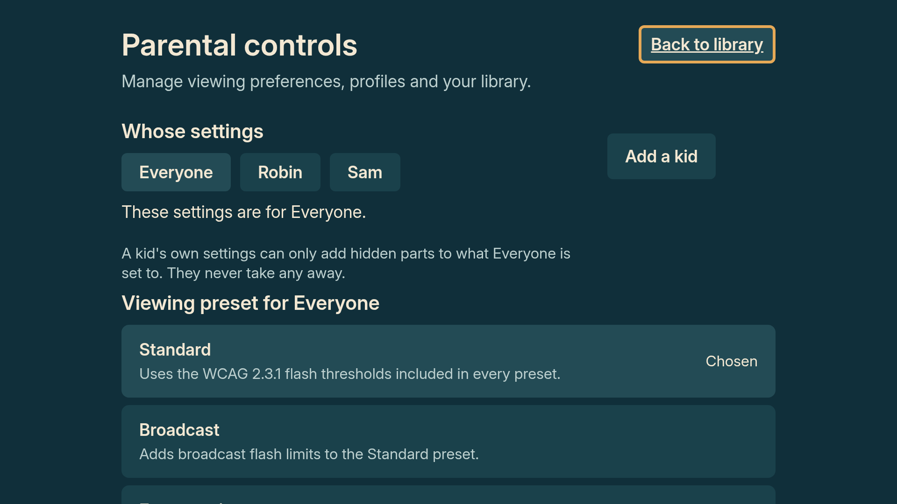
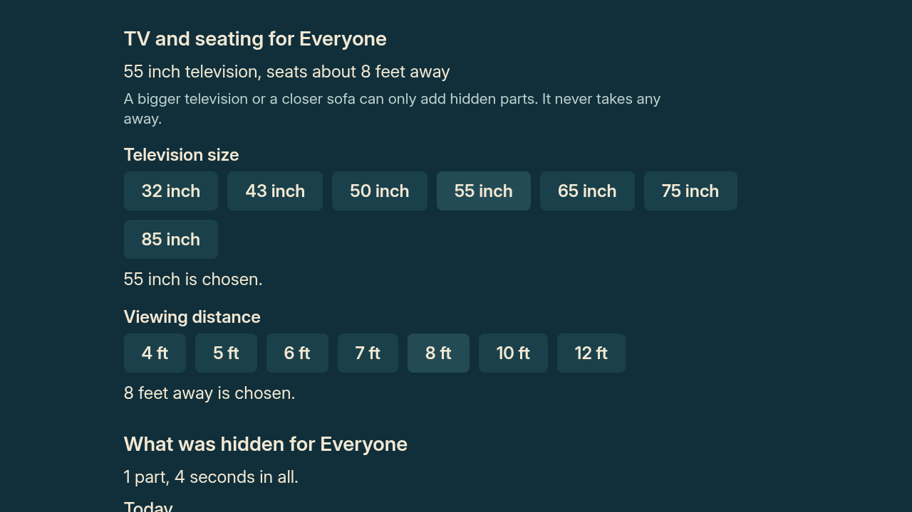

# Parent settings: centered controls and visible navigation

Design milestone from `113de2ea6e3b7e2615af3c0936238d9a7eaf3554` on
`codex/design-details-2026-10-13`. The accepted title-details passes are unchanged.

The baseline unlocked screen put a 1400 px settings column against the left
safe margin, with Back only after the history, title status and explanatory
sections. Profile-management buttons also pushed the first viewing preset
almost to the bottom of the initial screen.

The unlocked column is now centered. Back to library appears beside the heading
and requests initial TV focus; the existing Back at the bottom remains. Both
respect the existing save lock. Profile management sits beside the profile
selector, bringing the presets up without reducing their text or target sizes.
The full-household message wraps within that narrower management column. A
removal confirmation still uses the full content width with Keep preferred.

In the two-kid fixture, Standard begins at y=696 instead of y=878 at 1080p.
Standard and Broadcast now fit completely inside the initial safe area at
both 1080p and 720p. The reserved saving slot keeps the header stable. The
existing TV/seating, history, motion, sound, chime and title-status groups retain
their text, selected values, order, roles and callbacks.

## Compare the screens

All images are browser approximations of actual component trees, not native
captures. Each 720p tree was exported at the app's 720p scale. The fixtures use
an in-memory test PIN, family and history; no saved household or credential was
read, changed or recovered.

| View | 1080p before | 1080p after | 720p before | 720p after |
|---|---|---|---|---|
| household | [before](before/1080/household.png) | [after](after/1080/household.png) | [before](before/720/household.png) | [after](after/720/household.png) |
| child | [before](before/1080/child.png) | [after](after/1080/child.png) | [before](before/720/child.png) | [after](after/720/child.png) |
| saving | [before](before/1080/saving.png) | [after](after/1080/saving.png) | [before](before/720/saving.png) | [after](after/720/saving.png) |
| no-profiles | [before](before/1080/no-profiles.png) | [after](after/1080/no-profiles.png) | [before](before/720/no-profiles.png) | [after](after/720/no-profiles.png) |
| full-household | [before](before/1080/full-household.png) | [after](after/1080/full-household.png) | [before](before/720/full-household.png) | [after](after/720/full-household.png) |
| remove-confirm-question | [before](before/1080/remove-confirm-question.png) | [after](after/1080/remove-confirm-question.png) | [before](before/720/remove-confirm-question.png) | [after](after/720/remove-confirm-question.png) |
| locked | [before](before/1080/locked.png) | [after](after/1080/locked.png) | [before](before/720/locked.png) | [after](after/720/locked.png) |
| wrong-pin | [before](before/1080/wrong-pin.png) | [after](after/1080/wrong-pin.png) | [before](before/720/wrong-pin.png) | [after](after/720/wrong-pin.png) |
| no-pin | [before](before/1080/no-pin.png) | [after](after/1080/no-pin.png) | [before](before/720/no-pin.png) | [after](after/720/no-pin.png) |
| household-room | [before](before/1080/household-room.png) | [after](after/1080/household-room.png) | [before](before/720/household-room.png) | [after](after/720/household-room.png) |
| household-interface | [before](before/1080/household-interface.png) | [after](after/1080/household-interface.png) | [before](before/720/household-interface.png) | [after](after/720/household-interface.png) |
| household-history | [before](before/1080/household-history.png) | [after](after/1080/household-history.png) | [before](before/720/household-history.png) | [after](after/720/household-history.png) |
| household-bottom | [before](before/1080/household-bottom.png) | [after](after/1080/household-bottom.png) | [before](before/720/household-bottom.png) | [after](after/720/household-bottom.png) |





## Evidence and limits

Four focused app suites passed 122 tests, including existing PIN, profile,
settings, save-lock, removal, accessibility, text-size and contrast checks.
The two new header-navigation cases pass and fail on the baseline where that
control is absent. Typecheck passed with `--preserveSymlinks` for the shared
cloud dependency directory; targeted ESLint and preview Ruff passed.

All existing text and accessible control states match the baseline across
18 exported states after excluding the added header Back subtree. The locked,
wrong-PIN and no-PIN images are identical before and after at both sizes.
The renderer checks initial Back and preset visibility, centered preset rows,
and the full-household message staying within the safe bounds. Scrolled room,
interface, history, bottom-navigation and removal-confirmation views were also
inspected. [The receipt](../../../results/parent_design_2026-10-14.json) records
source, preview and preservation hashes.

No settings semantics, defaults, persistence, PIN logic, media or title-details
source changed. Native focus after unlock, D-pad navigation between the profile
and management columns, and VoiceView behavior still require Mac/Vega observation.
Component events and browser layout do not establish that native result.

## Reproduce

Copy `eval/preview/parent.fixture.tsx` into temporary
`app/test/calmframes/parentPreview.test.tsx`. Its defaults export the after stage
at 1080p. For 720p, change both `const height = 1080` values to 720 in that copy.
Run each export to completion from `app`:

```sh
node node_modules/jest/bin/jest.js --runInBand --no-cache --coverage=false test/calmframes/parentPreview.test.tsx
```

After both finish, run from the repository root with Python Playwright and
Chromium installed:

```sh
python eval/preview/render_parent.py --stage after
```

For before images, use a separate worktree at the baseline SHA, export with
`const stage = 'before'`, and invoke the renderer with
`--stage before --source-root /path/to/baseline-worktree`. Remove temporary
export test copies afterward. Ordinary tests do not generate these artifacts.
