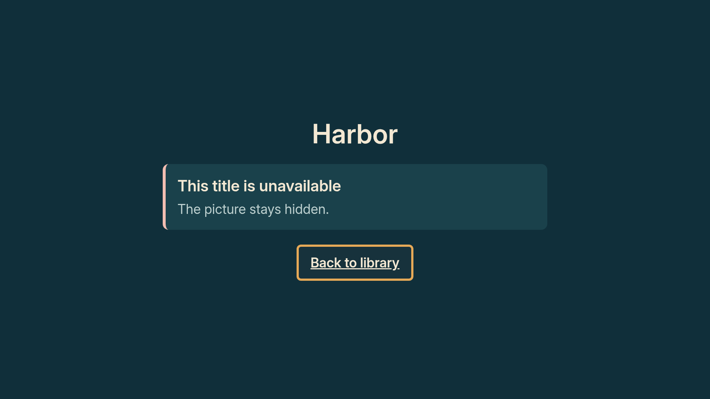
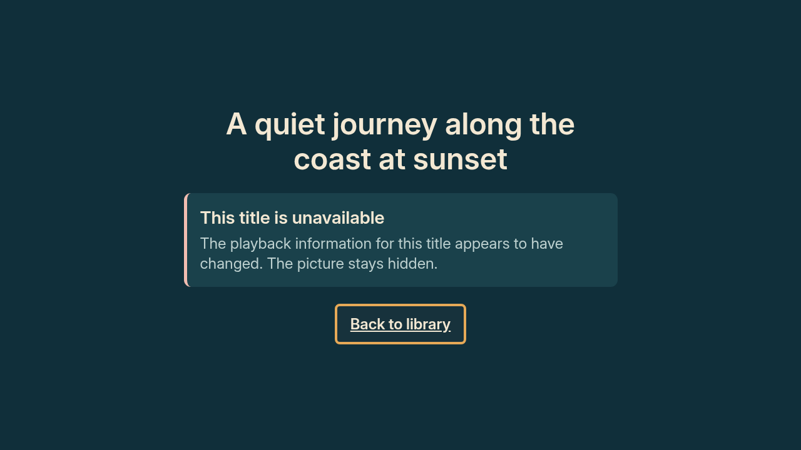

# Unavailable titles: reason and a way back

This design milestone continues `codex/design-details-2026-10-13` from
`83c5ac20bd4a74301d431c16cb09e4d0ead3c236`. The playable details layout is frozen.

Unavailable titles now use a compact, centered layout with the title, its
specific reason and one Back to library action. Removing the unused artwork
slot and synopsis brings the whole explanation into the first viewport. Back
requests initial TV focus and keeps the existing ring and underline when
focused. There is no playback control or callback in this state.

The existing notice selection and rejection messages remain authoritative.
Only an exact repetition of the notice heading at the start of its body is
removed. For example, the stale title still says it needs an update, once;
the generic state says unavailable once. The single polite announcement uses
the same resulting words. Back remains a separately accessible button.

## Before and after

These are browser approximations of the actual component trees at 1920 x 1080
and 1280 x 720. The smaller previews export the app at its 720p scale; they are
not resized 1080p pictures. Cases use all eight reader rejection messages,
plus the generic refusal, current-viewing-settings refusal and a long title.

| Variant | 1080p before | 1080p after | 720p before | 720p after |
|---|---|---|---|---|
| generic | [before](before/1080/generic.png) | [after](after/1080/generic.png) | [before](before/720/generic.png) | [after](after/720/generic.png) |
| missing | [before](before/1080/missing.png) | [after](after/1080/missing.png) | [before](before/720/missing.png) | [after](after/720/missing.png) |
| stale | [before](before/1080/stale.png) | [after](after/1080/stale.png) | [before](before/720/stale.png) | [after](after/720/stale.png) |
| unsigned | [before](before/1080/unsigned.png) | [after](after/1080/unsigned.png) | [before](before/720/unsigned.png) | [after](after/720/unsigned.png) |
| unknown-key | [before](before/1080/unknown-key.png) | [after](after/1080/unknown-key.png) | [before](before/720/unknown-key.png) | [after](after/720/unknown-key.png) |
| bad-signature | [before](before/1080/bad-signature.png) | [after](after/1080/bad-signature.png) | [before](before/720/bad-signature.png) | [after](after/720/bad-signature.png) |
| wrong-file | [before](before/1080/wrong-file.png) | [after](after/1080/wrong-file.png) | [before](before/720/wrong-file.png) | [after](after/720/wrong-file.png) |
| wrong-version | [before](before/1080/wrong-version.png) | [after](after/1080/wrong-version.png) | [before](before/720/wrong-version.png) | [after](after/720/wrong-version.png) |
| unparseable | [before](before/1080/unparseable.png) | [after](after/1080/unparseable.png) | [before](before/720/unparseable.png) | [after](after/720/unparseable.png) |
| viewing-settings | [before](before/1080/viewing-settings.png) | [after](after/1080/viewing-settings.png) | [before](before/720/viewing-settings.png) | [after](after/720/viewing-settings.png) |
| long-title | [before](before/1080/long-title.png) | [after](after/1080/long-title.png) | [before](before/720/long-title.png) | [after](after/720/long-title.png) |





## Validation

All 22 after views put the title, complete notice and Back within the five
percent safe margins, with no overlap. Back is centered in every view.
The renderer asserts these bounds. The compact layout is content-driven;
there is no blank artwork placeholder or fixed hero height.

Seven focused app suites passed 183 tests, including 11 new unavailable-state
cases. The new cases all fail against the baseline, where the unwanted playback
control still exists. They verify every reason, one accessible Back action,
preferred focus and its visual ring, an announcement without repeated headings,
and removal of playback when a verified title becomes unavailable. Existing
checks for blocked titles now assert that no play control exists. No playback
verification, schedule, media, maps or household data changed.

Typecheck passed with `--preserveSymlinks` for the shared dependency directory;
targeted ESLint and preview Ruff passed. The library, Harbor details and practice
details host trees, including their focused information states, match the
baseline after normalizing only the worktree prefix in image test paths.
The prior playable screenshots are preserved unchanged.

The [validation receipt](../../../results/unavailable_design_2026-10-13.json)
contains source and image hashes and the detailed measurements. Browser layout
and component focus events do not validate the native Vega focus engine or
VoiceView. Native initial focus and announcement reading remain Mac checks.

## Reproduce

Copy `eval/preview/unavailable.fixture.tsx` into the temporary
`app/test/calmframes/unavailablePreview.test.tsx`. Its defaults export the after
stage at 1080p. For 720p, change both `const height = 1080` values to 720 in the
temporary copy. Run each export to completion with:

```sh
cd app
node node_modules/jest/bin/jest.js --runInBand --no-cache --coverage=false test/calmframes/unavailablePreview.test.tsx
```

After both exports finish, from the repository root run:

```sh
python eval/preview/render_unavailable.py --stage after
```

The renderer needs Python Playwright and Chromium. For before previews, use a
separate worktree at the baseline SHA, copy `unavailableFixtures.ts` from this
milestone into its test folder, and export with `const stage = 'before'`. Run
this renderer with `--stage before --source-root /path/to/baseline-worktree`.
Remove the temporary export test copies after use. Ordinary tests do not write
these preview artifacts.
