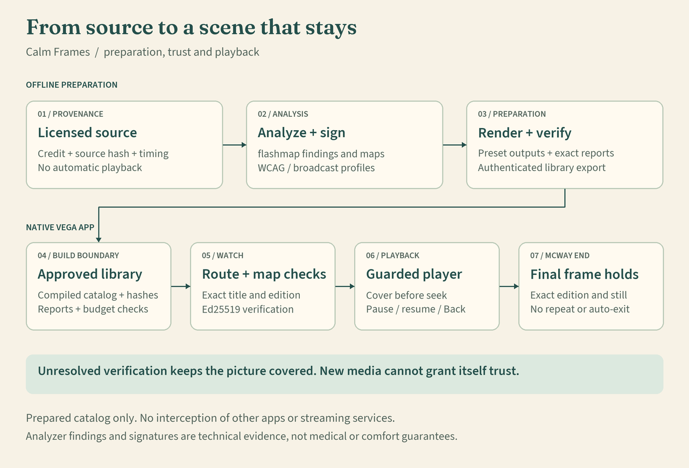

# Architecture grounded in the pinned code

This original project illustration describes the packaged-media workflow. It is documentation, not a new native screenshot. The rendered PNG and SVG are reused unchanged from `13551e4`. [Full SVG](assets/architecture.svg). The validated application source is `d96c088`.

## The path, in words

Preparation starts with a licensed source and its identity. Analysis produces maps; rendering produces the prepared output. Verification checks source/output binding and the required reports before export. The build accepts exact approved catalogs and verifies packaged bytes. At playback, route and signed-map checks bind the selection. The guarded seek and cover paths operate in the Vega player. McWay's approved ending holds a final still until Back.

Offline preparation is separate from the TV app. There is no general interception of other apps. Playback Proof explains existing evidence; it does not confer trust or run the analyzer. Recovery protects preparation state and publication gates; it is not a new detector benchmark.

## Code map

All original links below are pinned to `13551e4`, which contains validated `d96c088`. They are optional online source links. [Bundled exact code excerpts](evidence/code-excerpts.md) support an offline inspection without opening the repository on GitHub.

| Boundary | Implementation and source | User/developer meaning |
|---|---|---|
| Prepare a source | [pipeline/local_library.py](https://github.com/alejandro-publius/calm-frames/blob/13551e45bd853c392489dbecce7158a04036f615/pipeline/local_library.py), `prepare_local_title` | Coordinates the local preparation workflow and receipts. A candidate is not automatically a playable title. |
| Verify output | [pipeline/verify.py](https://github.com/alejandro-publius/calm-frames/blob/13551e45bd853c392489dbecce7158a04036f615/pipeline/verify.py), `verify_title` | Source identity, output and verification records are checked before publication. The excerpt shows source binding; the complete method contains the other checks. |
| Export exact prepared content | [pipeline/packaged_library.py](https://github.com/alejandro-publius/calm-frames/blob/13551e45bd853c392489dbecce7158a04036f615/pipeline/packaged_library.py), `export_packaged_library` | Requires current verified receipts and enforces package boundaries. Possession of a key is not blanket catalog approval. |
| Bind selection | [app/src/calmframes/packagedLibrary.ts](https://github.com/alejandro-publius/calm-frames/blob/13551e45bd853c392489dbecce7158a04036f615/app/src/calmframes/packagedLibrary.ts) and [build gate](https://github.com/alejandro-publius/calm-frames/blob/13551e45bd853c392489dbecce7158a04036f615/app/tools/check_prepared_library.mjs) | Expected route metadata and approved catalog identity are checked. Media-byte checking at build time is distinct from reading the proof page at runtime. |
| Guard seek and cover | [useFlashGuard.ts](https://github.com/alejandro-publius/calm-frames/blob/13551e45bd853c392489dbecce7158a04036f615/app/src/calmframes/useFlashGuard.ts) and [seekSafety.ts](https://github.com/alejandro-publius/calm-frames/blob/13551e45bd853c392489dbecce7158a04036f615/app/src/calmframes/seekSafety.ts) | Route playhead changes through the guard. Source code and tests do not establish physical-screen timing. |
| Explain, without authorizing | [PlaybackProofPanel.tsx](https://github.com/alejandro-publius/calm-frames/blob/13551e45bd853c392489dbecce7158a04036f615/app/src/calmframes/PlaybackProofPanel.tsx) | Source, Prepared and Selection separate evidence stages and display missing information explicitly. |
| Reach the record | [ReadingStop.tsx](https://github.com/alejandro-publius/calm-frames/blob/13551e45bd853c392489dbecce7158a04036f615/app/src/calmframes/ReadingStop.tsx) | Provides focusable reading sections with visible focused state. A code pattern is not full accessibility acceptance. |

## Resilience and limits

The [recovery report](evidence/preparation-recovery.md) explains locks, durable writes and dependency identity. Its recorded scenarios cover interruption and corruption on one Mac/APFS, mostly using a fake analyzer. No power-cut or cross-machine workspace test is implied. Analyzer-version changes alone do not invalidate every cache key, as the report explicitly records.

The [release evidence](evidence/release-readiness.md) is a separate layer: source tests, exact package identity and native observations. The claims ledger keeps these layers from turning into an unsupported claim of clinical safety, global device compatibility or hosted CI success.
