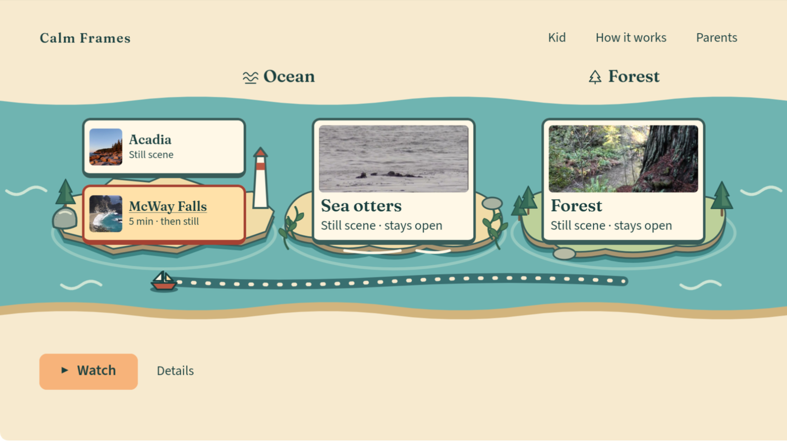
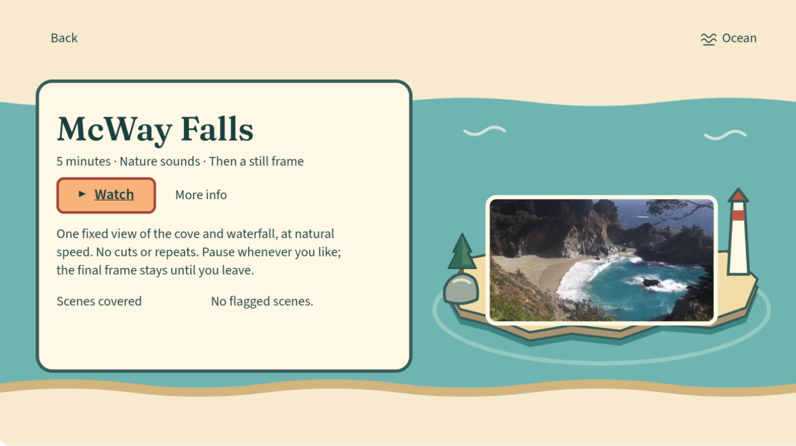
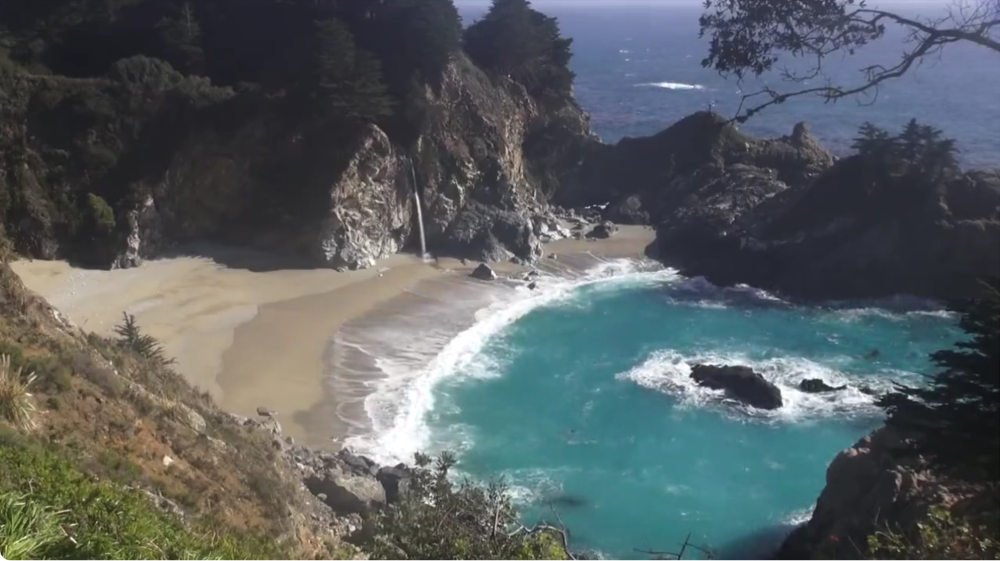
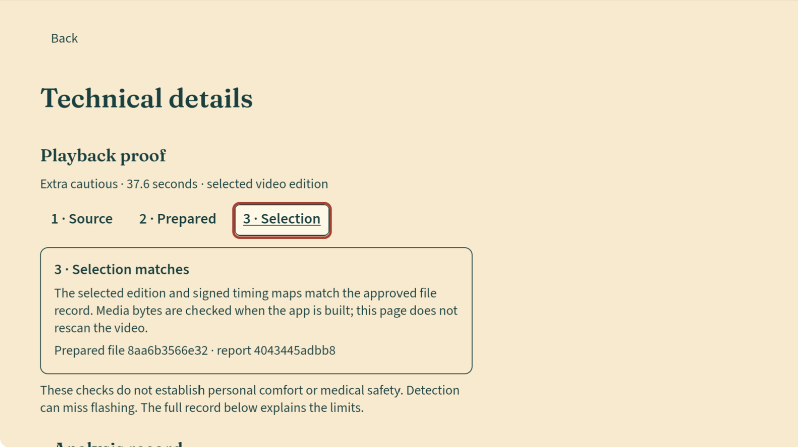
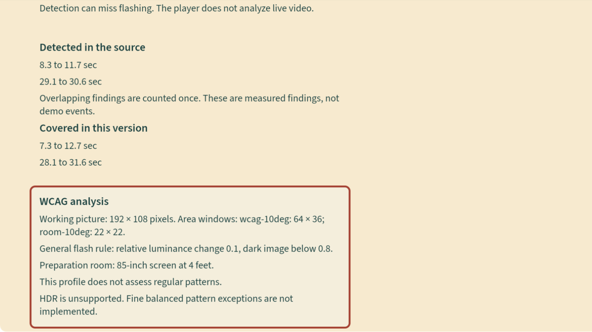

# Calm Frames: a guided review

Prepared nature scenes, an explicit choice to watch, and a readable record of the checks behind each edition. **Calm Frames reduces exposure to flashing above published limits in the videos it plays; not a medical device.**

This is the Markdown alternative to [the offline guide](index.html). It uses existing native captures, not mockups. Nothing here plays a video. For the shortest review, follow the tour below, then the [rubric matrix](RUBRIC_MATRIX.md) and [claims ledger](CLAIMS_LEDGER.md).

## Which version is this?

| Version | What it means here |
|---|---|
| Submitted baseline `bf2f615` | The submitted candidate described by the release receipt. Its app and hook trees match native source `60c3bbb`. The submitted version and public video are preserved. |
| Upgraded source `d96c088` | Preparation recovery and Playback Proof integrated and validated on the Mac. The evidence was committed in `13551e45bd853c392489dbecce7158a04036f615`, this package's base. |
| This judging package | Documentation and browser presentation only. It reuses the reviewer-page implementation from `3db0505`, with clearer navigation and portable assets. No native build or new benchmark run. |
| Planned or unavailable | The replacement video, further native review, user research and Claude's newer benchmarks are not supplied by this package. Newer benchmark results are **unavailable**, not inferred. |

Source: [release receipt selection](evidence/release-selected.json), original `bases`, `tested_commit` and `native.fallback` fields; [release report](evidence/release-readiness.md). Old “not pushed” wording in historical documents predates the owner's confirmed private integration push. It is not current GitHub or hosted CI status.

## Start without installing anything

Open `index.html` from this directory in a browser, or read this file. Keep the directory and its children together; images, fonts, readable documents and evidence excerpts are bundled. The page has no remote runtime dependencies and does not fetch external resources. Original-source and license links are optional links to the Internet, clearly separate from the local review.

Use Tab and Enter for controls and links. Choose a tour stop or use Previous and Next. All stops remain visible with JavaScript disabled. Nothing animates or autoplays. The architecture's text explanation is also in [Architecture and code map](ARCHITECTURE.md).

Some managed browsers block `file:` URLs. The cloud checks used a temporary loopback server as a test fixture; direct file opening could not be tested under that browser policy. The package itself uses no fetch or module imports and requires no server or installation in a browser that permits local files.

## The product walkthrough

### Choose a scene

**Historical native source `60c3bbb`.** Home groups the approved nature scenes and gives the selected title a clear Watch and Details route. The image explains the journey; it is not an integration-build capture. [Capture history](evidence/capture-history.md).

### Know what opens

**Historical native source `60c3bbb`.** McWay states its duration and that it ends on a still frame until Back. This screenshot does not establish comfort or sound quality.

### Watch the selected edition

**Integration source `d96c088`.** This still is from a shorter, separate native run. The full-duration McWay observation used trace lines while the Mac was locked. A still does not prove motion cadence, full-duration playback or audio quality. No new playback occurred in this cloud task.

### Check the edition

**Integration source `d96c088`.** Source, Prepared and Selection separate what was measured, what was rendered and checked, and which approved edition is selected. The media bytes are checked when the app is built. This information page does not rescan the video or authorize a new title.

### Read the record and its limits

The native record was made reachable with remote focus stops. McWay's Prepared page explicitly says its output analyzer version was not recorded. [View that existing capture](assets/f12-mcway-proof-prepared.png). McWay has no flagged output segments and does not demonstrate a protective cover activating.

## How the checks connect

Licensed source → analysis and signing → rendering and output verification → exact catalog approval → route and map checks → guarded native playback. Unresolved verification keeps the picture covered. The pipeline prepares media separately; the app plays its approved packaged library and does not intercept other apps or streaming services.

[Architecture and code evidence](ARCHITECTURE.md) connects each step to the pinned implementation. [Recovery evidence](evidence/preparation-recovery.md) explains interrupted-work handling. Its scenario evidence comes from one Mac/APFS; most scenarios use a fake analyzer, and no power was cut.

## Review kit

- [Rubric-to-evidence matrix](RUBRIC_MATRIX.md): the four recorded judging criteria, user benefit, support and gaps.
- [Impact and differentiation](IMPACT_AND_DIFFERENTIATION.md): a specific intended audience, implementation distinctions and unvalidated hypotheses.
- [Friction log draft](FRICTION_LOG_DRAFT.md) and [product feedback](PRODUCT_FEEDBACK_DRAFT.md): recorded issues, reproduction paths and suggested SDK improvements.
- [Presentation drafts](PRESENTATION_DRAFTS.md): proposed README opening, Devpost story and screenshot order.
- [Replacement-demo evidence brief](DEMO_EVIDENCE_BRIEF.md): evidence and boundaries for Claude's video work.
- [Claims ledger](CLAIMS_LEDGER.md) and [primary-source register](PRIMARY_SOURCES.md): what each statement rests on and what could not be rechecked.
- [Mac integration handoff](HANDOFF.md): apply only this package, without changing the integration branch or live submission.

## What this package cannot establish

There are no recorded external interviews, adoption figures or medical outcomes supporting this package. Audio and owner visual acceptance remain open. Physical Fire TV, full VoiceView acceptance and precise on-screen cover timing are not established here. Some native screenshots failed; trace evidence is labelled separately. No hosted CI success, competition score, new detector benchmark or replacement video is claimed.

The official Devpost rules URL was blocked by the cloud proxy. The rubric uses the repository's dated official-source record, whose stated last live review was October 17, 2026. Current wording and eligibility still need a live source check. W3C and Epilepsy Foundation requests were also blocked; their primary-source excerpts are labelled historical, not freshly fetched. See [source-access results](evidence/source-access.json).

## Credits

McWay Falls footage and extracted still: MoneySavingVideos, *Relaxing 3 Hour Video of a Waterfall on an Ocean Beach at Sunset*, CC BY 3.0. The prepared edition uses an excerpt, downsampling, H.264/AAC encoding, a closing audio fade and an extracted final still. Other visible artwork: NPS Video, Acadia National Park; NOAA Fisheries; NPS: G Litten. This package reuses existing native crops unchanged. Full source URLs, license terms and changes are in [capture credits](evidence/capture-history.md). No creator or agency endorsement is implied.
