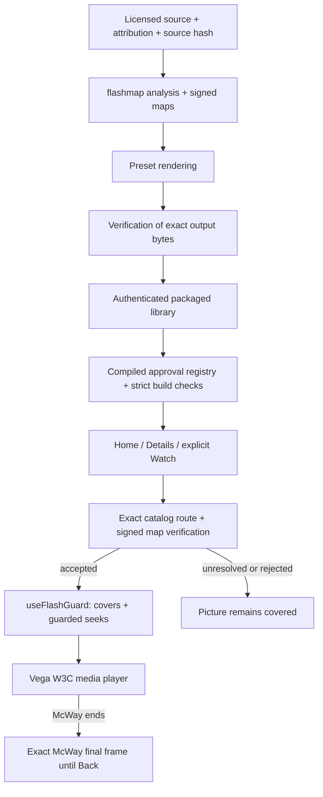

> Historical source excerpt copied from `docs/presentation/ARCHITECTURE.md` at `13551e4`. Local references now point to immutable source or bundled assets. Publication wording describes its original checkpoint, not current status.

# Architecture and code map

The rendered diagram describes the current packaged-media path. It is not a network service topology. The shipped app reads approved local media; the preparation tools run separately.

| Responsibility | Actual implementation |
|---|---|
| Analyzer and signature format | [flashmap](https://github.com/alejandro-publius/calm-frames/blob/13551e45bd853c392489dbecce7158a04036f615/flashmap/README.md) |
| Preparation orchestration | [local_library.py](https://github.com/alejandro-publius/calm-frames/blob/13551e45bd853c392489dbecce7158a04036f615/pipeline/local_library.py), [ingest.py](https://github.com/alejandro-publius/calm-frames/blob/13551e45bd853c392489dbecce7158a04036f615/pipeline/ingest.py) |
| Planned coverage and encoding | [hideplan.py](https://github.com/alejandro-publius/calm-frames/blob/13551e45bd853c392489dbecce7158a04036f615/pipeline/hideplan.py), [render.py](https://github.com/alejandro-publius/calm-frames/blob/13551e45bd853c392489dbecce7158a04036f615/pipeline/render.py) |
| Output/source checks, reanalysis and report | [verify.py](https://github.com/alejandro-publius/calm-frames/blob/13551e45bd853c392489dbecce7158a04036f615/pipeline/verify.py) |
| Normal authenticated library export | [packaged_library.py](https://github.com/alejandro-publius/calm-frames/blob/13551e45bd853c392489dbecce7158a04036f615/pipeline/packaged_library.py) |
| Replacement ambience preparation and reproduction | [ambient.py](https://github.com/alejandro-publius/calm-frames/blob/13551e45bd853c392489dbecce7158a04036f615/pipeline/ambient.py), [ambient_export.py](https://github.com/alejandro-publius/calm-frames/blob/13551e45bd853c392489dbecce7158a04036f615/pipeline/ambient_export.py) |
| Compiled approvals and package gates | [approved-prepared-libraries.json](https://github.com/alejandro-publius/calm-frames/blob/13551e45bd853c392489dbecce7158a04036f615/app/config/approved-prepared-libraries.json), [check_prepared_library.mjs](https://github.com/alejandro-publius/calm-frames/blob/13551e45bd853c392489dbecce7158a04036f615/app/tools/check_prepared_library.mjs), [approved_baked_ambient.mjs](https://github.com/alejandro-publius/calm-frames/blob/13551e45bd853c392489dbecce7158a04036f615/app/tools/approved_baked_ambient.mjs) |
| Home and title information | [KidHomeScreen.tsx](https://github.com/alejandro-publius/calm-frames/blob/13551e45bd853c392489dbecce7158a04036f615/app/src/calmframes/KidHomeScreen.tsx), [TitleDetailsScreen.tsx](https://github.com/alejandro-publius/calm-frames/blob/13551e45bd853c392489dbecce7158a04036f615/app/src/calmframes/TitleDetailsScreen.tsx) |
| Exact catalog/route binding | [packagedLibrary.ts](https://github.com/alejandro-publius/calm-frames/blob/13551e45bd853c392489dbecce7158a04036f615/app/src/calmframes/packagedLibrary.ts) |
| Signed map verification | [flashMap.ts](https://github.com/alejandro-publius/calm-frames/blob/13551e45bd853c392489dbecce7158a04036f615/app/src/calmframes/flashMap.ts) |
| Cover timing and seek entry point | [useFlashGuard.ts](https://github.com/alejandro-publius/calm-frames/blob/13551e45bd853c392489dbecce7158a04036f615/app/src/calmframes/useFlashGuard.ts), [seekSafety.ts](https://github.com/alejandro-publius/calm-frames/blob/13551e45bd853c392489dbecce7158a04036f615/app/src/calmframes/seekSafety.ts), [CoverLayer.tsx](https://github.com/alejandro-publius/calm-frames/blob/13551e45bd853c392489dbecce7158a04036f615/app/src/calmframes/CoverLayer.tsx) |
| Native player and end dispatch | [PlayerScreen.tsx](https://github.com/alejandro-publius/calm-frames/blob/13551e45bd853c392489dbecce7158a04036f615/app/src/screens/PlayerScreen.tsx) |
| Exact McWay identity and final still | [continuousScene.ts](https://github.com/alejandro-publius/calm-frames/blob/13551e45bd853c392489dbecce7158a04036f615/app/src/calmframes/continuousScene.ts), [AmbientScene.tsx](https://github.com/alejandro-publius/calm-frames/blob/13551e45bd853c392489dbecce7158a04036f615/app/src/calmframes/AmbientScene.tsx) |

The alternate ambient export path is used for prepared replacement imagery where required. McWay uses its own continuous approved edition. A prepared candidate, a verified export, a compiled approval and observed native playback are different milestones.

The final-frame still is a presentation asset bound to the exact McWay edition. It is not a signed protective cover and does not weaken the guard. The source, rendition and catalog identities remain distinct.

[SVG](../assets/architecture.svg) and [PNG](../assets/architecture.png) are generated by [render_architecture.py](https://github.com/alejandro-publius/calm-frames/blob/13551e45bd853c392489dbecce7158a04036f615/docs/presentation/render_architecture.py) using the existing project fonts and Pillow. The diagram is static and contains no external resources or scripts. The Mermaid graph provides a text-based alternative.
