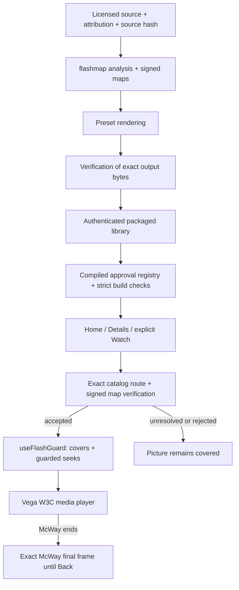

# Architecture and code map

The rendered diagram describes the current packaged-media path. It is not a network service topology. The shipped app reads approved local media; the preparation tools run separately.

| Responsibility | Actual implementation |
|---|---|
| Analyzer and signature format | [flashmap](../../flashmap/README.md) |
| Preparation orchestration | [local_library.py](../../pipeline/local_library.py), [ingest.py](../../pipeline/ingest.py) |
| Planned coverage and encoding | [hideplan.py](../../pipeline/hideplan.py), [render.py](../../pipeline/render.py) |
| Output/source checks, reanalysis and report | [verify.py](../../pipeline/verify.py) |
| Normal authenticated library export | [packaged_library.py](../../pipeline/packaged_library.py) |
| Replacement ambience preparation and reproduction | [ambient.py](../../pipeline/ambient.py), [ambient_export.py](../../pipeline/ambient_export.py) |
| Compiled approvals and package gates | [approved-prepared-libraries.json](../../app/config/approved-prepared-libraries.json), [check_prepared_library.mjs](../../app/tools/check_prepared_library.mjs), [approved_baked_ambient.mjs](../../app/tools/approved_baked_ambient.mjs) |
| Home and title information | [KidHomeScreen.tsx](../../app/src/calmframes/KidHomeScreen.tsx), [TitleDetailsScreen.tsx](../../app/src/calmframes/TitleDetailsScreen.tsx) |
| Exact catalog/route binding | [packagedLibrary.ts](../../app/src/calmframes/packagedLibrary.ts) |
| Signed map verification | [flashMap.ts](../../app/src/calmframes/flashMap.ts) |
| Cover timing and seek entry point | [useFlashGuard.ts](../../app/src/calmframes/useFlashGuard.ts), [seekSafety.ts](../../app/src/calmframes/seekSafety.ts), [CoverLayer.tsx](../../app/src/calmframes/CoverLayer.tsx) |
| Native player and end dispatch | [PlayerScreen.tsx](../../app/src/screens/PlayerScreen.tsx) |
| Exact McWay identity and final still | [continuousScene.ts](../../app/src/calmframes/continuousScene.ts), [AmbientScene.tsx](../../app/src/calmframes/AmbientScene.tsx) |

The alternate ambient export path is used for prepared replacement imagery where required. McWay uses its own continuous approved edition. A prepared candidate, a verified export, a compiled approval and observed native playback are different milestones.

The final-frame still is a presentation asset bound to the exact McWay edition. It is not a signed protective cover and does not weaken the guard. The source, rendition and catalog identities remain distinct.

## Personal file pre-check is a separate local workflow

[local_intake.py](../../pipeline/local_intake.py) owns the loopback upload,
analysis and review boundary. [edition_delivery.py](../../pipeline/edition_delivery.py)
owns delivery review and staging. Neither a review report nor a signed package
automatically changes the TV's compiled approval registry. Personal import does
not decrypt DRM, establish ownership rights or imply a native TV file picker.

An unreadable saved import now stays visible without hiding intact reviews.
Its damaged record cannot authorize analysis, approval or delivery; files stay
until explicit removal, after any owned worker is stopped. Completed results
also remain in a finishing state until the producing worker exits. See the
[source-backed recovery record](../cloud-followup-2026-10-25/IMPORT_RECOVERY.md).

The [current checkpoint](../cloud-integration-2026-10-23/CHECKPOINT.md) identifies
implemented behavior, source tests, native observations and remaining human
acceptance separately. The diagram is a code map, not evidence of a deployed
service or exact native compositor timing.

[SVG](architecture.svg) and [PNG](architecture.png) are generated by [render_architecture.py](render_architecture.py) using the existing project fonts and Pillow. The diagram is static and contains no external resources or scripts. The Mermaid graph provides a text-based alternative.

## Native interaction and dependency boundaries

Home retains selection independently of focus. [KidHomeScreen.tsx](../../app/src/calmframes/KidHomeScreen.tsx)
resolves native poster and Watch refs: card Down targets Watch and action Up
targets the selected card. This explicit routing removes reliance on nearest
screen geometry. [ParentAreaScreen.tsx](../../app/src/calmframes/ParentAreaScreen.tsx)
consumes its initial Back focus once and uses native layout measurements to
keep a focused Reading comfort switch in view after per-profile saving.

[VideoPlayerUI.tsx](../../app/src/w3cmedia/mediacontrols/VideoPlayerUI.tsx)
keeps a persistent polite pause notice separate from the guard-owned cover.
It publishes only after observed playback and a real pause; initial restored
pause gets visible guidance without claiming a new pause event. The native
speech outcome still needs observation. Root/card backgrounds use the existing
coastal surface before lazy route content mounts. This does not alter the
native decoder, media frames or protection order.

The app's generated JavaScript, installed host dependencies and device system
bundles are different inventories. The [received fbe53bf package inventory](../../results/native-validation-fbe53bf-2026-10-25/receipt.json)
is bound to each packaged bundle's own source-map hash. [Current dependency
remediation](../native-fixes-2026-10-25/DEPENDENCIES.md) tests the fixed decoder
through real legacy consumers and Metro, and UUID through its actual Xcode
consumer. Neither a development SBOM nor those tests describe all code in a
new native package or the device system bundles. Current Audit still fails.
