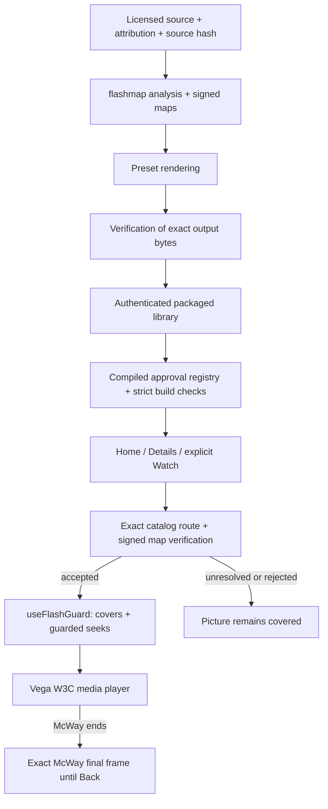

# Architecture and code map

The rendered diagram describes the current packaged-media path. It is not a network service topology. The shipped app reads approved local media; the preparation tools run separately.

| Responsibility | Actual implementation |
|---|---|
| Analyzer and signature format | [flashmap](../../flashmap/README.md) |
| Preparation orchestration | [local_library.py](../../pipeline/local_library.py), [ingest.py](../../pipeline/ingest.py) |
| Planned coverage and encoding | [hideplan.py](../../pipeline/hideplan.py), [render.py](../../pipeline/render.py) |
| Output/source checks, reanalysis and report | [verify.py](../../pipeline/verify.py) |
| Normal authenticated library export | [packaged_library.py](../../pipeline/packaged_library.py) |
| Replacement ambience preparation and reproduction | [ambient.py](../../pipeline/ambient.py), [ambient_export.py](../../pipeline/ambient_export.py) |
| Compiled approvals and package gates | [approved-prepared-libraries.json](../../app/config/approved-prepared-libraries.json), [check_prepared_library.mjs](../../app/tools/check_prepared_library.mjs), [approved_baked_ambient.mjs](../../app/tools/approved_baked_ambient.mjs) |
| Home and title information | [KidHomeScreen.tsx](../../app/src/calmframes/KidHomeScreen.tsx), [TitleDetailsScreen.tsx](../../app/src/calmframes/TitleDetailsScreen.tsx) |
| Exact catalog/route binding | [packagedLibrary.ts](../../app/src/calmframes/packagedLibrary.ts) |
| Signed map verification | [flashMap.ts](../../app/src/calmframes/flashMap.ts) |
| Cover timing and seek entry point | [useFlashGuard.ts](../../app/src/calmframes/useFlashGuard.ts), [seekSafety.ts](../../app/src/calmframes/seekSafety.ts), [CoverLayer.tsx](../../app/src/calmframes/CoverLayer.tsx) |
| Native player and end dispatch | [PlayerScreen.tsx](../../app/src/screens/PlayerScreen.tsx) |
| Exact McWay identity and final still | [continuousScene.ts](../../app/src/calmframes/continuousScene.ts), [AmbientScene.tsx](../../app/src/calmframes/AmbientScene.tsx) |

The alternate ambient export path is used for prepared replacement imagery where required. McWay uses its own continuous approved edition. A prepared candidate, a verified export, a compiled approval and observed native playback are different milestones.

The final-frame still is a presentation asset bound to the exact McWay edition. It is not a signed protective cover and does not weaken the guard. The source, rendition and catalog identities remain distinct.

[SVG](architecture.svg) and [PNG](architecture.png) are generated by [render_architecture.py](render_architecture.py) using the existing project fonts and Pillow. The diagram is static and contains no external resources or scripts. The Mermaid graph provides a text-based alternative.
