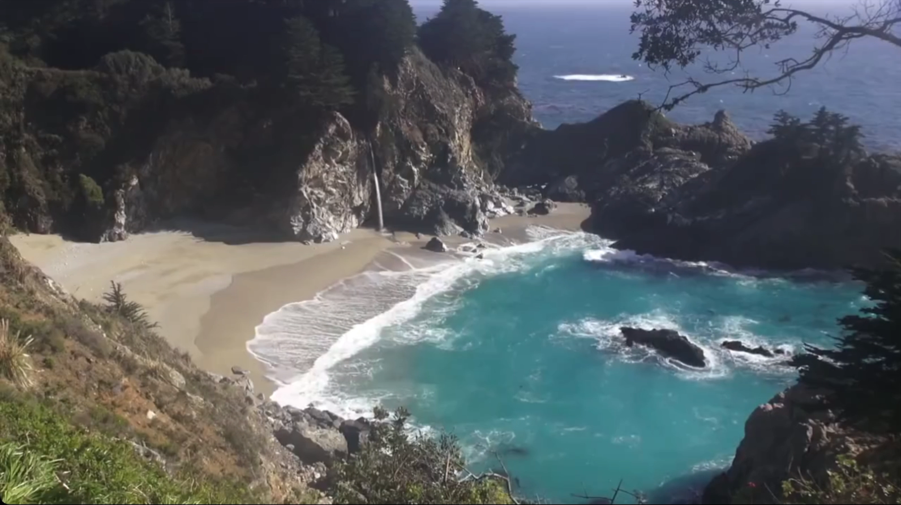
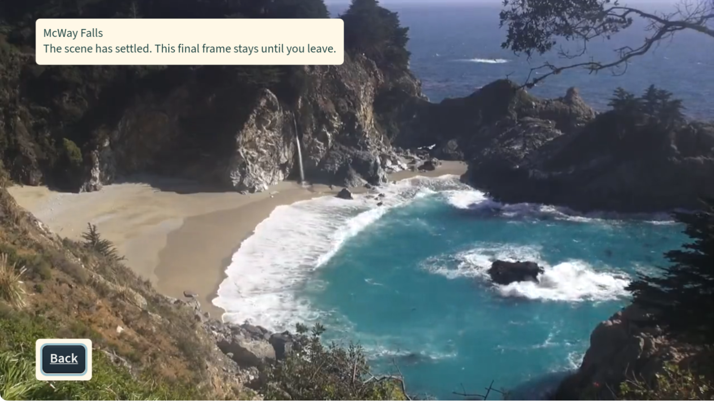

# Native app gallery and current evidence

## October 25 native evidence

The current review gallery uses unmodified JPEG review copies from the received
**fbe53bf9e5ff432dbc28cd68cd8b89e3f5cac93f** native validation. They precede
the local D1/D2/D3 and dependency fixes. The original PNG hashes, copy dimensions
and repository JPEG hashes are in the [received manifest](../../results/native-validation-fbe53bf-2026-10-25/evidence/MANIFEST.json).
All 102 review files were hash-checked; no private household images were added.

| Order | Native file | What it shows |
|---|---|---|
| 1 | [Home, 1280 by 720](../../results/native-validation-fbe53bf-2026-10-25/evidence/e02-720-home.jpg) | Four distinct islands, fictional Kid 2, Acadia selected and Watch focused. D1 was still present in this build. |
| 2 | [Acadia Details, 1080 capture review copy](../../results/native-validation-fbe53bf-2026-10-25/evidence/h09-1080-acadia-details.jpg) | Still-scene default and a deliberate Watch choice; no claim of moving playback. |
| 3 | [Release McWay playback, 1280 by 720](../../results/native-validation-fbe53bf-2026-10-25/evidence/r24-720-release-playing.jpg) | Actual scene and transport controls; the frame does not establish full-duration audio or comfort. |

The source-map-bound inventories and Debug/Release package identities are in the
[receipt](../../results/native-validation-fbe53bf-2026-10-25/receipt.json). These
review images contain no reconstruction or UI substitution. They were inspected
in this pass and linked directly, without another crop or recompression. Images
from 1080 captures can be smaller review copies; the original manifest records
that transformation. No screenshot proves the later source fixes or speech.

[Current implementation and checks](../cloud-followup-2026-10-25/README.md) and
[exact-source native handoff](../cloud-followup-2026-10-25/NATIVE_VERIFICATION.md)
separate these captures from the pending build. Item 14 is complete as prepared
repository presentation; publication and exact-build native acceptance remain
separate. The following October 21 gallery is historical.

## Historical October 21 gallery

These are existing Calm Frames app-only captures from the Vega Virtual Device on October 21, 2026. The source is the installed local ending-bounds fix, `60c3bbb701081c37dbd87a6b1f5b66d51a74b855`. They are not browser mockups or generated UI.

| Home | Title details |
|---|---|
|  |  |
| Ocean and Forest remain visible; Watch is the primary action. | The title states its duration and ending before playback starts. |

| Native playback | Corrected final-frame hold |
|---|---|
|  |  |
| A frame from the actual native recording, not a separately substituted source frame. | The final picture keeps its bounds; the message and Back button remain visible. |

## What the images establish

The images show the real native layout and selected states, including the corrected final-frame bounds. The earlier session also observed full-duration playback, pause/resume and Back. A still image cannot establish motion cadence, complete audio quality, precise protective-cover timing, or individual comfort. No physical-TV or full VoiceView acceptance is asserted.

The capture system missed some static UI changes in its continuous recordings. The Details and ending images here are independent app-only screenshots taken after those states rendered. They are not presented as frames from one uninterrupted walkthrough. The playback image was extracted from an existing native recording before this presentation task; this task did not open, change or encode any MP4.

The only image transformation is an exact rectangular crop: remove the simulator titlebar, right-hand remote and unused black area. There is no resizing, retouching, color adjustment, UI replacement or compositing. The original image hashes, crop rectangles and resulting hashes are in [capture-provenance.json](capture-provenance.json). Pixel comparison against the original captures confirms every crop.

## Build and publication status

This table records the installed build and the pre-publication checkpoint. The ending fix is an ancestor of this presentation revision. The current remote branch head must be checked in GitHub or with `git ls-remote`; the historical remote value below is not a live status badge.

| Item | Status at this presentation checkpoint |
|---|---|
| Installed source | Local commit `60c3bbb701081c37dbd87a6b1f5b66d51a74b855` |
| Remote candidate before this publication pass | `677e53935e140204c404ae80502361040b5e09bd` on private branch `claude/ocean-layout-fix-2026-10-19` |
| Current package | aarch64 Debug, 132,557,605 bytes; identity/architecture and strict packaged-media validation passed |
| Package SHA-256 | `207898aa14d8659760348a716b825fabab83afd8e3b9431f9387202cc10e7163` |
| Ending-fix checks | Two targeted suites, ten tests passed; TypeScript and focused lint passed |
| Earlier full source baseline | The [McWay activation receipt](../../results/mcway-activation-2026-10-21/verification.json) records the full-suite baseline and exact media verification. It predates the ending-bounds fix and contains historical installation status. |
| Native observations | Installed app, full scene duration, pause/resume, Back and corrected ending picture observed in the prior session |
| Audio | Native capture contains app audio; final subjective audio and edited-demo acceptance remain open |
| Public video | No confirmed published URL; local cut is under separate review |
| Devpost | No confirmed submission receipt |
| This presentation pass | README/docs/assets only; prepared for publication to the existing private candidate branch |

Copied local evidence (the TypeScript log has trailing blank lines removed): [package identity](evidence/ending-fix-package.json), [targeted tests](evidence/ending-fix-tests.log), [TypeScript](evidence/ending-fix-typecheck.log), [focused lint](evidence/ending-fix-lint.log). The empty focused-lint output is normal for a successful silent command; it is not a full lint-suite report.

The source baseline and native checks were already completed before this documentation task. No test counts here are new measurements from this presentation pass. No green hosted CI status is implied for the local ending fix or the new presentation.

## Media credits

McWay Falls footage and extracted still: **MoneySavingVideos**, *♥♥ Relaxing 3 Hour Video of a Waterfall on an Ocean Beach at Sunset*.

- Source: [Wikimedia Commons description and provenance](https://commons.wikimedia.org/wiki/File:%E2%99%A5%E2%99%A5_Relaxing_3_Hour_Video_of_a_Waterfall_on_an_Ocean_Beach_at_Sunset.webm).
- License: [Creative Commons Attribution 3.0 Unported](https://creativecommons.org/licenses/by/3.0/), rechecked on the source page for this presentation.
- Changes to the prepared edition: first five-minute excerpt, downsampled to 720p, H.264/AAC encoding, three-second fade of source audio at the end, extracted final-frame still.
- Changes to these native screenshots: crop to the app picture area only. The UI is part of the captured app. No creator endorsement implied.

Other visible title art: **NPS Video, Acadia National Park**; **NOAA Fisheries**; **NPS: G Litten** for Prairie Creek and Redwood. Their source URLs and individual terms are preserved in [media/LICENSES.csv](../../media/LICENSES.csv) and [NOTICE](../../NOTICE). No agency endorsement implied.

The architecture illustration is original project documentation and follows the code license. Its layout, colors and fonts match the existing Calm Frames interface. The overall README organization follows the user's [Tideline reference](https://github.com/alejandro-publius/tideline), without copying Tideline screenshots or product claims.
